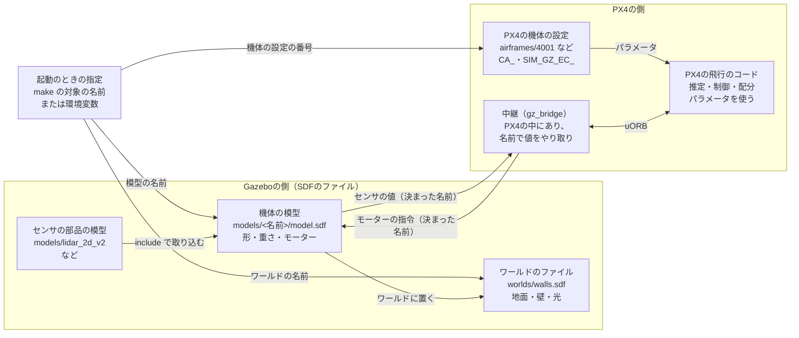

# 間章: 機体を定義する ― Gazeboの模型とPX4の機体の設定

[学習計画](learning_plan.md) の間章（任意）。この教材では、PX4に付属する機体 `x500` と、LiDAR付きの機体 `x500_lidar_2d` を使ってきた。シミュレーションの「機体」は、1つのファイルではない。Gazeboが計算する機体の模型と、PX4が使う機体の設定が組になり、決まった名前でつながって、初めて飛ぶ。この章では、その組み立てを、PX4に付属するファイルを読んで確かめる。そのうえで、例として「真後ろも見える360°のLiDAR」を付けた機体を、自分で定義して飛ばす。

- 想定環境: [フェーズ5](phase5_collision_prevention.md) を終えたWSL2のUbuntu 24.04（フェーズ6は終えていなくてよい）。1〜4節は、環境が無くても読み物として読める
- 所要の目安: 1〜2コマ
- 必須の範囲: なし（任意の章）。読む場合は1〜9節（10節の課題は任意。11節の用語集は引くためのもの）
- 前提（親プロジェクト）: なし

> **この手順書の位置づけ**: 任意の機体を定義する方法の、全体の見通しを付ける。すべての種類の機体の作り方を説明する章ではない。手を動かすのは、機体の形を変えずにセンサだけを替える例（5節・6節）である。機体の形や種類を変える場合に合わせるものは、4節で表にまとめる（読み物）。[間章（フライトコントローラ）](interlude_flight_controller.md) の2-3節では機体の設定のファイルを、4節では【B】機体に合わせる設定の層を扱った。この章は、そのシミュレーションの側の話である。親プロジェクトの [間章（URDFとRViz2）](https://github.com/SanghunIm1991/ros2MinimalPhysicalAi/blob/main/docs/interlude_urdf_rviz.md) は、ロボットの形をURDFで書く話で、ここで扱うGazeboのSDFとは別の形式である（参考）。
>
> **期待する結果の出どころ**: （作成中）1〜4節のファイルの中身・起動の流れ・パラメータの名前と機体の設定の番号は、PX4 v1.17.0のソース（`~/PX4-Autopilot`）で確かめた。5節で書く模型のファイルは、この教材で一から書いたもので、Gazeboのコマンド `gz sdf -k` で形式だけを点検し、まだGazeboで読み込んでいない。6節の起動・トピック・RViz2・機体の動きの表示は想定したもので、実際に動かした表示に差し替える予定。T1の表示の中の `<ユーザー名>` は、実行する人のユーザー名に変わる。

## 0. 学習目標と完了条件

この章を終えると、次のことができるようになる。

1. シミュレーションの機体を定義する部品（ワールド・機体の模型・PX4の機体の設定）の役割と、起動のときに組み合わせられる流れを説明できる（1節）。
2. 機体の模型が、部品の模型を重ねて作られていることを、`x500` と `x500_lidar_2d` のファイルで説明できる（2節）。
3. 模型とPX4の機体の設定で、何を合わせる必要があるか（モーターの番号・位置・回転の向き、センサのトピックの名前）を説明できる（3節）。
4. 機体のどこを変えると、どのファイルを直すことになるかを、表で説明できる（4節）。
5. センサを替えた機体の模型を書き、PX4のシミュレーションで使える（5節・6節）。

**完了条件**: 自分で書いた360°のLiDAR付きの機体で、RViz2に真後ろの向きの点が表示され、フェーズ5の衝突防止を有効にしたPosition modeで、真後ろへも動けることを確かめる（6節）。

この章では、5つのターミナルを使う（フェーズ4の1節の表と同じ）。

| ターミナル | 動かすもの | 仮想環境 `~/px4-venv` |
|---|---|---|
| T1 | PX4のシミュレーション（6-1節の、環境変数を付けた起動） | 使う |
| T2 | QGroundControl | 使わない |
| T4 | `ros_gz_bridge`（中継） | 使わない |
| T5 | ファイルを読むコマンドと、`gz` と `ros2` のコマンド | 使わない |
| T6 | RViz2 | 使わない |

ターミナルの番号は、[READMEの「ターミナルの番号」](../README.md#ターミナルの番号)のとおり、T1〜T4がどの手順書でも同じプログラムで、T5以降がそのページの作業用である。この章では、Agent（T3）を使わないので、T3は開かない。

## 1. 機体を定義するもの

### 1-1. 全体の図

フェーズ4では、`make px4_sitl gz_x500_lidar_2d_walls` で、壁のワールドにLiDAR付きの機体が現れた。このため、「LiDAR付きの機体が置かれたワールドのファイルがある」と考えたくなる。しかし、実際には、次の図の部品が、起動のたびに組み合わせられている。図と表の `.sdf` は、SDF（Gazeboのワールドと模型を書く、XMLの形式）のファイルである。


<details>
<summary>mermaid版（同じ内容）</summary>



</details>

| 部品 | 置き場所（PX4のソースの中） | 何が書かれているか | 節 |
|---|---|---|---|
| ワールド | `Tools/simulation/gz/worlds/<ワールドの名前>.sdf` | 地面・光・障害物・物理の設定など、機体の周りの世界。機体は入っていない | 1-2 |
| 機体の模型 | `Tools/simulation/gz/models/<模型の名前>/model.sdf` | 機体の形・重さ・関節・モーターの仕組み・センサ。部品の模型を取り込んで作る | 2 |
| PX4の機体の設定 | `ROMFS/px4fmu_common/init.d-posix/airframes/<番号>_gz_<模型の名前>` | PX4のパラメータ（機体の形・出力の割り当て・ホバリングの推力など）と、使う模型の名前 | 3-1 |
| 名前の約束 | （ファイルではない。PX4の中継のソース `GZBridge.cpp` などで決まっている） | センサの値とモーターの指令を、どの名前のトピックでやり取りするか | 3-2・3-3 |

ワールドのファイル（`~/PX4-Autopilot/Tools/simulation/gz/worlds/walls.sdf`）を開くと、地面・光・4枚の壁が書かれているだけである。フェーズ1の既定のワールド（`default.sdf`）にも、機体は入っていない。`Tools/simulation/gz` のフォルダは、PX4の模型とワールドを集めた別のリポジトリ（[PX4-gazebo-models](https://github.com/PX4/PX4-gazebo-models)）を、PX4のリポジトリの中に取り込んだもの（Gitのサブモジュール）である。

起動のときの指定は、ワールド・機体の模型・PX4の機体の設定を、それぞれ選ぶ。`make` の対象の名前を使うと、模型の名前から機体の設定の番号が探されるので、模型と設定が自動で組になる（1-2節）。環境変数を使うと、模型と設定の番号を別々に選べるので、ある機体の設定を借りて、模型だけを替えることもできる（5-5節）。機体の模型をワールドに置くのは、PX4の起動のスクリプトである（1-2節の4）。

「機体を定義する」とは、Gazeboの側の模型と、PX4の側の機体の設定を、名前の約束が合うように用意することである。どちらか一方だけでは飛ばない。

### 1-2. 機体がワールドに置かれる流れ

`make px4_sitl gz_<模型の名前>_<ワールドの名前>` を実行すると、次の順に進む（PX4のソースの `src/modules/simulation/gz_bridge/CMakeLists.txt`、`ROMFS/px4fmu_common/init.d-posix/rcS`・`px4-rc.gzsim` による）。

| 順 | 何が起きるか |
|---|---|
| 1 | `make` が、環境変数 `PX4_SIM_MODEL=gz_<模型の名前>`・`PX4_GZ_WORLD=<ワールドの名前>` を付けて、PX4を起動する |
| 2 | PX4の起動のスクリプトが、名前が `<番号>_gz_<模型の名前>` の機体の設定のファイルを探し、その番号（`SYS_AUTOSTART`）の設定を読み込む |
| 3 | PX4の起動のスクリプトが、Gazeboをワールドのファイルだけで起動する |
| 4 | PX4の起動のスクリプトが、Gazeboのサービス `/world/<ワールドの名前>/create` を呼び、`models/<模型の名前>/model.sdf` の機体を、`<模型の名前>_0` という名前でワールドに追加する |
| 5 | PX4の中のGazeboとの中継（`gz_bridge`）が、その機体の名前で、センサのトピックを購読し、モーターの回転の指令を送り始める |

`make` の対象の名前の後ろ半分を変えるとワールドが変わり、前半を変えると機体が変わる。後ろ半分を省くと、既定のワールド（`default`）になる（フェーズ1の `make px4_sitl gz_x500`）。フェーズ4のトピックの名前の中の `x500_lidar_2d_0` は、4の順で付けられた名前である（末尾の `0` は、PX4のインスタンスの番号）。

Gazeboの側で、LiDARやカメラの値を計算する仕組み（センサのシステム）は、ワールドのファイルではなく、PX4が用意したGazeboのサーバの設定（`src/modules/simulation/gz_bridge/server.config`）で読み込まれる。Gazeboは、ワールドのファイルに仕組み（`<plugin>`）が書かれていないとき、このサーバの設定を使う。この教材で使うワールド（`default`・`walls`）のファイルには `<plugin>` が書かれていないので、どちらのワールドでもセンサが動く。

## 2. Gazeboの模型は、重ねて作る

### 2-1. 3段の重なり

PX4に付属するクアッドコプターの模型は、1つのファイルに全部を書かず、3段に重ねて作られている。

| 段 | 模型 | 中身 |
|---|---|---|
| 1 | `x500_base` | 機体の形と重さ。本体（`base_link`、2.0kg）・4つのプロペラの部品（`rotor_0`〜`rotor_3`）・プロペラを回す関節。本体には、PX4が飛ぶのに要るセンサ（慣性センサ・磁気センサ・気圧センサ・GPS）が付いている |
| 2 | `x500` | `x500_base` を取り込み、4つのモーターの仕組み（Gazeboのプラグイン `MulticopterMotorModel`）を足す。モーターの番号・回転の向き・推力の係数は、ここで決まる |
| 3 | `x500_lidar_2d` など | `x500` を取り込み、センサの部品の模型（`lidar_2d_v2` 等）を取り込んで、固定の関節で本体につなぐ |

PX4の模型のフォルダには、3段目に当たる模型が、ほかにも並んでいる（`x500_depth`・`x500_mono_cam`・`x500_lidar_front`・`x500_lidar_down` など）。どれも、機体は `x500` のまま、付けるセンサだけが違う。

### 2-2. `x500_lidar_2d` の模型を読む

2段目と3段目の模型のファイルを開いて比べる。

```bash
# T5
cd ~/PX4-Autopilot/Tools/simulation/gz/models

cat x500_lidar_2d/model.sdf

head -6 x500/model.sdf
```

**期待する結果**（抜粋）:

```text
$ cat x500_lidar_2d/model.sdf
<?xml version="1.0" encoding="UTF-8"?>
<sdf version='1.9'>
  <model name='x500_lidar_2d'>
    <include merge='true'>
      <uri>x500</uri>
    </include>
    <include merge='true'>
      ...
      <uri>model://lidar_2d_v2</uri>
      <pose>.12 0 .26 0 0 0</pose>
    </include>
    <joint name="LidarJoint" type="fixed">
      <parent>base_link</parent>
      <child>link</child>
      <pose relative_to="base_link">-.1 0 .26 0 0 0</pose>
    </joint>
  </model>
</sdf>

$ head -6 x500/model.sdf
<?xml version="1.0" encoding="UTF-8"?>
<sdf version='1.9'>
  <model name='x500'>
    <include merge='true'>
      <uri>model://x500_base</uri>
    </include>
```

`x500_lidar_2d` の模型は、わずか十数行で、自分では機体の形を何も書いていない。次の3つを組み合わせているだけである。

| 部分 | 何をしているか |
|---|---|
| 1つ目の `<include>` | `x500` の模型を、まるごと取り込む |
| 2つ目の `<include>` | LiDARの部品の模型 `lidar_2d_v2` を、模型の原点（機体の真下の地面の高さ）から前へ0.12m、上へ0.26mの位置に取り込む |
| `<joint>` | 機体の本体（`base_link`）と、LiDARの部品（`link`）を、動かない関節（`fixed`）でつなぐ。つながないと、LiDARの部品は機体と別の物体になり、飛び立つ機体を置いて地面に落ちる |

`x500_base` の模型は、模型そのものの `<pose>` で0.24m持ち上げてあり、本体（`base_link`）の中心は、その位置にある。そのため、LiDARの部品は、本体の中心から見ると、前へ0.12m、上へ約0.02mの位置にある。`<joint>` の中の `<pose>` は、関節の軸の位置を表すもので、固定の関節では部品の位置に影響しない。

`merge='true'` は、取り込んだ模型の部品を、別の模型としてではなく、この模型の部品として直接並べる指定である。これで、`x500_lidar_2d` は、`x500` の部品（`base_link`・4つのプロペラ・モーターの仕組み）と、LiDARの部品（`link`）を持つ、1つの模型になる。

### 2-3. LiDARの部品の中身

LiDARの部品の模型（`lidar_2d_v2/model.sdf`）は、次のものからできている（フェーズ4の2-1節の表は、ここから読んだ）。

| 要素 | 何を表すか |
|---|---|
| `<link name="link">` | 部品そのもの。重さ（`<inertial>`）、ぶつかるときの形（`<collision>`）、見た目（`<visual>` のメッシュ）を持つ |
| `<sensor name="lidar_2d_v2" type="gpu_lidar">` | 部品に付いたセンサ。`type` の `gpu_lidar` は、画面の描画の仕組み（GPU）で距離を計算するLiDAR |
| `<ray>` の中の `<horizontal>` | 水平の向きの点の数（`samples` が1080）と、角度の範囲（`min_angle`・`max_angle` が±2.356ラジアン＝±135°） |
| `<range>` | 測れる距離（0.1〜30m）と、距離の細かさ |
| `<noise>` | 距離に足すばらつき（正規分布、標準偏差0.001m） |
| `<update_rate>` | 1秒あたりの走査の回数（30） |
| `<gz_frame_id>` | 値に付ける座標系の名前（`link`。フェーズ4の5-2節の `frame_id`） |

## 3. PX4の機体の設定と、名前の約束

### 3-1. 機体の設定のファイルを読む

PX4の側の機体の設定のファイルを、LiDAR付きの機体（4013番）と、`x500`（4001番）で比べる。

```bash
# T5
cd ~/PX4-Autopilot/ROMFS/px4fmu_common/init.d-posix/airframes

cat 4013_gz_x500_lidar_2d

grep -E "CA_|SIM_GZ_EC_FUNC|PX4_SIM_MODEL" 4001_gz_x500
```

**期待する結果**（抜粋）:

```text
$ cat 4013_gz_x500_lidar_2d
PX4_SIM_MODEL=${PX4_SIM_MODEL:=x500_lidar_2d}

. ${R}etc/init.d-posix/airframes/4001_gz_x500

$ grep -E "CA_|SIM_GZ_EC_FUNC|PX4_SIM_MODEL" 4001_gz_x500
PX4_SIM_MODEL=${PX4_SIM_MODEL:=x500}
param set-default CA_AIRFRAME 0
param set-default CA_ROTOR_COUNT 4
param set-default CA_ROTOR0_PX 0.13
param set-default CA_ROTOR0_PY 0.22
param set-default CA_ROTOR0_KM  0.05
...
param set-default SIM_GZ_EC_FUNC1 101
param set-default SIM_GZ_EC_FUNC2 102
param set-default SIM_GZ_EC_FUNC3 103
param set-default SIM_GZ_EC_FUNC4 104
```

LiDAR付きの機体の設定は、使う模型の名前を決めた後、`x500` の設定（4001番）をそのまま読み込むだけである。`${PX4_SIM_MODEL:=x500_lidar_2d}` は、環境変数 `PX4_SIM_MODEL` がまだ決まっていなければ `x500_lidar_2d` にする、というシェルの書き方で、すでに決まっていれば、その値を使う（5-5節で、この性質を使う）。つまり、2つの機体の違いは、Gazeboの模型にLiDARの部品があるかどうかだけで、PX4のパラメータは同じである。

4001番の主なパラメータの意味は、[間章（フライトコントローラ）](interlude_flight_controller.md) の2-3節の表にある。この章で大事なのは、次の2つの組である。

| パラメータ | 意味 |
|---|---|
| `CA_AIRFRAME`・`CA_ROTOR_COUNT`・`CA_ROTOR<n>_PX`・`_PY`・`_KM` | 配分（フェーズ0の推力とトルクを各モーターに分ける計算）が前提にする機体の形。0はマルチコプター、モーターは4つ。各モーターの位置（FRDのxとy、m）と、回転の向き（`KM` が正なら反時計回り） |
| `SIM_GZ_EC_FUNC<n>` | 中継（`gz_bridge`）の、n番目の出力に何を出すか。101〜104は、PX4の出力の機能の「モーター1〜4」（配分のモーター0〜3） |

### 3-2. モーターで合わせるもの

配分が計算した各モーターの回転の指令は、次の順に、Gazeboのプロペラまで届く（PX4のソースの `GZMixingInterfaceESC.cpp`、模型の `x500/model.sdf`）。

1. 配分が、モーター0〜3の指令を計算する（`CA_ROTOR<n>_*` の形を前提にする）。
2. 中継が、`SIM_GZ_EC_FUNC1`〜`4` のとおりに、モーター1〜4の指令を1〜4番目の出力に並べ、`/<機体の名前>/command/motor_speed` という名前のトピックで、回転の速さの配列として送る。
3. Gazeboのモーターの仕組み（`MulticopterMotorModel`）が、そのトピックを受け取る（模型の `<commandSubTopic>` が `command/motor_speed`）。配列の何番目を使うかは、模型の `<motorNumber>` で決まり、`<jointName>` の関節（`rotor_0_joint` 等）を回す。

このため、模型とPX4の機体の設定の間で、モーターごとに次の3つが合っている必要がある。

| 合わせるもの | 模型の側（`x500` と `x500_base`） | PX4の側（4001番） |
|---|---|---|
| 番号 | `<motorNumber>` が0〜3 | `SIM_GZ_EC_FUNC1`〜`4` が101〜104（配分のモーター0〜3） |
| 位置 | プロペラの部品の `<pose>`。モーター0（`rotor_0`）は (0.174, −0.174)。Gazeboの座標系（前・左・上）なので、前右 | `CA_ROTOR0_PX`・`_PY` が (0.13, 0.22)。FRD（前・右・下）なので、前右 |
| 回転の向き | `<turningDirection>`。モーター0と1が `ccw`（反時計回り）、2と3が `cw` | `CA_ROTOR0_KM`・`1_KM` が正、`2_KM`・`3_KM` が負 |

位置は、座標系の向きの違い（[フェーズ0](phase0_drone_px4.md) の8節）でyの符号が逆になる。4001番の値は、模型の値とぴったり同じではないが、前後左右の並びと回転の向きは合っている。並びや向きが食い違うと、配分が「右を上げる」つもりで左のモーターを速く回すことになり、機体は離陸の直後にひっくり返る。新しい形の機体を作るときは、模型の値に合わせて書くのが素直である。

### 3-3. センサは、トピックの名前で見つける

PX4は、機体の設定のファイルで「この機体にはLiDARがある」と教わるわけではない。中継（`gz_bridge`）は、起動するときに、決まった名前のGazeboのトピックを購読する（PX4のソースの `src/modules/simulation/gz_bridge/GZBridge.cpp`）。主なものを次に挙げる（`<ワールド>`・`<機体>` は、1-2節の4の名前）。

| センサ | PX4が購読するトピックの名前 |
|---|---|
| 慣性センサ | `/world/<ワールド>/model/<機体>/link/base_link/sensor/imu_sensor/imu` |
| 磁気センサ | `/world/<ワールド>/model/<機体>/link/base_link/sensor/magnetometer_sensor/magnetometer` |
| 気圧センサ | `/world/<ワールド>/model/<機体>/link/base_link/sensor/air_pressure_sensor/air_pressure` |
| GPS | `/world/<ワールド>/model/<機体>/link/base_link/sensor/navsat_sensor/navsat` |
| 2DのLiDAR | `/world/<ワールド>/model/<機体>/link/link/sensor/lidar_2d_v2/scan` |

名前の中の `link/<部品の名前>/sensor/<センサの名前>` は、模型の中の `<link name>` と `<sensor name>` から作られる。上の4つは、`x500_base` の本体（`base_link`）に付いたセンサの名前と一致している。

`x500_lidar_2d` で起動すると、LiDARのトピックに値が流れるので、PX4は、フェーズ4の2-1節のとおり、値を5°ごとの区画にまとめて、衝突防止（フェーズ5）に使う。`x500` で起動しても、PX4は同じ形の名前（機体の名前が `x500_0` になる）のトピックを購読するが、値が流れてこない。衝突防止を無効にしていれば（`CP_DIST` が−1）、何も起きない。有効にしていると、距離の値が届かないので、フェーズ5のつまずきやすい点の「前へ倒しても、まったく動かない」の状態になる。LiDARの購読は、パラメータ `SIM_GZ_EN_LIDAR`（既定は1で有効）が有効なときに行われる。

このことから、自分でセンサを付けるときの大事な点が分かる。PX4にもそのセンサを使わせたい場合は、部品とセンサの名前を、PX4が決め打ちしている形に合わせる（2DのLiDARなら、部品の名前を `link`、センサの名前を `lidar_2d_v2` にする）。ROS 2でだけ使うなら、名前は自由に決めてよい（`ros_gz_bridge` で、実際のトピックの名前を指定すればよい）。

## 4. 何を変えると、どこを合わせるか

ここまでの3つの部品（模型・機体の設定・名前の約束）で、変えたいものごとに、直すファイルをまとめる。上の行ほど、直すものが少ない。

| 変えたいもの | 機体の模型 | PX4の機体の設定 | 名前の約束 | 例 |
|---|---|---|---|---|
| センサを足す（ROS 2でだけ使う） | 3段目の模型を作り、部品を取り込んで固定の関節でつなぐ | 変えない。元の番号の設定を使う | 自由。`ros_gz_bridge` で指定する | 下向きのカメラを足して、ROS 2で画像を見る |
| センサを足す・替える（PX4にも使わせる） | 同上 | 変えない（センサによっては、使う機能のパラメータを変える） | 3-3節の決め打ちの名前に合わせる | この章の5節・6節の360°のLiDAR |
| 機体の重さ・大きさを変える | 1段目（形と重さ）と、それを取り込む2段目（モーター）を作る（2段目は1段目を名前で取り込むため） | 新しい番号の設定を作り、ホバリングの推力（`MPC_THR_HOVER`）などを見直して、調整し直す。大きさが変わってプロペラの位置が動くなら、`CA_ROTOR<n>_PX`・`_PY` も直す | 変えない（プロペラの位置が動くなら、3-2節の位置を合わせる） | 荷物を積んだ重い機体・一回り大きい機体 |
| モーターの数・並びを変える | 1段目と2段目を作る（プロペラの部品・関節・モーターの仕組み） | 新しい番号の設定を作る（`CA_ROTOR_COUNT`・`CA_ROTOR<n>_*`・`SIM_GZ_EC_FUNC<n>`） | 3-2節の番号・位置・向きを合わせる | 6つのモーターの機体 |
| 機体の種類を変える | 新しく作る（翼・車輪など） | 種類ごとの既定（`rc.fw_defaults` 等）を読み込む設定を作る。舵は `SIM_GZ_SV_FUNC<n>`、車輪は `SIM_GZ_WH_FUNC<n>` で割り当てる | 種類ごとの決まりに合わせる | 飛行機・VTOL・地上を走るロボット |

下の3行のように、PX4の機体の設定を新しく作る場合は、7節の登録の手順が要る。機体の種類を変える場合は、PX4に付属する同じ種類の機体（飛行機の `4003_gz_rc_cessna`、VTOLの `4004_gz_standard_vtol`、地上を走るロボットの `50000_gz_rover_differential` 等）の模型と設定を、組で読むところから始めるとよい。どの行でも、PX4の飛行のコード（推定・制御・配分の中身）は変えない。間章（フライトコントローラ）の4節の層で言えば、どれも【B】機体に合わせる設定の範囲である。

## 5. 例: 360°のLiDARを付けた機体を作る

### 5-1. 何を作るか

4節の表の2行目（センサを替えて、PX4にも使わせる）の例である。フェーズ5の6-4節で見たとおり、`x500_lidar_2d` のLiDARは真後ろの90°を測らないので、衝突防止を有効にすると、真後ろへ動けない。ここでは、同じ位置に、360°を測るLiDARを付けた機体 `x500_lidar_360` を作る。2-1節の3段目の模型を1つ増やすだけで、PX4の機体の設定は作らない。

| 項目 | `x500_lidar_2d` | 作る `x500_lidar_360` |
|---|---|---|
| 取り付け位置（模型の原点から） | 前へ0.12m、上へ0.26m | 同じ |
| 部品の重さ | 0.37kg | 0.1kg |
| 角度の範囲 | ±135°（270°） | −180°〜約179.75°（360°） |
| 点の数 | 1080（約0.25°ごと） | 1440（0.25°ごと） |
| 距離・回数・ばらつき | 0.1〜30m、毎秒30回、0.001m | 同じ |
| 部品とセンサの名前 | `link`・`lidar_2d_v2` | 同じ（PX4にも使わせるため。3-3節） |
| 見た目 | 実物のLiDARのメッシュ | 簡単な円柱（メッシュのファイルを写さないため） |

点の数を1440にすると、PX4が5°ごとの区画にまとめたとき、ちょうど72区画（360°）になる。PX4の障害物までの距離の型（`obstacle_distance`）は72区画を持つので、すべての向きが埋まる。

### 5-2. 模型のフォルダを作る

模型は、PX4の模型のフォルダの中に、新しいフォルダとして作る。PX4の起動のスクリプトは、機体の模型を `Tools/simulation/gz/models/<模型の名前>/model.sdf` から読むためである（1-2節の4）。既存の模型のファイルは書き換えない。

```bash
# T5
mkdir -p ~/PX4-Autopilot/Tools/simulation/gz/models/x500_lidar_360
```

**期待する結果**: 何も表示されない。

このフォルダは、PX4-gazebo-modelsのサブモジュールの中に、Gitで管理されていないフォルダとして増える。PX4のフォルダで `git status` を実行すると、`Tools/simulation/gz (untracked content)` と表示される。また、PX4の `make distclean` や `make submodulesclean` は、サブモジュールの中の管理されていないファイルを消すので、このフォルダも黙って消える。5-3節と5-4節の2つのファイルは、控えを自分のワークスペース（例: `~/px4_ws/models/x500_lidar_360/`）にも取っておく。PX4を更新するときに邪魔になったら、このフォルダを消せば元に戻る。

PX4のフォルダの外に模型を置く方法は、この起動の仕組みでは使えない（PX4の起動のスクリプトが、模型の置き場所の環境変数 `PX4_GZ_MODELS` を、PX4の模型のフォルダに決め打ちで設定するため）。PX4の文書には、Gazeboの模型の検索のパス（`GZ_SIM_RESOURCE_PATH`）に置けばPX4のフォルダに足さなくてよい、という説明もあるが、そのときも `make` の対象は使えず、この章の起動の方法にも当てはまらない。

### 5-3. 模型の説明のファイルを書く

`model.config` は、模型の名前と、本体のファイル（`model.sdf`）を書いた説明のファイルである。Gazeboは、模型が `model://x500_lidar_360` の形で参照されたときに、これを読む（PX4の起動のスクリプトは `model.sdf` を直接指定するので、6節の起動では読まれないが、模型のフォルダの決まりとして置いておく）。

ファイル: `~/PX4-Autopilot/Tools/simulation/gz/models/x500_lidar_360/model.config`

```xml
<?xml version="1.0"?>
<model>
  <name>x500_lidar_360</name>
  <version>1.0</version>
  <sdf version="1.9">model.sdf</sdf>
  <description>x500 with a 360-degree 2D lidar (learning example)</description>
</model>
```

### 5-4. 模型の本体を書く

ファイル: `~/PX4-Autopilot/Tools/simulation/gz/models/x500_lidar_360/model.sdf`

```xml
<?xml version="1.0" encoding="UTF-8"?>
<sdf version="1.9">
  <model name="x500_lidar_360">
    <!-- 機体はx500をそのまま取り込む -->
    <include merge="true">
      <uri>x500</uri>
    </include>

    <!-- LiDARの部品。PX4に使わせるため、名前はlinkにする -->
    <link name="link">
      <pose>0.12 0 0.26 0 0 0</pose>
      <inertial>
        <mass>0.1</mass>
        <inertia>
          <ixx>0.00005</ixx>
          <iyy>0.00005</iyy>
          <izz>0.00005</izz>
        </inertia>
      </inertial>
      <visual name="visual">
        <pose>0 0 0.03 0 0 0</pose>
        <geometry>
          <cylinder>
            <radius>0.03</radius>
            <length>0.06</length>
          </cylinder>
        </geometry>
      </visual>

      <!-- 360°のLiDAR。PX4に使わせるため、名前はlidar_2d_v2にする -->
      <sensor name="lidar_2d_v2" type="gpu_lidar">
        <gz_frame_id>link</gz_frame_id>
        <pose>0 0 0.055 0 0 0</pose>
        <update_rate>30</update_rate>
        <always_on>0</always_on>
        <visualize>false</visualize>
        <lidar>
          <scan>
            <horizontal>
              <samples>1440</samples>
              <resolution>1</resolution>
              <min_angle>-3.141593</min_angle>
              <max_angle>3.137230</max_angle>
            </horizontal>
          </scan>
          <range>
            <min>0.1</min>
            <max>30</max>
            <resolution>0.01</resolution>
          </range>
          <noise>
            <type>gaussian</type>
            <mean>0.0</mean>
            <stddev>0.001</stddev>
          </noise>
        </lidar>
      </sensor>
    </link>

    <!-- 機体の本体とLiDARの部品を、動かない関節でつなぐ -->
    <joint name="lidar_joint" type="fixed">
      <parent>base_link</parent>
      <child>link</child>
    </joint>
  </model>
</sdf>
```

- **`<include>`**: `x500_lidar_2d` と同じく、`x500` をまるごと取り込む（2-2節）。モーターの仕組みも一緒に入るので、3-2節のモーターの約束は、`x500` のまま変わらない。
- **`<link>`**: LiDARの部品を、自分で書く。位置（`<pose>`）は、模型の原点から測った値で、`x500_lidar_2d` と同じにした（2-2節）。`<inertial>` の重さと慣性は、小さな部品として適当な値にした（機体の約2kgに比べて十分に軽いので、4節の表の「重さを変える」には当たらない）。`<visual>` は、見た目だけの円柱である。`<collision>` は書いていないので、この部品は、ほかの物にぶつからない（機体の本体の形で、ぶつかりは足りる）。
- **`<sensor>`**: 360°を測るLiDARである。`max_angle` を π（3.141593）ではなく3.137230にしたのは、−180°と180°が同じ向きで、点が重なるのを避けるためである。1440個の点の間の1439個の間隔で割ると、ちょうど0.25°ごとになる。`<lidar>` は、SDFの新しい版でのLiDARの書き方で、`lidar_2d_v2` が使っている古い書き方の `<ray>` と同じ中身を持つ。仕様の値は、`lidar_2d_v2` に倣った。
- **`<joint>`**: 本体（`base_link`）とLiDARの部品（`link`）を、動かない関節でつなぐ（2-2節）。

### 5-5. 機体の設定は、環境変数で借りる

この模型には、PX4の機体の設定のファイルを作らない。3-1節のとおり、LiDAR付きの機体の設定（4013番）は、環境変数 `PX4_SIM_MODEL` が決まっていれば、その模型を使う。そこで、起動のときに、設定の番号を4013番に、模型の名前を `x500_lidar_360` に、環境変数で指定する（6-1節）。この方法では、`make px4_sitl gz_x500_lidar_360_walls` のような `make` の対象は使えない（`make` の対象は、機体の設定のファイルの一覧から作られるため）。`make` の対象として使いたい場合の手順は、7節にまとめる。

## 6. 作った機体で飛ばす

### 6-1. 起動する

フェーズ5と同じように、T1でPX4のシミュレーションを、T2でQGCを起動する。T1は、`make` ではなく、ビルド済みのPX4を、環境変数を付けて直接起動する。

```bash
# T1
source ~/px4-venv/bin/activate

cd ~/PX4-Autopilot

PX4_SYS_AUTOSTART=4013 PX4_SIM_MODEL=gz_x500_lidar_360 PX4_GZ_WORLD=walls GZ_IP=127.0.0.1 \
  ./build/px4_sitl_default/bin/px4

# T2
cd ~/qgc

./QGroundControl-x86_64.AppImage
```

| 環境変数 | 意味 |
|---|---|
| `PX4_SYS_AUTOSTART=4013` | PX4の機体の設定を、4013番（LiDAR付きの機体）にする。この変数があると、PX4は、模型の名前から設定を探さない（1-2節の2を飛ばす） |
| `PX4_SIM_MODEL=gz_x500_lidar_360` | Gazeboに置く模型を、5節で作った模型にする |
| `PX4_GZ_WORLD=walls` | ワールドを、壁のワールドにする |
| `GZ_IP=127.0.0.1` | `make` の対象が付けていた値（フェーズ4の4節）を、自分で付ける |

**期待する結果**（T1の抜粋。想定）:

```text
env SYS_AUTOSTART: 4013
...
INFO  [init] Starting gazebo with world: /home/<ユーザー名>/PX4-Autopilot/Tools/simulation/gz/worlds/walls.sdf
...
INFO  [init] Spawning Gazebo model
...
INFO  [commander] Ready for takeoff!
```

Gazeboの画面に、上に小さな円柱を載せた機体が現れる。模型のファイルに誤りがあると、Gazeboが模型を読み込めず、`Spawning Gazebo model` の後に機体が現れない（つまずきやすい点）。

### 6-2. Gazeboのトピックと、ROS 2の値を見る

フェーズ4の4節・5節と同じ手順で、トピックを確かめ、ROS 2へ中継する。トピックの名前の中の機体の名前が、`x500_lidar_360_0` に変わる。

```bash
# T5
export GZ_IP=127.0.0.1

gz topic -l | grep lidar_2d_v2

# T4
export GZ_IP=127.0.0.1

ros2 run ros_gz_bridge parameter_bridge \
  /world/walls/model/x500_lidar_360_0/link/link/sensor/lidar_2d_v2/scan@sensor_msgs/msg/LaserScan[gz.msgs.LaserScan \
  --ros-args -r /world/walls/model/x500_lidar_360_0/link/link/sensor/lidar_2d_v2/scan:=/scan

# T5
ros2 topic echo /scan --once --no-arr
```

**期待する結果**（抜粋。想定）:

```text
$ gz topic -l | grep lidar_2d_v2
/world/walls/model/x500_lidar_360_0/link/link/sensor/lidar_2d_v2/scan
/world/walls/model/x500_lidar_360_0/link/link/sensor/lidar_2d_v2/scan/points

$ ros2 topic echo /scan --once --no-arr
header:
  ...
  frame_id: link
angle_min: -3.1415929794311523
angle_max: 3.1372299194335938
angle_increment: 0.004363324027508497
...
ranges: '<sequence type: float, length: 1440>'
...
```

トピックの名前が、3-3節のPX4が決め打ちしている形と一致していることを確かめる。`angle_min`・`angle_max` が5-4節の値、点の数が1440個になっている。

フェーズ4の6節と同じように、T6でRViz2を起動し、Fixed Frameを `link` にして `/scan` を表示する。

```bash
# T6
rviz2
```

RViz2のウィンドウが開いたら、次の順に設定する（フェーズ4の6-2節と同じ操作）。

1. 左の **Displays** の **Global Options** の **Fixed Frame** の欄をクリックし、`link` と入力して、Enterを押す。
2. 左下の **Add** を押し、**By topic** のタブで、`/scan` の下の **LaserScan** を選び、**OK** を押す。
3. 足された **LaserScan** の **Size (m)** を `0.05` にする。

**期待する結果**（想定）: フェーズ4の6-2節と同じく、前の約4.4m先に壁1、左の約4.5m先に壁2の点の直線が出る。左の壁2の点の直線は、フェーズ4よりも後ろへ長く延びる（フェーズ4では、左後ろの135°より後ろは測っていなかった）。

### 6-3. 真後ろへ動けることを確かめる

フェーズ5の4節〜6節と同じ手順で、`CP_DIST` を2にし、仮想ジョイスティックを表示して、離陸してからPosition modeにする（フェーズ5の8節で `CP_DIST` を−1に戻していれば、もう一度設定する）。

1. T1でEnterを押して `pxh>` のプロンプトを出し、衝突防止の最小の距離を2mにする（`pxh>` は打たない）。

   ```text
   pxh> param set CP_DIST 2
   ```

   **期待する結果**（想定）: フェーズ5の4節と同じく、`CP_DIST: curr: -1.0000 -> new: 2.0000` と表示される。何も表示されない場合は、前に設定した2が保存されていて、すでに2になっている。

2. QGCの左上の **Q** のアイコンから **Application Settings** を開き、左の一覧の **Fly View** のタブ（地図の画面の設定）の **Virtual joystick** にチェックを入れて、地図の画面に戻る。
3. 左の **Takeoff** のボタンで離陸させる（確定のボタンは、受け付けられるまで押したままにする）。
4. 止まったら、上の帯の飛行モードの表示（**Hold**）を押し、一覧から **Position** を選ぶ。

周りの空いた位置で、右の操縦桿を真下（真後ろ）へ倒す。

**期待する結果**（想定）: フェーズ5の6-4節では動かなかった真後ろへ、機体が動く。真後ろの向きにも距離の値があり、その向きに障害物が無いことが分かるので、衝突防止が動きを止めない。

もし動かない場合は、360°に広げたLiDARの光が、機体自身の部品（後ろのプロペラやアームなど）に当たっていないかを疑う。走査の面は、本体の中心から約0.075m上にあり、プロペラ（約0.06m上）のすぐ上を通る。6-2節の `ros2 topic echo` で `--no-arr` を外し、`ranges` の最初と最後のあたり（真後ろに近い向き）に、0.1〜0.4mほどの小さな値が並んでいないかを見る（つまずきやすい点）。

確かめたら、フェーズ5の8節のとおり、着陸させ、`CP_DIST` を−1に戻し、仮想ジョイスティックを無効にして、すべてを止める。

1. QGCの **Land** で着陸させ、ディスアームするまで待つ。
2. T1で、衝突防止を元の無効に戻す。

   ```text
   pxh> param set CP_DIST -1
   ```

   **期待する結果**（想定）: フェーズ5の8節と同じく、`+ CP_DIST: curr: 2.0000 -> new: -1.0000` と表示される。

3. QGCの **Application Settings** の **Fly View** のタブの **Virtual joystick** のチェックを外し、QGCのウィンドウを閉じる。
4. T4の中継とT6のRViz2を閉じ（T4は Ctrl+C）、T1のPX4のシミュレーションを Ctrl+C で止める。

## 7. 恒久的な機体として登録する（参考）

5-5節の環境変数を使う方法は、PX4のリポジトリの管理されたファイルを書き換えず、手軽に試せる。何度も使う機体にする場合や、4節の表の下の3行のように、PX4の機体の設定を新しく作る場合は、PX4の文書（PX4 User Guide の「Adding a Model」）のとおり、次の手順で、PX4の機体として登録する。

1. 機体の設定のファイル `ROMFS/px4fmu_common/init.d-posix/airframes/<空いている番号>_gz_<模型の名前>` を作る。センサを替えただけなら、中身は3-1節の4013番と同じ形で、模型の名前を変える。モーターの数や並びが違うなら、4001番のように、`CA_` と `SIM_GZ_EC_` のパラメータを、模型に合わせて書く（3-2節）。
2. 同じフォルダの `CMakeLists.txt` の一覧に、そのファイルの名前を足す（一覧に載ったファイルだけが、ビルドのときにPX4の起動の場所へ写され、起動のスクリプトから見つけられる）。
3. PX4をビルドし直す。これで、`make px4_sitl gz_<模型の名前>_walls` が使えるようになる。

この方法は、PX4のリポジトリのファイルを書き換えるので、PX4を更新するときに、自分の変更との食い違いを解決する手間が増える。この教材では、試すだけなら5-5節の方法で足りる。

ほかのセンサ（カメラ・深度カメラ・1方向の距離センサなど）も、5節と同じ手順で付けられる。違うのは、`<sensor>` の `type` と中身、ROS 2へ中継するときの型（`ros_gz_bridge` の [README](https://github.com/gazebosim/ros_gz/blob/jazzy/ros_gz_bridge/README.md) の表）、PX4に使わせたい場合のトピックの名前（`GZBridge.cpp` で決め打ちされている名前）である。

## 8. まとめ

- シミュレーションの機体は、Gazeboの機体の模型と、PX4の機体の設定の組でできている。ワールドに機体は入っておらず、起動のときの指定（`make` の対象の名前か環境変数）で、ワールド・模型・設定が組み合わせられる（1節）。
- 機体の模型は、形と重さ（`x500_base`）→ モーター（`x500`）→ センサ（`x500_lidar_2d` 等）の3段に、`<include merge>` で重ねて作られている。部品は固定の関節で本体につなぐ（2節）。
- PX4の機体の設定は、配分が前提にする機体の形（`CA_`）と、出力の割り当て（`SIM_GZ_EC_`）を決める。模型とは、モーターの番号・位置・回転の向きを合わせる。センサは、決め打ちのトピックの名前で見つけるので、PX4に使わせるなら名前を合わせる（3節）。
- センサを替えるだけなら模型を1つ足せばよく、モーターの数や機体の種類を変えるほど、合わせるものと直すファイルが増える。どの場合も、PX4の飛行のコードは変えない（4節）。
- 例として、360°のLiDARを付けた機体の模型を書き、4013番の設定を環境変数で借りて飛ばした（5節・6節）。何度も使うなら、機体の設定のファイルを作って登録する（7節）。

## 9. 確かめの問い

答えを見ずに、自分の言葉で答えてから開く。

**問い1**: フェーズ4の `make px4_sitl gz_x500_lidar_2d_walls` で、壁のワールドにLiDAR付きの機体が現れる。ワールドのファイルに機体が入っていないのに、なぜ機体が現れるのか。

<details>
<summary>答え</summary>

PX4の起動のスクリプトが、Gazeboをワールドのファイルだけで起動した後、Gazeboのサービス `/world/walls/create` を呼んで、`models/x500_lidar_2d/model.sdf` の機体を `x500_lidar_2d_0` という名前で追加するからである。どの模型を使うかは、`make` の対象の名前の前半（`x500_lidar_2d`）から、環境変数 `PX4_SIM_MODEL` と、機体の設定（4013番）を通して決まる（1-2節）。

</details>

**問い2**: 下向きのカメラを付けた機体を作り、カメラの画像をROS 2のノードでだけ使いたい。新しく作るファイルは何か。PX4の機体の設定は作る必要があるか。

<details>
<summary>答え</summary>

`x500` を取り込み、カメラの部品を固定の関節でつないだ3段目の模型（`model.sdf` と `model.config`）を作る。PX4にカメラを使わせないので、トピックの名前は自由でよく、`ros_gz_bridge` で実際の名前を指定する。機体の形は `x500` のままなので、PX4の機体の設定は作らず、`x500` の設定（4001番）を、5-5節のように環境変数で借りればよい（4節の表の1行目）。何度も使うなら、7節の手順で登録する。

</details>

**問い3**: 6つのモーターの機体の模型を作り、4001番の設定のまま飛ばそうとした。どんなことが起きそうか。何を直せばよいか。

<details>
<summary>答え</summary>

4001番は、モーターが4つ（`CA_ROTOR_COUNT` が4）で、出力も4つ（`SIM_GZ_EC_FUNC1`〜`4`）しか割り当てていない。配分は4つのモーターの機体として計算し、指令の配列も4つ分しか送らないので、5番目と6番目のモーターは回らず、残りのモーターの位置も合わない。機体は正しく飛ばず、離陸の直後に傾いてひっくり返るおそれが大きい。新しい番号の機体の設定を作り、`CA_ROTOR_COUNT` を6にし、6つのモーターの位置と回転の向き（`CA_ROTOR<n>_PX`・`_PY`・`_KM`）と、出力の割り当て（`SIM_GZ_EC_FUNC1`〜`6`）を、模型の `<motorNumber>`・プロペラの位置・`<turningDirection>` に合わせて書く（3-2節、4節の表の4行目）。

</details>

**問い4**: 自分で付けたLiDARの値は、ROS 2の `/scan` には届いているが、PX4の衝突防止が働かない。まず何を確かめるか。

<details>
<summary>答え</summary>

`gz topic -l` で、LiDARのトピックの名前が、PX4が決め打ちしている `/world/<ワールド>/model/<機体>/link/link/sensor/lidar_2d_v2/scan` と一字一句同じかを確かめる。ROS 2へは `ros_gz_bridge` で好きな名前を中継できるので、ROS 2で見えていても、PX4が購読する名前と違うことがある。名前が違えば、部品の名前を `link`、センサの名前を `lidar_2d_v2` に直す（3-3節）。パラメータ `SIM_GZ_EN_LIDAR` と `CP_DIST` が有効かも確かめる。

</details>

## 10. 課題（任意）

1. 5-4節の `samples` を360に、`max_angle` を3.124139（πから1°を引いた値）にして、点の間隔を1°に粗くすると、PX4の区画のまとめ方（5°ごと）では、1区画が5点になる。RViz2の点の並びと、フェーズ5の衝突防止の止まり方が変わるかを予想し、確かめる。
2. `<noise>` の `stddev` を0.05にして、RViz2の壁の点の並びのばらつきが大きくなることを確かめる。フェーズ6を終えていれば、フェーズ6のコストマップ（障害物の地図）に、どんな影響が出そうかも考える。
3. 5-4節の `<pose>` の高さ（0.26）を0.6に上げ、Gazeboの画面とRViz2の見え方の違いを確かめる。重心より高い位置に部品を付けても、0.1kgなら飛び方がほとんど変わらないことを、フェーズ1の手順で離陸させて確かめる。
4. （読むだけ）PX4に付属するほかの3段目の模型（`x500_depth` や `x500_lidar_front`）と、その機体の設定（`4002_gz_x500_depth`・`4017_gz_x500_lidar_front`）を読み、4節の表のどの行に当たるかを考える。

## 11. 用語集

この章で新しく出てきた用語を、英字で始まる用語をアルファベット順に、続けてそのほかの用語を50音順にまとめた。フェーズ0の用語（uORB・SITL・FRD等）は、[フェーズ0の12節](phase0_drone_px4.md#12-用語集) にある。

| 用語 | 意味 | 節 |
|---|---|---|
| `CA_` のパラメータ | 配分が前提にする機体の形（種類・モーターの数・位置・回転の向き）を決めるパラメータ | 3-1 |
| `gpu_lidar` | Gazeboのセンサの種類の1つ。画面の描画の仕組み（GPU）で距離を計算するLiDAR | 2-3 |
| `gz_bridge` | PX4の中の、Gazeboとの中継のモジュール。決まった名前のトピックで、センサの値を受け取り、モーターの指令を送る | 1-2・3 |
| `include`（`merge`） | SDFで、ほかの模型を取り込む書き方。`merge='true'` なら、取り込んだ部品を、この模型の部品として直接並べる | 2-2 |
| `MulticopterMotorModel` | Gazeboのプラグイン。指令の回転の速さで、プロペラの関節を回し、推力とトルクを出す | 2-1・3-2 |
| `PX4_SIM_MODEL` | Gazeboに置く模型の名前を決める環境変数（`gz_` を頭に付ける）。`make` の対象の名前からも決まる | 1-2・6-1 |
| SDF | Gazeboのワールドと模型を書く、XMLの形式 | 1-1 |
| `server.config` | PX4が用意したGazeboのサーバの設定。センサの値を計算する仕組みを読み込む | 1-2 |
| `SIM_GZ_EC_FUNC<n>` | PX4の中継の、n番目のモーターの出力に出す機能を決めるパラメータ（101〜がモーター1〜） | 3-1・3-2 |
| `SYS_AUTOSTART` | 使う機体の設定のファイルの番号。環境変数 `PX4_SYS_AUTOSTART` でも指定できる | 1-2・6-1 |
| 機体の設定のファイル（airframe） | PX4の、ある種類の機体に要るパラメータの既定の値と、使う模型の名前を書いたファイル | 3-1 |
| 機体の模型 | Gazeboが計算する機体の形・重さ・関節・モーター・センサを書いたSDFのファイル（`model.sdf`） | 1-1・2 |
| 固定の関節（`fixed`） | 2つの部品を、動かないようにつなぐ関節 | 2-2 |
| サブモジュール | Gitで、別のリポジトリを、リポジトリの中のフォルダとして取り込む仕組み | 1-1・5-2 |
| 名前の約束 | 模型とPX4の中継が、センサの値とモーターの指令をやり取りするトピックの名前の決まり。PX4の側に決め打ちされている | 1-1・3-2・3-3 |
| ワールド | Gazeboの、機体の周りの世界（地面・光・障害物・物理の設定）を書いたSDFのファイル | 1-1 |

## つまずきやすい点

- **機体が現れない（`Spawning Gazebo model` の後に何も起きない）**: 模型のファイルを、Gazeboが読み込めていない。XMLの閉じ忘れや、タグの名前の誤りを確かめる。T1に、Gazeboの読み込みのエラーが出ていないかを見る。フォルダの名前と `PX4_SIM_MODEL` の `gz_` の後ろの名前が、同じかを確かめる。
- **機体は現れるが、LiDARのトピックが無い**: `<sensor>` が `<link>` の中に入っているかを確かめる。`gz topic -l | grep scan` で、別の名前で出ていないかを見る。
- **トピックはあるが、PX4の衝突防止が働かない**: トピックの名前が、3-3節の決め打ちの形と一字一句同じかを確かめる（部品の名前 `link`、センサの名前 `lidar_2d_v2`）。
- **離陸するとLiDARの部品だけが落ちる・離れる**: `<joint>` を書き忘れているか、`<parent>`・`<child>` の名前が違う。
- **離陸の直後に機体がひっくり返る**（モーターの数や並びを変えた機体）: 模型とPX4の機体の設定で、モーターの番号・位置・回転の向きが合っていない（3-2節）。
- **後ろへ動けない・RViz2で機体のすぐ近くに点が出る**: LiDARの光が、機体自身の部品に当たっている（6-3節）。5-4節の `<link>` の `<pose>` の高さを、0.26から0.3程度に上げる。
- **フェーズ4・5の機体（`x500_lidar_2d`）に戻したい**: 環境変数は、そのターミナルで実行したコマンドにだけ効く。フェーズ4の起動のコマンド（`make px4_sitl gz_x500_lidar_2d_walls`）を、そのまま使えばよい。機体の設定の番号は同じ4013番なので、パラメータ（`CP_DIST` 等）は、そのまま引き継がれる（PX4は、設定の番号が変わったときだけ、パラメータを初期値に戻す）。

## 次へ

学習計画（[`docs/learning_plan.md`](learning_plan.md)）に戻る。この章で作った `x500_lidar_360` は、フェーズ6で使う機体の代わりにもできる（フェーズ6-2の1-1節のT1の起動を、この章の6-1節のコマンドに、T4の中継のトピックの名前を、この章の6-2節の名前に変える）。

## 出典

- ワールド・模型・機体の設定のファイルの中身と、起動の流れ・名前の約束: PX4 v1.17のソース（[PX4-Autopilot](https://github.com/PX4/PX4-Autopilot)、`release/1.17`、BSD 3-Clause License）の [`ROMFS/px4fmu_common/init.d-posix/rcS`](https://github.com/PX4/PX4-Autopilot/blob/release/1.17/ROMFS/px4fmu_common/init.d-posix/rcS)・[`px4-rc.gzsim`](https://github.com/PX4/PX4-Autopilot/blob/release/1.17/ROMFS/px4fmu_common/init.d-posix/px4-rc.gzsim)・[`airframes/`](https://github.com/PX4/PX4-Autopilot/tree/release/1.17/ROMFS/px4fmu_common/init.d-posix/airframes)・[`src/modules/simulation/gz_bridge/`](https://github.com/PX4/PX4-Autopilot/tree/release/1.17/src/modules/simulation/gz_bridge)・[`src/lib/mixer_module/output_functions.yaml`](https://github.com/PX4/PX4-Autopilot/blob/release/1.17/src/lib/mixer_module/output_functions.yaml)・[`src/modules/control_allocator/module.yaml`](https://github.com/PX4/PX4-Autopilot/blob/release/1.17/src/modules/control_allocator/module.yaml) と、模型とワールド（[PX4-gazebo-models](https://github.com/PX4/PX4-gazebo-models)、各自のPCの `~/PX4-Autopilot/Tools/simulation/gz/`）を読んで、自分の言葉でまとめたもの。2節・3節の模型のファイルと機体の設定のファイルの表示は、説明に必要な部分の抜粋である。
- 機体の登録の手順: PX4 User Guide（v1.17、[CC BY 4.0](https://creativecommons.org/licenses/by/4.0/)、Dronecode/PX4）の [Gazebo Simulation](https://github.com/PX4/PX4-Autopilot/blob/release/1.17/docs/en/sim_gazebo_gz/index.md) の「Adding New Worlds and Models」の「Adding a Model」を読んで、自分の言葉でまとめたもの。
- 5節の模型のファイル（`model.config`・`model.sdf`）は、この教材で一から書いたもの（Apache License 2.0）。LiDARのセンサの要素の並びと仕様の値は、`lidar_2d_v2` の模型（PX4-gazebo-models）に倣った。メッシュ等のファイルは写していない。
- 図（`img/interlude_cs_overview.svg`）は、この教材で作ったもの。
