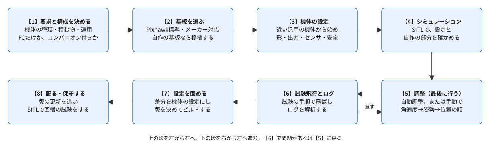
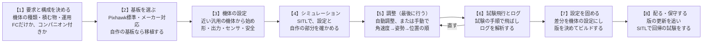
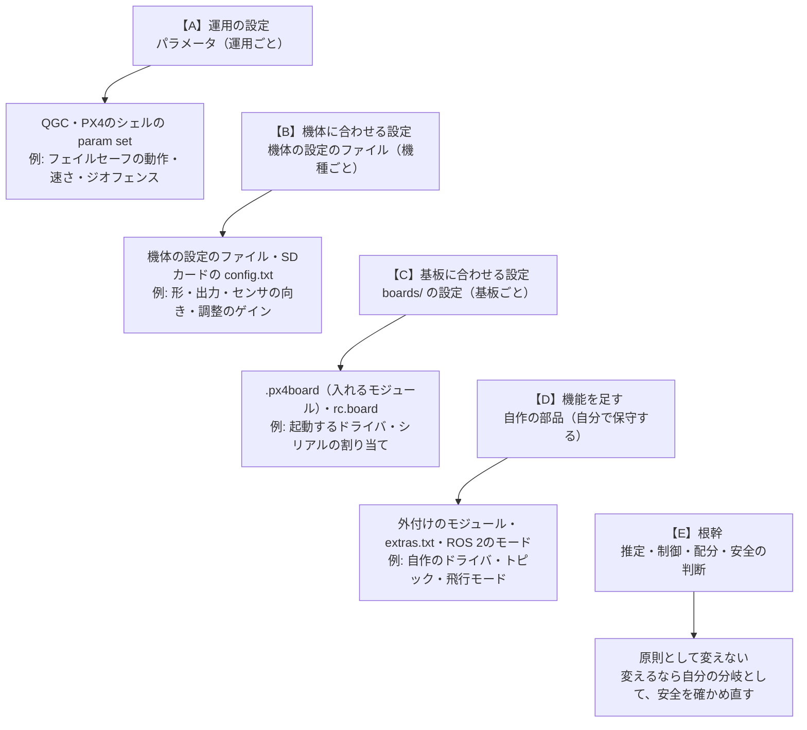
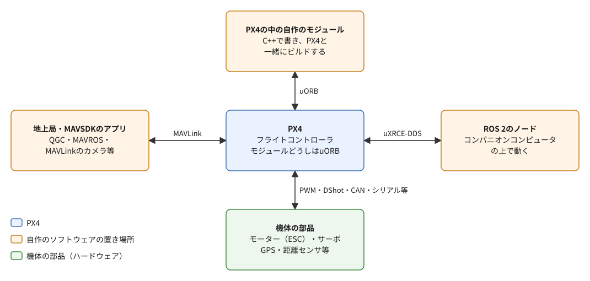
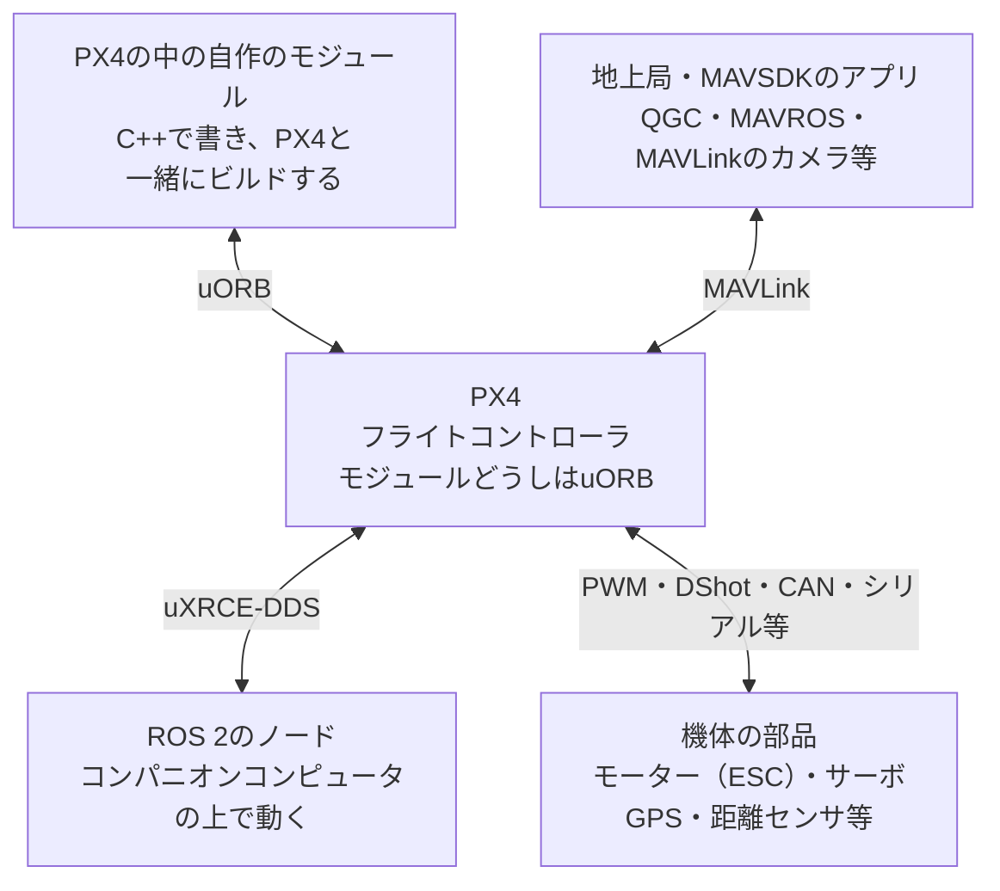

# 間章: フライトコントローラの一般論と、PX4を製品に組み込むとき

[学習計画](learning_plan.md) の間章（任意の読み物）。[フェーズ0](phase0_drone_px4.md) では、PX4の中の流れ（推定 → 制御 → 配分）と、機体の中と外の分担を見た。この章では、そこから一歩引いて、フライトコントローラ一般が受け持つ仕事を整理する。次に、PX4を自分の機体（製品）に組み込むときの流れを見る。そのうえで、PX4を機体に合わせて調整してよい部分と、根幹に当たる部分の境界を見る。最後に、自作のソフトウェアをPX4とつなぐインターフェースを見る。

- 想定環境: 環境に依らない（読み物。コマンドは実行しない）。[フェーズ3](phase3_offboard.md) まで終えていると、4節と5節の例が実感しやすい（4節の例の一部は、[フェーズ5](phase5_collision_prevention.md) と[機体の模型の間章](interlude_custom_sensor.md)のもの）
- 所要の目安: 1コマ
- 必須の範囲: なし（任意の章）
- 前提（親プロジェクト）: なし

> **この章の位置づけ**: 製品を開発するための手順書ではない。全体の見通しを付けるための読み物である。PX4についての事実（構成・設定の仕組み・公式の文書が勧める手順・インターフェース）は、この教材で使うPX4 v1.17の公式の文書とソースに基づく。ただし、3節のワークフローの並べ方と、4節の5つの層の分け方は、公式の文書の記述を元に筆者が整理したもので、PX4の公式の区分ではない。製品にするときに要る法規・認証・製造の品質管理は扱わない（国や用途によって違うので、それぞれの公式の情報で確かめる）。細部が最新の公式の情報と食い違う場合は、公式を優先する。
>
> **期待する結果の出どころ**: このページには、コマンドを実行する手順が無いので、期待する結果も無い。2-3節の機体の設定のファイルの説明は、PX4 v1.17のソースのファイル（2026-11-01に読んだv1.17.0）を読んで書いた。

## 0. 学習目標と完了条件

この章を読み終えたら、次を自分の言葉で説明できる状態を目指す。

1. フライトコントローラが受け持つ仕事を、ハードウェアとソフトウェアに分けて挙げられる（1節）。
2. PX4の構成（2つの層、モジュールとuORB、設定の仕組み）を説明できる（2節）。
3. PX4を製品に組み込むときの流れを、順番の理由とともに説明できる（3節）。
4. PX4を機体に合わせて調整する部分と、根幹の部分の境界を、層に分けて説明できる（4節）。
5. 自作のソフトウェアをPX4とつなぐインターフェースを挙げ、目的に合わせて選べる（5節）。

**完了条件**: 7節の4つの問いに、答えを見ずに答えられる。

## 1. フライトコントローラの一般論

### 1-1. 受け持つ仕事

市販のドローンの機体を開けると、手のひらほどの大きさの基板が見つかる。これがフライトコントローラである。フェーズ0の3-2節では、その中で動く「推定 → 制御 → 配分」の流れを見た。製品として飛ぶ機体のフライトコントローラは、これに加えて、いくつもの仕事を受け持っている。

| 仕事 | 中身 | PX4での例（2-2節） |
|---|---|---|
| センサの値を読む | ジャイロ・加速度計・気圧計・磁気センサ・GPSなどの値を、決まった周期で読む | 各センサのドライバ、`sensors` |
| 推定 | センサの値を組み合わせて、位置・速度・姿勢を推定する | `ekf2` |
| 制御 | 目標と推定した状態の差から、傾き・トルク・推力を決める | `mc_pos_control`・`mc_att_control`・`mc_rate_control` |
| 配分と出力 | 推力とトルクを、各モーター（とサーボ）への指令に直して出す | `control_allocator`、出力のドライバ |
| 動作の状態の管理 | アームしてよいか、どの飛行モードか、フェイルセーフに入るかを判断する | `commander` |
| 自動の飛行 | 離陸・着陸・帰還・飛行計画の経由点など、目標を自分で作る | `navigator`・`flight_mode_manager` |
| 通信 | 地上局・コンパニオンコンピュータ・送信機と、値や指示をやり取りする | `mavlink`・`uxrce_dds_client` |
| 記録 | 飛行中の値をログとして残す。不具合の原因を後から調べるのに使う | `logger` |
| 設定の保存 | 機体ごとの設定（パラメータ）や、飛行計画を保存する | パラメータの仕組み、`dataman` |

これらのうち、センサを読む・推定・制御・配分は、速くて決まった周期で動く必要がある。姿勢の制御が少し遅れただけで、機体は傾きを戻し損ねるからである。PX4の文書によると、多くの慣性センサ（ジャイロと加速度計）のドライバは、1秒に1000回値を読み、それをまとめて1秒に250回、ほかのモジュールに渡す。一方、自動の飛行（`navigator`）のように、そこまで速くなくてよい仕事もある。フライトコントローラのソフトウェアは、速さの違う仕事を、1つの小さなコンピュータの上で両立させている。

### 1-2. ハードウェア

フライトコントローラの基板と、そのまわりの部品は、おおむね次のとおりである。

| 部品 | 役割 | つなぎ方の例 |
|---|---|---|
| 演算の部品（マイコン） | フライトスタックを動かす。多くの基板は、STM32の系列などのマイコンを使う | 基板の上 |
| 慣性センサ（IMU: ジャイロと加速度計）・気圧計・磁気センサ | 回転の速さ・加速度・高さ・方位を測る | 基板に内蔵されていることが多い |
| GPS（多くは磁気センサと一体） | 地球の上の位置を測る | シリアル（UART）・CAN |
| ESC（モーターの回転を電気で制御する部品）とモーター | フライトコントローラの指令どおりにプロペラを回す | PWM・DShot（ESCへの指令の信号の方式）・DroneCAN（CANの上の規格） |
| 電源のモジュール | 電池の電圧と電流を測り、基板に電気を送る | 専用の端子 |
| 送信機の受信機 | 人の操縦の入力を受け取る | 専用の端子・シリアル |
| テレメトリの無線 | 地上局とMAVLinkでやり取りする | シリアル |
| コンパニオンコンピュータ | 重い処理（画像・経路の計画等）を受け持つ。フェーズ0の3-3節 | シリアル・Ethernet |
| SDカード | ログと、設定のファイルを保存する | 基板の上 |

この教材のSITLでは、表の部品のうち、センサ・ESC・モーターに当たるものをGazeboが計算し、マイコンの代わりにPCがPX4を動かしている（フェーズ0の4節）。

### 1-3. ソフトウェアの層

フライトコントローラのソフトウェアは、どの製品でも、おおむね次の層に分かれる。

- **OS**: 決まった時間の中で処理を終えることを重視したリアルタイムOS。PX4では、実機の基板の多くでNuttXを使う。
- **ドライバ**: 個々のセンサやモーターの出力を扱う。
- **中継の仕組み**: 部品どうしがデータをやり取りする仕組み。PX4ではuORB（フェーズ0の3-2節）。
- **推定・制御・配分**: 1-1節の流れの中心。
- **状態の管理と自動の飛行**: アーム・飛行モード・フェイルセーフ・帰還など。
- **通信・記録・設定**: 外とのやり取り、ログ、パラメータ。

この層の分け方には、大事な効き目がある。センサの種類が変わっても、ドライバが同じ形のデータを中継の仕組みに出せば、推定と制御は変えなくてよい。PX4の文書でも、ドライバが必ず守るべき決まりは、正しいuORBのトピックを出すことだけだとしている。4節の「調整する部分と根幹の境界」は、この分け方の上に成り立っている。

### 1-4. 主なフライトスタックとライセンス

オープンソースのフライトスタックは、PX4のほかにもある。よく知られているのは、PX4と同じく多くの種類の機体を扱えるArduPilotと、手動で速く飛ばすレース用の機体（FPV）向けのBetaflightなどである。

製品に組み込むときは、機能の違いと同じくらい、ライセンスの違いが大事になる。

- **PX4**: BSD 3-clause（PX4の文書の Licenses のページ）。著作権の表示と、条件と免責の文を残せば、変えた部分のソースを公開せずに、製品に組み込める。
- **ArduPilot・Betaflight**: GPLv3（各プロジェクトの表示による。この教材では、各リポジトリのファイルで確かめていない）。変えたものも含め、機体に入れて配るときは、そのソースを、同じ条件で受け取った人に渡す義務がある。

PX4に含まれる他の部品（OSのNuttX・ライブラリ等）は、それぞれ別のライセンスを持つ。製品に使う前には、使う版のリポジトリのライセンスのファイルを自分で確かめ、必要なら専門家に相談する。

PX4の周りには、PX4を中心にしたエコシステムもある。地上局のQGroundControl、MAVLinkで機体を扱うためのライブラリのMAVSDK、基板の規格のPixhawkである。Pixhawkの規格に合う基板は、PX4の開発の基準の機材として、PX4の開発チームが対応し、試験している。

## 2. PX4の構成

### 2-1. 2つの層と、モジュール

PX4の文書は、PX4を次の2つの層に分けて説明している。

- **フライトスタック**: 推定・制御・自動の飛行など、機体を飛ばすための仕組みの集まり。マルチコプター・固定翼・VTOLなどの制御器と、姿勢と位置の推定器を含む。
- **ミドルウェア**: センサなどのドライバ、外（コンパニオンコンピュータ・地上局等）との通信、uORBの仕組み。PCの上でPX4を動かすためのシミュレーションの層（SITL）も、ここに含まれる。

すべての機体の種類（マルチコプター・飛行機・地上の車両・船など）が、1つのコードを共有している。機能は、役割ごとの**モジュール**（部品のプログラム）に分かれ、モジュールどうしは、uORBでデータをやり取りする。この形にしたことで、1つのモジュールを、ほかのモジュールに触らずに差し替えられる。

PX4は、実機ではNuttXの上で、LinuxやmacOSなど（POSIXの仕組みを持つOS）の上でも動く。この教材のSITLは、Linux（WSL2のUbuntu）の上で、PX4をふつうのプログラムとして動かしている。

### 2-2. 主なモジュール

PX4のソースの `src/modules` には、モジュールが1つずつフォルダとして並ぶ。フェーズ0の3-2節の図の箱は、おおむね次のモジュールに当たる（マルチコプターの場合）。

| モジュール | 役割 | フェーズ0の図の箱 |
|---|---|---|
| `sensors` | センサのドライバの値をまとめ、ほかのモジュールに渡す | センサ |
| `ekf2` | 位置・速度・姿勢を推定する | 推定（EKF2） |
| `commander` | アーム・飛行モード・フェイルセーフの判断（動作の状態の管理） | 飛行モード |
| `navigator` | 離陸・着陸・帰還・飛行計画などの自動のモードで、目標を作る | 飛行モード |
| `flight_mode_manager` | 飛行モードに応じて、位置の制御への目標を作る | 飛行モード |
| `mc_pos_control` | 位置と速度の制御 | 位置と速度の制御 |
| `mc_att_control`・`mc_rate_control` | 姿勢の制御と、角速度の制御 | 姿勢と角速度の制御 |
| `control_allocator` | 推力とトルクを各モーターの指令に直す | 配分 |
| `land_detector` | 着陸したかを判断する | （図には無い） |
| `mavlink`・`uxrce_dds_client` | 外との通信（フェーズ0の6節・7節） | （図の外とのつながり） |
| `logger`・`dataman` | ログの記録と、飛行計画などの保存 | （図には無い） |

動いているモジュールは、PX4のシェルで調べられる。たとえば、`uorb top` は、各トピックが1秒に何回出ているかを表示する。

### 2-3. 設定の仕組み

PX4を機体に合わせる設定は、主に4つの仕組みでできている。4節の「層」は、この仕組みの違いに沿っている。

**パラメータ**: 名前の付いた数（小数か整数）の一覧で、PX4の動きのほとんどを、ここで変える。QGroundControlの設定の画面や、PX4のシェルの `param` コマンド（フェーズ5で `param set CP_DIST 2` を使った）で読み書きし、基板の中に保存する。名前の頭の文字から、だいたいどのモジュールの設定かが分かる。

| 名前の頭 | 持ち主（だいたい） | 例 |
|---|---|---|
| `MC_` | マルチコプターの姿勢と角速度の制御 | `MC_ROLLRATE_P`（ロールの角速度の制御の比例のゲイン） |
| `MPC_` | マルチコプターの位置の制御 | `MPC_THR_HOVER`（ホバリングに要る推力の割合） |
| `CA_` | 配分（機体の形とモーターの並び） | `CA_ROTOR_COUNT`（モーターの数） |
| `EKF2_` | 推定 | `EKF2_IMU_POS_X`（機体の中の慣性センサの位置） |
| `COM_`・`NAV_` | 動作の状態の管理・自動の飛行 | `NAV_DLL_ACT`（地上局とのつながりが切れたときの動作） |
| `CP_` | 衝突防止（フェーズ5） | `CP_DIST`（障害物の手前で止まる距離） |
| `SYS_` | システム全体 | `SYS_AUTOSTART`（使う機体の設定のファイルの番号） |

**機体の設定のファイル**（airframe）: ある種類の機体に要るパラメータの値と、起動する制御器などを書いたシェルのスクリプトである。QGroundControlで機体の種類を選ぶ（パラメータ `SYS_AUTOSTART` に番号が入る）と、PX4は起動のときに、その番号のファイルを実行する。実機向けのファイルは `ROMFS/px4fmu_common/init.d/airframes`、SITL向けのファイルは `ROMFS/px4fmu_common/init.d-posix/airframes` にある。この教材の `x500` の設定は、SITL向けの4001番（`4001_gz_x500`）で、たとえば次の値を決めている。

| パラメータ | 4001番の値 | 意味 |
|---|---|---|
| `CA_ROTOR_COUNT` | 4 | モーターは4つ |
| `CA_ROTOR0_PX`・`CA_ROTOR0_PY` など | 0.13・0.22 など | 各モーターの、機体の中心からの位置（m。FRDのxとy） |
| `CA_ROTOR0_KM` など | 0.05・−0.05 | 回転の向き（正なら反時計回り、負なら時計回り）と、回転の反動の大きさの係数 |
| `MPC_THR_HOVER` | 0.60 | ホバリングに要る推力の割合 |
| `NAV_DLL_ACT` | 2 | 地上局とのつながりが切れたら、Returnのモードに移る |

フェーズ0の2-2節で見たプロペラの向き（前右が反時計回り）は、モーター0（xが正の前・yが正の右）の `CA_ROTOR0_KM` が正であることと合っている。値は `param set-default` で書かれている。これは既定の値を変える書き方で、利用者がQGroundControl等で変えて保存した値は、上書きしない。

**基板の設定**: 基板ごとのフォルダ `boards/<メーカー>/<型>/` にある。`default.px4board` は、どのモジュールやドライバをビルドに入れるかを決める（Kconfigという設定の形式）。`init/rc.board_defaults` などの起動のスクリプトは、その基板にだけ載っているセンサの起動や、シリアルの端子の割り当て、基板の既定の値を決める。SITLも、`boards/px4/sitl` という「基板」として扱われている。

**起動の手順の追加**: 実機では、SDカードの `/etc/config.txt` にパラメータの設定を、`/etc/extras.txt` に追加で起動するプログラムを書くと、起動の手順に足せる。起動の手順の全体を置き換える方法（`/etc/rc.txt`）もあるが、PX4の文書は、ほとんどの場合、既定の起動の手順を足し引きする方を勧めている。

## 3. 製品に組み込むワークフロー

### 3-1. 全体の流れ

PX4の文書には、「製品の開発の手順」という1つのページは無い。ただし、基板の移植・機体の設定の作り方・基本の設定と調整・試験の飛行などのページに、それぞれの段階の勧める手順が書かれている。それらを、製品にする流れとして並べると、次のようになる。

同じ図（mermaid版）

実際の開発では、一方通行には進まない。【6】で問題が見つかって【5】に戻るほかに、【4】で自作の部分の不具合が見つかって【1】の構成を見直すことも多い。順番そのものより、各段階で「何を決め、何で確かめるか」をつかむことが大事である。

### 3-2. 各段階で決めること

**【1】要求と構成を決める**: 機体の種類（マルチコプター・VTOL等）、積む物（カメラ・荷物等）、どこでどう運用するか（人が操縦を取り戻せるか、通信が切れたらどうするか）を決める。あわせて、フライトコントローラだけの構成にするか、コンパニオンコンピュータを載せるかを決める。画像の処理や経路の計画のような重い処理は、コンパニオンコンピュータに置くのがふつうである（フェーズ0の3-3節）。どの機能をPX4の中に置き、どれを外に置くかの目安は、5-3節で見る。

**【2】基板を選ぶ**: PX4の文書は、基板を大きく3つに分けている。Pixhawkの規格に合う基板（PX4の開発チームが対応し、試験する）、メーカーが対応する基板、それ以外である。自分で基板を作る場合は、PX4を移植する（`boards/` に基板のフォルダを作り、OSの設定・起動のスクリプト・ドライバを用意する）。文書は、規格から外れるほど、外れた分の保守の手間をメーカーが負うことになるので、外れる前によく考えるよう勧めている。コンパニオンコンピュータと一緒に使う場合は、Pixhawkの基板を差し込める台の基板（キャリアボード）もある。

**【3】機体の設定**: PX4の文書が勧める新しい機体の設定の作り方は、次のとおりである。まず、QGroundControlで、近い「汎用の機体の設定」（たとえば Generic Quadcopter）を選ぶ。次に、機体の形とモーター・サーボの出力の割り当てを設定し、モーターを1つずつ回して、向きと順番を確かめる。続けて、センサの向きと較正（磁気センサ・ジャイロ・加速度計・水平）、送信機と飛行モードの割り当て、電池、フェイルセーフの設定を行う。調整（【5】）だけは、最後に行う。

**【4】シミュレーションで確かめる**: SITLでは、実機と同じ飛行のコードがPCの上で動く。製品の機体の模型（Gazeboの模型）を作れば、設定や、自作のソフトウェア（ROS 2のノード等）を、実機を壊す心配なしに何度でも試せる。この教材のフェーズ1〜6は、すべてこの段階に当たる。機体の模型を自分で作る方法は、[機体の模型の間章](interlude_custom_sensor.md) で扱った。実機の基板で、シミュレーション向けのファームウェアを動かすHITL（Hardware In The Loop）もあるが、PX4 v1.17の文書では、コミュニティが保守するもので、今の版で動くとは限らない、とされている。フェイルセーフの判断だけなら、PX4の文書に、ブラウザの上で設定と条件を変えて動きを確かめられるページもある。

**【5】調整**: 調整は、機体の揺れや応答に合わせて、制御のゲイン（どれだけ強く直すかの係数）を決める作業である。PX4の文書によると、対応する機体の設定を使えば、既定のゲインでも安全に飛べることが多い。ただし、ESCやモーターを替えるといった小さな違いでも、最適なゲインは変わるので、新しい機体では調整を勧めている。多くの機体には、自動の調整（Autotune）が勧められている。手動で調整するときは、内側の制御から順に、角速度 → 姿勢 → 速度と位置の順に行う（内側の制御が、外側の制御すべての土台になるため。フェーズ0の3-2節のカスケード制御）。シミュレーションの模型に合わせたゲインは、実機の物理とは違うので、実機でそのまま使えるとは限らない。

**【6】試験飛行とログの解析**: PX4の文書は、試験の飛行の手順（テストカード）を用意している。飛行のログは、SDカードに記録され、Flight Reviewなどの道具で解析する。解析では、制御が目標に追い付いているか（ロールとピッチの角速度と、その目標を比べる）、振動が強すぎないか、などを見る。センサの故障を、わざと起こして試す仕組み（パラメータ `SYS_FAILURE_EN`）もあるが、v1.17の文書でも開発中とされている（その記述は、v1.14の時点のもの）。

**【7】設定を固める**: 調整を終えたら、PX4のシェルの `param show-for-airframe` で、元にした汎用の機体の設定から変わったパラメータの一覧を出す。この差分を書き足した、自分の機体の設定のファイルを作る（2-3節）。ファイルは、ファームウェアの中に入れる（空いている番号を付けて `airframes` に置き、ビルドの一覧に足す）か、SDカードに置く。製品の更新のときに、利用者が変えた機体の設定にかかわる値を既定に戻したい場合は（センサの較正の値などは残る）、ファイルの中の `PARAM_DEFAULTS_VER` の値を上げる。自作のモジュールは、PX4のソースのフォルダの外に置き、外付けのモジュール（out-of-tree）として、一緒にビルドする。使うPX4の版を決め（この教材ではv1.17）、その版からファームウェアをビルドする。

**【8】配る・保守する**: PX4は版が上がるたびに、機能が増え、PX4の中の決まり（uORBのトピックの中身等）も変わることがある。版を上げる前に、リリースノートで変更点を確かめ、SITLで、製品の飛び方と自作の部分を、自動の試験（回帰の試験）で確かめ直す。PX4自身も、プルリクエストのたびに、シミュレーションで結合の試験を回している（MAVSDKやROS 2のライブラリを使った試験の仕組みがある）。PX4の文書は、自分の変更をPX4の本体に取り込んでもらう（貢献する）ことも勧めている。本体に入れば、版の更新のたびに自分で直す手間が減る。

## 4. 調整する部分と、根幹の境界

### 4-1. 5つの層

PX4を自分の機体に合わせるとき、どこを、どの手段で変えるかには、外側から内側への順がある。この教材では、次の5つの層に分けて考える（筆者の整理で、PX4の公式の区分ではない）。

同じ図（mermaid版）

（上ほど外側。下の層ほど、変えた後の確かめと、版の更新のときの保守が重い）

この順には、PX4の文書の勧め方が裏付けになっている。起動の手順は、置き換えるより足し引きする方がよい。起動のスクリプトを基板の設定に足す方法は例外のためのもので、ほとんどの場合は機体の設定を使う。基板が規格から外れるほど保守が重くなる。独自のMAVLinkのメッセージを使うと、PX4・地上局・SDKを自分で分岐して保守することになる。PX4の中の飛行モードを自作すると、PX4の中で「内部のもの」とされる決まりを使うので、版の間の移植が難しくなる。どれも、内側に手を入れるほど、自分で背負う確かめと保守が増える、という同じ考え方である。

### 4-2. 層ごとの中身

| 層 | 何を変えるか | 主な手段 | 版を上げたときの影響 | この教材での例 |
|---|---|---|---|---|
| 【A】運用の設定 | フェイルセーフの動作、速さの上限、ジオフェンス、衝突防止の距離など、運用で変わるもの | QGroundControlの設定の画面、PX4のシェルの `param set` | 小さい。ただし、パラメータの名前や意味が変わることがあるので、リリースノートで確かめる | フェーズ5の `CP_DIST`、[機体の模型の間章](interlude_custom_sensor.md)の360°のLiDARでの `CP_DIST` |
| 【B】機体に合わせる設定 | 機体の形（`CA_` の設定）、出力の割り当て、センサの向き、調整のゲイン、ホバリングの推力など、機種で決まるもの | 機体の設定のファイル、SDカードの `config.txt` | 中くらい。元にした汎用の設定が変わると、差分を見直す | [機体の模型の間章](interlude_custom_sensor.md)で、4013番（LiDAR付きの機体）の設定を読み、模型だけを差し替えた |
| 【C】基板に合わせる設定 | ビルドに入れるモジュールやドライバ、起動するセンサ、シリアルの割り当て | `boards/` の `.px4board` と起動のスクリプト | 中くらい〜大きい。自作の基板は、版ごとに移植を見直す | なし（SITLの「基板」をそのまま使った） |
| 【D】機能を足す | 新しいセンサのドライバ、新しいトピック、新しい飛行モード、ペイロードの制御 | 外付けのモジュール、`extras.txt`、自作のuORBのメッセージ、`dds_topics.yaml`、MAVLinkの独自の定義、ROS 2のモード（5節） | 大きい。PX4の中の決まりに依る部分は、版ごとに直す | なし（自作のノードはPX4の外。4-4節） |
| 【E】根幹 | 推定（`ekf2`）、制御器、配分、アームとフェイルセーフの判断（`commander`）、uORBと処理の順番の仕組み | 原則として変えない | 変えた場合は、PX4の版を上げるたびに、自分の変更を移し直し、安全を確かめ直す | なし |

【E】を変えてはいけない理由は、能力の問題ではなく、確かめの重さの問題である。根幹の部品は、PX4の開発の中で、自動の試験と試験の飛行で確かめられ、多くの機体で使われてきた。そこに手を入れると、その確かめを、自分の機体のために一からやり直すことになる。根幹の働きを変えたくなったら、まず【A】〜【D】の手段で目的を果たせないかを探す。PX4の文書が、安全に直結しないモードは、なるべくROS 2のモード（5-2節）として外に作るよう勧めているのも、この考え方による（Flight Modes のページの、中と外のモードの節の要約）。

### 4-3. 境目がまぎらわしいところ

層の境目は、きれいに分かれているわけではない。次の3つは特に注意する。

- **パラメータでも、中身は【B】や【E】に近いもの**: `CA_` の設定は、パラメータとして変えられるが、機体の形そのものである。回転の向き（`CA_ROTORn_KM` の符号）を取り違えると、向きを変えようとした機体が逆に回る。変えたら、QGroundControlのモーターの試験の画面で、1つずつ回して確かめる。
- **安全を弱めるパラメータ**: フェイルセーフの動作を「無効」にする値（たとえば `NAV_DLL_ACT` の0）は、【A】の手段で変えられるが、【E】の安全の判断を弱める。製品では、変えた理由を記録し、その状態で試験する。
- **【D】の自作の部品が、【E】の代わりに働く場合**: ROS 2のモードは、PX4の中のモード（たとえばReturn）を置き換えられる。この場合、ROS 2のモードのプログラムが止まると、PX4は元の中のモードに戻る。外に作った部品が止まったときに、根幹の側の安全な動作に戻れる作りになっているかが、境目の設計で一番大事な点である。

### 4-4. この教材は、どの層を触ったか

振り返ると、この教材では、【A】のパラメータを少し変え（フェーズ5の `CP_DIST`）、【B】の機体の設定のファイルを読んだ（[機体の模型の間章](interlude_custom_sensor.md)）だけである。フェーズ3とフェーズ6で書いたROS 2のノードは、PX4を1行も変えていない。5節のインターフェース（uXRCE-DDS）の外側から、PX4に目標を送っただけである。同じPX4の外のプログラムでも、ROS 2のモードを【D】に入れたのは、PX4の飛行モードの仕組みに自分のモードを登録し、PX4の側の振る舞いを足すからである。オフボード制御は、PX4にもともとあるOffboardのモードを使うだけなので、どの層も変えていない。機体を飛ばす根幹はPX4に任せ、外側で行き先を決める。フェーズ0の1節の分担は、そのまま、製品で「根幹に触らずに機能を作る」形にもなっている。

## 5. 自作のソフトウェアとつなぐインターフェース

### 5-1. 4つの方向

自作のソフトウェアをPX4とつなぐ道は、PX4から見て、4つの方向にある。

同じ図（mermaid版）

左右の2つ（MAVLinkとuXRCE-DDS）は、PX4の外で動くソフトウェアとの道である。上（uORB）は、PX4の中に自作のモジュールを入れる道、下は、機体の部品をつなぐ道である。コンパニオンコンピュータの上のプログラムが、MAVLinkを使うこともある（MAVSDKやMAVROSを、コンパニオンコンピュータで動かす）。

### 5-2. 各インターフェースの中身

| インターフェース | つなぐ相手 | できること | 注意 |
|---|---|---|---|
| **MAVLink** | 地上局（QGC）、MAVSDKで書いたアプリ、MAVROS、MAVLinkのカメラ・ジンバル | 状態の受け取り、モードの切り替え・アームなどの指示、飛行計画・パラメータの読み書き、目標の送信 | PX4の配布版は、実機の基板では、標準の定義（`common.xml`）でビルドされる（この教材のSITLでは、開発中の定義も含む `development.xml`）。独自のメッセージを足すと、PX4・地上局・SDKを自分で保守することになる。試作の間は、デバッグ用のメッセージ（`DEBUG_VECT` 等）を流用する手もある |
| **uXRCE-DDS**（と `px4_msgs`） | ROS 2のノード（この教材の道） | uORBのトピックを、ROS 2のトピック（`/fmu/out/`・`/fmu/in/`）として読み書きする。オフボード制御（フェーズ3）。一部はROS 2のサービス | どのトピックを出すかは `dds_topics.yaml` が決め、ビルドのときに組み込まれる。トピックを足したら、`px4_msgs` も合わせる。v1.16から、メッセージに版の番号が付き、版の違うメッセージを変換するノードもある（試験的） |
| **PX4 ROS 2 Interface Library** | ROS 2のノード（C++） | 自作の飛行モードを、PX4に登録する（「外部のモード」。地上局から名前で選べ、アームの条件やフェイルセーフと連動する）。モードを順に切り替える係（mode executor）、自前の位置の推定をPX4の推定に渡す仕組み、ROS 2の中で回る飛行計画も含む | v1.15から。試験的で、まだ変わる部分がある。PX4とのやり取りには、ROS 2のトピック（`px4_msgs`）を使う |
| **Zenoh** | ROS 2のノード（`rmw_zenoh`） | uXRCE-DDSの代わりに、Zenohという通信の仕組みでuORBのトピックをROS 2に出す | PX4 v1.17の文書で試験的とされている |
| **uORB**（PX4の中のモジュール） | PX4の中で動く、C++の自作のモジュールやドライバ | PX4のほかのモジュールと同じ形で、トピックを読み書きする。外付けのモジュールとして、PX4のソースの外で管理できる | 基板の小さな記憶領域や、処理の順番の決まりに合わせて書く必要がある。PX4の中の決まりは、版の間で変わることがある |
| **機体の部品のつなぎ方** | ESC・サーボ・センサ・ペイロード | PWM・DShot・DroneCAN・シリアル・I2C・SPIで部品をつなぐ。ペイロード（カメラ・荷物の切り離し等）は、出力の端子か、MAVLinkで扱う | 新しい部品は、対応するドライバがあるかを先に確かめる。無ければ、uORBの正しいトピックを出すドライバを書く |

uXRCE-DDSの `/fmu/in/` には、目標の送信のほかにも、外から値を渡すトピックがある。たとえば、距離センサの値（`/fmu/in/distance_sensor`）、障害物までの距離（`/fmu/in/obstacle_distance`）、カメラなどで推定した機体の位置（`/fmu/in/vehicle_visual_odometry`）である（PX4 v1.17の `dds_topics.yaml` で確かめた）。コンパニオンコンピュータで処理したセンサの値を、PX4の衝突防止や推定に使わせる道になる。

### 5-3. 目的に合わせて選ぶ

| やりたいこと | 選ぶもの |
|---|---|
| ROS 2のノードで、行き先を決めて飛ばす（この教材） | uXRCE-DDSでのオフボード制御 |
| 上と同じことを、製品として、地上局から名前で選べるモードにしたい。フェイルセーフと連動させたい | PX4 ROS 2 Interface Library の外部のモード |
| ROS 2を使わないアプリ・地上局・クラウドから扱う | MAVLink（MAVSDK等） |
| 自前の位置の推定（カメラの映像から推定する等）を、PX4の推定に使わせる | uXRCE-DDSの `/fmu/in/vehicle_visual_odometry`、または同じライブラリの位置の値を渡す仕組み |
| 新しいセンサを付ける | PX4がドライバを持つセンサなら、つないで設定する。無ければ、PX4の中にドライバを書くか、コンパニオンコンピュータで読んでuXRCE-DDSで渡す |
| モーターを直接扱うような、速い周期・厳しい時間の処理。安全に直結する処理。コンパニオンコンピュータが無い機体 | PX4の中の自作のモジュール（uORB） |

最後の行の考え方は、PX4の文書の、中と外のモードの使い分けに沿っている。文書によると、外部のモード（ROS 2）を使えないのは、コンパニオンコンピュータが無い機体、低い層への直接のアクセスや厳しい時間・速い周期が要る場合、安全に直結するモード（帰還等）、ROSを使えない場合である。それ以外では、外部のモードを検討するよう勧めている。理由は4-1節と同じで、外に作る方が、作りやすく、PX4の版の更新の影響を受けにくく、止まってもPX4の中のモードに戻れるからである。

フェーズ3とフェーズ6のオフボード制御と、外部のモードの違いもまとめておく。オフボード制御では、PX4から見て、外のプログラムは「Offboard」という1つのモードの中身にすぎない。外部のモードでは、自作のモードが、地上局に独自の名前で表示される。PX4のアームの条件やフェイルセーフの仕組みと連動し、どのノードが機体を制御しているかも、はっきり決まる。製品として使う機能なら、外部のモードの方が扱いやすい。ただし、試験的な仕組みで、ライブラリはC++だけである（この教材のPythonのノードでは使えない）。

## 6. まとめ

- フライトコントローラは、推定・制御・配分に加えて、動作の状態の管理・通信・記録・設定の保存を受け持つ。ソフトウェアは層に分かれ、ドライバが決まった形のデータを出せば、推定と制御は変えずに済む（1節）。
- PX4は、フライトスタックとミドルウェアの2つの層からなり、モジュールどうしがuORBでつながる。機体に合わせる設定は、パラメータ・機体の設定のファイル・基板の設定・起動の手順の追加でできている（2節）。
- 製品に組み込む流れは、要求と構成 → 基板 → 機体の設定 → シミュレーション → 調整 → 試験飛行とログ → 設定を固める → 配って保守する、である。調整は最後に行い、試験で問題があれば戻る（3節）。
- 調整する部分と根幹の境界は、外側から【A】運用の設定・【B】機体の設定・【C】基板の設定・【D】機能を足す・【E】根幹、の層で考える。内側ほど、確かめと保守が重い。根幹を変えたくなったら、まず外側の手段を探す（4節）。
- 自作のソフトウェアとつなぐ道は、MAVLink・uXRCE-DDS（とROS 2のライブラリ）・PX4の中のuORB・機体の部品のつなぎ方の4つの方向にある。安全に直結せず、時間に厳しくない機能は、PX4の外に作るのが基本である（5節）。

## 7. 確かめの問い

答えを見ずに、自分の言葉で答えてから開く。

**問い1**: 新しいクアッドコプターにPX4を載せる。調整（ゲインの調整）を、機体の設定のほかの手順より後に行うのはなぜか。手動で調整する場合、どの制御から順に行うか。

答え

調整は、機体の形・出力・センサの向きと較正などが正しく決まった後でないと、意味のある値にならないからである（PX4の文書も、調整を最後に行うよう求めている）。手動の場合は、内側の制御から、角速度 → 姿勢 → 速度と位置の順に行う。内側の制御が、外側の制御すべての土台になるためである（3-2節の【5】）。

**問い2**: 製品の機体で、地上局とのつながりが切れたときの動作を変えたい。また、全く新しい種類の機体の形のための、新しい配分の計算を入れたい。それぞれ、4節のどの層の変更か。どちらの方が、確かめと保守が重いか。

答え

地上局とのつながりが切れたときの動作は、パラメータ（`NAV_DLL_ACT`）で変えられるので【A】である。ただし、動作を「無効」にする場合は、根幹の安全の判断を弱めるので、理由を記録して試験する（4-3節）。新しい配分の計算は、配分のモジュール（`control_allocator`）そのものを変えることになり、【E】の根幹に当たる。こちらの方が、PX4の版を上げるたびに移し直し、安全を確かめ直す必要があり、ずっと重い（4-2節）。既存の機体の形の設定（`CA_` の設定）で表せるなら、【B】で済む。

**問い3**: 自作の荷物の配達の機能（目的地へ飛び、荷物を降ろし、戻る）を、コンパニオンコンピュータのROS 2で作りたい。オフボード制御で作る場合と比べて、外部のモード（PX4 ROS 2 Interface Library）で作るよさは何か。

答え

外部のモードは、地上局に独自の名前で表示されて選べ、PX4のアームの条件やフェイルセーフと連動する。どのノードが機体を制御しているかもはっきりする。モードを順に切り替える係（mode executor）を使えば、離陸 → 自作のモード → 帰還のような流れも作れる。ノードが止まった場合は、PX4の中のモードに戻る。オフボード制御では、外のプログラムは「Offboard」という1つのモードの中身にすぎない（5-3節）。ただし、試験的な仕組みで、ライブラリはC++である。

**問い4**: PX4の中のモジュールとして作るべき機能と、コンパニオンコンピュータの上に作るべき機能を、それぞれ1つずつ、理由とともに挙げる。

答え

PX4の中に作るべきなのは、たとえば、モーターを直接扱う制御のように、速い周期と厳しい時間が要る処理や、安全に直結する処理である。コンパニオンコンピュータが無い機体の機能も、PX4の中に作るしかない。コンパニオンコンピュータの上に作るべきなのは、たとえば、LiDARやカメラの値からの経路の計画（この教材のフェーズ6）のように、計算が重く、多くのライブラリを使いたい処理である。外に作ると、作りやすく、PX4の版の更新の影響を受けにくく、止まってもPX4の側の安全な動作に戻れる（5-3節）。

## 8. 用語集

この章で新しく出てきた用語を、英字で始まる用語をアルファベット順に、続けてそのほかの用語を50音順にまとめた。フェーズ0の用語（uORB・uXRCE-DDS・MAVLink・フェイルセーフ等）は、[フェーズ0の12節](phase0_drone_px4.md#12-用語集) にある。

| 用語 | 意味 | 節 |
|---|---|---|
| ArduPilot・Betaflight | PX4のほかのオープンソースのフライトスタック。ライセンスはGPLv3 | 1-4 |
| Autotune | PX4の自動の調整の機能 | 3-2 |
| BSD 3-clause | PX4のライセンス。著作権の表示と条件・免責の文を残せば、変えた部分を公開せずに使える | 1-4 |
| `dds_topics.yaml` | uXRCE-DDSで、どのuORBのトピックをROS 2に出すかを決めるファイル | 5-2 |
| DroneCAN | CANの上で、ESCやセンサとやり取りする規格 | 1-2 |
| DShot | ESCへ回転の指令を送る、デジタルの信号の方式 | 1-2 |
| ESC | モーターの回転を電気で制御する部品 | 1-2 |
| Flight Review | PX4の飛行のログを解析する道具 | 3-2 |
| HITL | 実機の基板で、シミュレーション向けのファームウェアを動かす試験の形 | 3-2 |
| MAVSDK | MAVLinkで機体を扱うためのライブラリ | 1-4・5-2 |
| Pixhawk | 基板の規格。規格に合う基板は、PX4の開発の基準の機材になっている | 1-4・3-2 |
| PX4 ROS 2 Interface Library | ROS 2で自作の飛行モード（外部のモード）を作るためのC++のライブラリ | 5-2 |
| 移植 | PX4を、新しい基板で動くようにすること | 3-2 |
| 回帰の試験 | 変更の後に、前と同じように動くかを確かめ直す試験 | 3-2 |
| 外部のモード | ROS 2で作り、PX4に登録して、PX4の飛行モードの1つとして使うモード | 5-2 |
| 機体の設定のファイル（airframe） | ある種類の機体に要るパラメータと、起動する制御器などを書いたスクリプト | 2-3 |
| 基板の設定 | `boards/` の、基板ごとのビルドと起動の設定 | 2-3 |
| ゲイン | 制御で、目標との差をどれだけ強く直すかの係数 | 3-2 |
| 外付けのモジュール（out-of-tree） | PX4のソースのフォルダの外に置き、PX4と一緒にビルドする自作のモジュール | 3-2・4-2 |
| 調整 | 機体に合わせて、制御のゲインを決める作業 | 3-2 |
| テストカード | PX4の文書が用意している、試験の飛行の手順 | 3-2 |
| パラメータ | PX4の動きを決める、名前の付いた数の設定 | 2-3 |
| フライトスタック／ミドルウェア | PX4の2つの層。飛ばすための仕組み／ドライバ・通信・uORBなど | 2-1 |
| モジュール | PX4の、役割ごとに分かれた部品のプログラム | 2-1 |

## 次へ

学習計画（[`docs/learning_plan.md`](learning_plan.md)）に戻る。PX4の中のモジュールや設定を、実際に読んでみたい場合は、環境構築で取得した `~/PX4-Autopilot`（GitHubでは [`release/1.17`](https://github.com/PX4/PX4-Autopilot/tree/release/1.17/)）の [`src/modules`](https://github.com/PX4/PX4-Autopilot/tree/release/1.17/src/modules)（モジュール）と [`ROMFS/px4fmu_common/init.d-posix/airframes`](https://github.com/PX4/PX4-Autopilot/tree/release/1.17/ROMFS/px4fmu_common/init.d-posix/airframes)（SITLの機体の設定）から読み始めるとよい。

## 出典

このページの技術的な記述は、次の文書とファイル（PX4 v1.17の版）を読んで、自分の言葉でまとめたもの（逐語の転載ではない）。PX4の文書（PX4 User Guide）のライセンスは [CC BY 4.0](https://creativecommons.org/licenses/by/4.0/)（Dronecode/PX4）である。

- PX4 User Guide（v1.17）
  - 構成（1節・2節）: [Architectural Overview](https://github.com/PX4/PX4-Autopilot/blob/release/1.17/docs/en/concept/architecture.md)、[PX4 System Architecture](https://github.com/PX4/PX4-Autopilot/blob/release/1.17/docs/en/concept/px4_systems_architecture.md)、[Driver Development](https://github.com/PX4/PX4-Autopilot/blob/release/1.17/docs/en/middleware/drivers.md)、[Licenses](https://github.com/PX4/PX4-Autopilot/blob/release/1.17/docs/en/contribute/licenses.md)
  - 設定の仕組み（2-3節）: [Parameters & Configurations](https://github.com/PX4/PX4-Autopilot/blob/release/1.17/docs/en/advanced/parameters_and_configurations.md)、[Adding a Frame Configuration](https://github.com/PX4/PX4-Autopilot/blob/release/1.17/docs/en/dev_airframes/adding_a_new_frame.md)、[System Startup](https://github.com/PX4/PX4-Autopilot/blob/release/1.17/docs/en/concept/system_startup.md)、[Flight Controller Porting Guide](https://github.com/PX4/PX4-Autopilot/blob/release/1.17/docs/en/hardware/porting_guide.md)、[PX4 Board Configuration (Kconfig)](https://github.com/PX4/PX4-Autopilot/blob/release/1.17/docs/en/hardware/porting_guide_config.md)
  - 基板（3-2節の【2】）: [Flight Controller Selection](https://github.com/PX4/PX4-Autopilot/blob/release/1.17/docs/en/getting_started/flight_controller_selection.md)、[Manufacturer's PX4 Board Support Guide](https://github.com/PX4/PX4-Autopilot/blob/release/1.17/docs/en/hardware/board_support_guide.md)、[Companion Computers](https://github.com/PX4/PX4-Autopilot/blob/release/1.17/docs/en/companion_computer/index.md)
  - 機体の設定・シミュレーション・調整（3-2節の【3】〜【5】）: [Standard Configuration](https://github.com/PX4/PX4-Autopilot/blob/release/1.17/docs/en/config/index.md)、[Actuator Configuration and Testing](https://github.com/PX4/PX4-Autopilot/blob/release/1.17/docs/en/config/actuators.md)、[Simulation](https://github.com/PX4/PX4-Autopilot/blob/release/1.17/docs/en/simulation/index.md)、[HITL Simulation](https://github.com/PX4/PX4-Autopilot/blob/release/1.17/docs/en/simulation/hitl.md)、[Failsafe State Machine Simulation](https://github.com/PX4/PX4-Autopilot/blob/release/1.17/docs/en/config/safety_simulation.md)、[Multicopter PID Tuning Guide (Manual/Basic)](https://github.com/PX4/PX4-Autopilot/blob/release/1.17/docs/en/config_mc/pid_tuning_guide_multicopter_basic.md)
  - 試験と保守（3-2節の【6】〜【8】）: [Test Flights](https://github.com/PX4/PX4-Autopilot/blob/release/1.17/docs/en/test_and_ci/test_flights.md)、[Flight Log Analysis](https://github.com/PX4/PX4-Autopilot/blob/release/1.17/docs/en/log/flight_log_analysis.md)、[System Failure Injection](https://github.com/PX4/PX4-Autopilot/blob/release/1.17/docs/en/debug/failure_injection.md)、[External Modules (Out-of-Tree)](https://github.com/PX4/PX4-Autopilot/blob/release/1.17/docs/en/advanced/out_of_tree_modules.md)、[Integration Testing](https://github.com/PX4/PX4-Autopilot/blob/release/1.17/docs/en/test_and_ci/integration_testing.md)、[Release Notes](https://github.com/PX4/PX4-Autopilot/blob/release/1.17/docs/en/releases/index.md)
  - インターフェース（5節）: [MAVLink Messaging](https://github.com/PX4/PX4-Autopilot/blob/release/1.17/docs/en/mavlink/index.md)、[Custom MAVLink Messages](https://github.com/PX4/PX4-Autopilot/blob/release/1.17/docs/en/mavlink/custom_messages.md)、[uXRCE-DDS](https://github.com/PX4/PX4-Autopilot/blob/release/1.17/docs/en/middleware/uxrce_dds.md)、[uORB Messaging](https://github.com/PX4/PX4-Autopilot/blob/release/1.17/docs/en/middleware/uorb.md)（メッセージの版）、[PX4 ROS 2 Message Translation Node](https://github.com/PX4/PX4-Autopilot/blob/release/1.17/docs/en/ros2/px4_ros2_msg_translation_node.md)、[PX4 ROS 2 Interface Library](https://github.com/PX4/PX4-Autopilot/blob/release/1.17/docs/en/ros2/px4_ros2_interface_lib.md)、[PX4 ROS 2 Control Interface](https://github.com/PX4/PX4-Autopilot/blob/release/1.17/docs/en/ros2/px4_ros2_control_interface.md)、[PX4 ROS 2 Navigation Interface](https://github.com/PX4/PX4-Autopilot/blob/release/1.17/docs/en/ros2/px4_ros2_navigation_interface.md)、[PX4 ROS 2 Waypoint Missions](https://github.com/PX4/PX4-Autopilot/blob/release/1.17/docs/en/ros2/px4_ros2_waypoint_missions.md)、[Flight Modes](https://github.com/PX4/PX4-Autopilot/blob/release/1.17/docs/en/concept/flight_modes.md)（中と外のモードの使い分け）、[Zenoh](https://github.com/PX4/PX4-Autopilot/blob/release/1.17/docs/en/middleware/zenoh.md)、[Payloads and Cameras](https://github.com/PX4/PX4-Autopilot/blob/release/1.17/docs/en/payloads/index.md)
- PX4 v1.17のソース（作成に使った環境に取得したもの）
  - モジュールの一覧（2-2節）: `src/modules` のフォルダ
  - パラメータの意味（2-3節・4-3節）: 各モジュールのパラメータの定義（`src/modules/commander/commander_params.c` の `NAV_DLL_ACT`、`src/modules/control_allocator/module.yaml` の `CA_ROTOR${i}_KM`、`src/modules/mc_pos_control/multicopter_position_control_params.c` の `MPC_THR_HOVER` 等）
  - `x500` の機体の設定（2-3節）: [`ROMFS/px4fmu_common/init.d-posix/airframes/4001_gz_x500`](https://github.com/PX4/PX4-Autopilot/blob/release/1.17/ROMFS/px4fmu_common/init.d-posix/airframes/4001_gz_x500)
  - 外から値を渡すトピック（5-2節）: [`src/modules/uxrce_dds_client/dds_topics.yaml`](https://github.com/PX4/PX4-Autopilot/blob/release/1.17/src/modules/uxrce_dds_client/dds_topics.yaml)
- 1節のフライトコントローラの一般論（仕事・部品・層の分け方）と、1-4節のArduPilot・Betaflightのライセンスは、一般に知られている情報を、筆者の言葉でまとめたもの（ArduPilot・Betaflightのライセンスは、この教材では各リポジトリで確かめていない）。
- 図（`img/interlude_fc_*.svg`）は、この教材で作ったもの。
