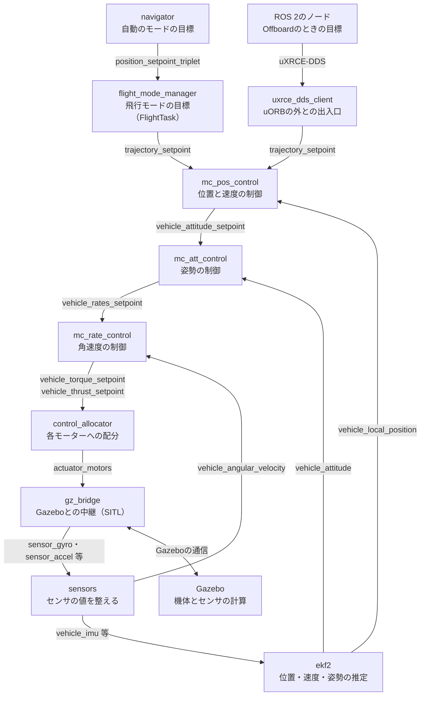
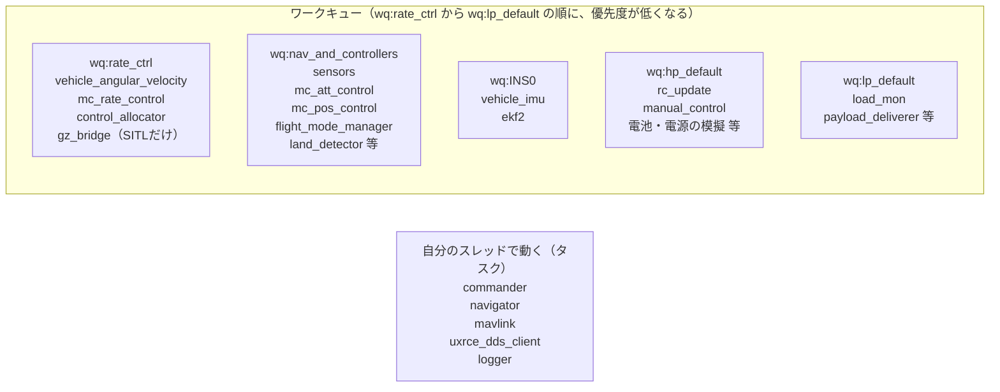

# 間章: PX4の中の仕組み ― モジュール・uORB・ワークキュー・起動の流れ

[学習計画](learning_plan.md) の間章（任意）。[フェーズ0](phase0_drone_px4.md) の3-2節では、PX4の中を「推定 → 制御 → 配分」の箱と矢印で見た。[間章「フライトコントローラの一般論」](interlude_flight_controller.md) の2節では、その箱が、おおむねどのモジュールに当たるかを見た。この章では、もう一段深く入る。箱と箱の間の矢印が、実際にはどの名前のデータ（uORBのトピック）なのか、モジュールがいつ・どのスレッドで動くのか、PX4がどの順番で起動するのかを、PX4のソースと、PX4のシェルでの観察で確かめる。

- 想定環境: [環境構築](setup_px4_gazebo.md) を終えたWSL2のUbuntu 24.04。読むのは、[フェーズ6-2](phase6_2_replan_flight.md) の後を勧める（5-3節で、フェーズ3・5・6-2で見た動きが、PX4の中のどこで決まるかを振り返る）
- 所要の目安: 1コマ（読むだけなら40分。シェルで観察するなら、シミュレーションの起動と離陸の時間が加わる）
- 必須の範囲: なし（任意の章）。シェルで観察するかは任意（観察の節は、表示の例と読み方だけでも読める）
- 前提（親プロジェクト）: なし

> **この章の位置づけ**: PX4を改造するための手順書ではない。PX4の中で何が起きているかの見通しを付けるための読み物で、観察もPX4の設定やソースを変えない。PX4についての事実は、この教材で使うPX4 v1.17の公式の文書とソース（v1.17.0）に基づく。PX4のソースは、短い抜粋を載せて読む（出典と、`LICENSE` の3節の第三者の一覧に記載した）。抜粋の後の説明は、筆者がソースを読んでまとめたもので、細部が最新の公式の情報と食い違う場合は、公式を優先する。
>
> **期待する結果の出どころ**: 2-4節・3-2節・4-4節・6-2節のT1（PX4のシミュレーション）の表示は、筆者の環境で、画面なしで起動したPX4（`gz_x500`）で確かめたもの（2026-11-08）。ほかのシミュレーションと混ざらないように、インスタンスの番号・作業フォルダ等を変え、QGCをつながずに、PX4の外から送るコマンド（`px4-uorb` 等）で表示を取った。この章の手順（`make px4_sitl gz_x500` で起動し、QGCをつなぎ、`pxh>` のシェルで打つ）とは、起動の仕方が違う。起動の表示のうち、インスタンスの番号に依る部分（模型の名前・MAVLinkのポートの番号）と、分けるために変えた設定に依る部分（uXRCE-DDSのAgentのポートの番号）は、この章の手順のとおりに起動したときの値に直して載せた。`uorb top` の表示からは、画面を消すための制御の文字を取り除いた。時刻（`timestamp`）・位置・推力の値・購読の数（`#SUB`）は、実行ごとに変わる。頻度（`RATE`）と間隔は、PX4の中の時計で数える。SITLでは、その時計がシミュレーションの時刻に従うので（4-1節）、PCの速さには左右されにくいが、細かな値は実行ごとに変わることがある。

この章では、[フェーズ1](phase1_first_flight.md) と同じく、T1でPX4のシミュレーションを起動し、T2でQGCを起動する（観察する場合だけ）。ターミナルの番号は、[READMEの「ターミナルの番号」](../README.md#ターミナルの番号)のとおり、T1〜T4がどの手順書でも同じプログラムで、T5以降がそのページの作業用である。この章では、T1とT2だけを使う。打つコマンドの前に `pxh> ` を付けて書くが、`pxh>` はPX4のシェルのプロンプトなので打たない。

## 0. 学習目標と完了条件

この章を読み終えたら、次を自分の言葉で説明できる状態を目指す。

1. PX4の中の層（ドライバ・ミドルウェア・フライトスタック）と、どのOSの上でも同じに動かす仕組みを説明できる（1節）。
2. uORBのトピックが、メッセージの定義のファイルからどう作られ、どう出版・購読されるかを説明できる（2節）。
3. マルチコプターの制御の連鎖を、uORBのトピックの名前で、目標の位置からモーターの指令まで追える（3節）。
4. モジュールが「自分のスレッド」で動く場合と「ワークキュー」で動く場合の違いと、データが届いたら動く仕組みを説明できる（4節）。
5. `commander`・`navigator`・`flight_mode_manager` の分担と、この教材で見た動き（Offboardの合図が途切れたときのReturn、衝突防止）が、どのモジュールで決まるかを説明できる（5節）。
6. PX4が起動するときの順番を、起動のスクリプトに沿って説明できる（6節）。

**完了条件**: 8節の4つの問いに、答えを見ずに答えられる。

## 1. 全体の見取り図

フェーズ0の3-2節の図では、推定・制御・配分の箱が、矢印でつながっていた。実際のPX4では、この1つ1つの箱が、独立したプログラムの部品（**モジュール**）である。モジュールは、ほかのモジュールを直接呼び出さない。データを、名前の付いた通り道（**uORBのトピック**）に出し、要るモジュールが、そこから受け取る。PX4の文書は、この作りを「反応型」（新しいデータが届いたら、すぐに更新する）と説明している。どのモジュールも、ほかのモジュールに触らずに差し替えられるのは、この作りのおかげである。

PX4の中を、下から順に並べると、次のようになる。

| 層 | 中身 | 例 |
|---|---|---|
| OSとの間の層 | OSの違い（NuttX・Linux等）を吸収し、スレッド・時計・ファイル等を同じ形で使えるようにする | `platforms/nuttx`・`platforms/posix` |
| ミドルウェア | ドライバ、uORB、ワークキュー（4節）、パラメータ、ログ、外との通信 | `uorb`・`work_queue`・`param`・`logger`・`mavlink`・`uxrce_dds_client` |
| フライトスタック | 推定・制御・飛行モード・安全の判断 | `ekf2`・`mc_pos_control`・`commander`・`navigator` |

SITLでは、OSとの間の層が、Linuxの上でPX4を1つのプログラム（`px4`）として動かす。PX4の文書によると、PX4のミドルウェア全体は1つのアドレス空間（メモリの空間）の中で動き、uORBは共有のメモリでデータを渡す。どのモジュールも、同じ1つのプログラムの中のスレッドである。センサとモーターは、実機ではドライバが受け持つが、SITLでは `gz_bridge`（Gazeboとの中継のモジュール）が代わりをする（フェーズ0の4節）。

## 2. uORB ― モジュールどうしの通り道

### 2-1. メッセージの定義から、トピックへ

uORBのトピックの形は、PX4のソースの `msg/` のフォルダの、メッセージの定義のファイル（`.msg`）で決まる。たとえば、角速度の目標のトピック `vehicle_rates_setpoint` は、`VehicleRatesSetpoint.msg` で定義されている。次は、その抜粋である。

ファイル（PX4のソース）: `~/PX4-Autopilot/msg/versioned/VehicleRatesSetpoint.msg`（抜粋）

```text
uint64 timestamp	# time since system start (microseconds)

# body angular rates in FRD frame
float32 roll		# [rad/s] roll rate setpoint
float32 pitch		# [rad/s] pitch rate setpoint
float32 yaw		# [rad/s] yaw rate setpoint

float32[3] thrust_body	# Normalized thrust command in body NED frame [-1,1]
```

1行に1つの項目を、型と名前で書く。`roll`・`pitch`・`yaw` は、機体の座標系（FRD。フェーズ0の8節）での角速度の目標（rad/s）、`thrust_body` は、推力の目標（−1〜1に直した値）である。PX4の文書は、どのメッセージにも `timestamp`（PX4が起動してからの時刻、μs）を必ず入れるように定めている。ログを記録する `logger` が、この時刻を使うからである。

ビルドのときに、この定義から、C++のヘッダ（`uORB/topics/vehicle_rates_setpoint.h`）が自動で作られる。モジュールのコードでは、ファイルの名前を小文字とアンダースコアに直した名前（`vehicle_rates_setpoint`）を、`ORB_ID(vehicle_rates_setpoint)` の形で指して使う。フェーズ2で使った `px4_msgs` の型（`px4_msgs/msg/VehicleRatesSetpoint` 等）も、PX4のこの `msg/` のフォルダの定義を写したものである。`versioned` のフォルダの定義は、ROS 2に出すために版の番号（`MESSAGE_VERSION`）を持つ。

### 2-2. 出す側と受ける側

モジュールは、トピックを出す側（出版）と受ける側（購読）の部品を、メンバーとして持つ（4-3節でソースを見る）。

- **出す**: `uORB::Publication<型>` の `publish()` で、新しい値を書く。
- **受ける**: `uORB::Subscription` の `update()` で、前に読んだ後に新しい値が書かれていたら、それを読む。`updated()` は、新しい値があるかだけを調べる。
- **新しい値が届いたら起こしてもらう**: `uORB::SubscriptionCallbackWorkItem` を使うと、そのトピックに値が書かれたときに、モジュールの処理が呼ばれる（4-2節）。

uORBのトピックは、既定では、最新の1つの値だけを持つ。速く書かれると、読む前に上書きされる。PX4の文書によると、センサの値や目標の値は、最新のものだけが要るので、これで困らない。取りこぼすと困るトピック（指令の `vehicle_command` 等）は、定義のファイルに `ORB_QUEUE_LENGTH`（キューの長さ）を書いて、複数の値をためられるようにする。

同じ型のデータを、複数の出し手が出すこともある（たとえば、慣性センサが3つあれば、`sensor_gyro` が3つ出る）。この場合、トピックは**インスタンス**（0・1・2…の番号の付いた、同じトピックの複数の口）に分かれる。出す側は `uORB::PublicationMulti` を使い、受ける側は番号で選ぶ。

### 2-3. uORBの外への出口

PX4の外とのやり取りも、uORBのトピックを通る。

- **uXRCE-DDS**（フェーズ2）: `uxrce_dds_client` が、`dds_topics.yaml` に書かれたトピックを購読してROS 2へ出し（`/fmu/out/...`）、ROS 2から届いた値をuORBに出す（`/fmu/in/...`）。フェーズ3のノードが送った `/fmu/in/trajectory_setpoint` は、PX4の中では、uORBの `trajectory_setpoint` になる。
- **MAVLink**（フェーズ0の6節）: `mavlink` が、uORBのトピックを読んでMAVLinkのメッセージに直してQGCへ送り、QGCからの指令をuORBの `vehicle_command` 等に直して出す。
- **ログ**: `logger` が、決められたトピックを購読して、ファイル（`.ulg`）に書く。飛行の後にログを解析するときに見るのは、このuORBのトピックの記録である。

ROS 2から見えるのは、PX4の中のトピックのうち、`dds_topics.yaml` に書かれた一部だけである（どれを出すかは、[間章「実機向けのファームウェアをビルドする」](interlude_firmware_build.md) の5節）。PX4の中には、ずっと多くのトピックがある。

### 2-4. 観察: どのトピックが、どのくらいの頻度で出ているか

フェーズ1と同じように、PX4のシミュレーションとQGCを起動し、機体を離陸させてから、`uorb top` で、出ているトピックの一覧を見る。

```bash
# T1
cd ~/PX4-Autopilot

make px4_sitl gz_x500

# T2
~/QGroundControl-x86_64.AppImage
```

QGCに機体がつながったら、T1のPX4のシェルで、離陸させる。

```bash
# T1（PX4のシェル）
pxh> commander takeoff
```

機体が2.5mの高さで止まったら、`uorb top` を、1回だけ表示する指定（`-1`）で実行する。

```bash
# T1（PX4のシェル）
pxh> uorb top -1
```

**期待する結果**（抜粋。値は実行ごとに変わる）:

```text
update: 1s, topics: 121, total publications: 6841, 552.7 kB/s
TOPIC NAME                          INST #SUB RATE #Q SIZE
actuator_motors                        0    4  250  1   72
sensor_accel                           0    6  250  8   48
sensor_gyro                            0    7  250  8   48
telemetry_status                       0    2    2  1   88
telemetry_status                       1    2    2  1   88
trajectory_setpoint                    0    3   50  1   64
vehicle_angular_velocity               0   11  250  1   40
vehicle_attitude                       0   18  250  1   56
vehicle_attitude_setpoint              0    7  125  1   40
vehicle_control_mode                   0   21    2  1   24
vehicle_local_position                 0   40  125  1  192
vehicle_rates_setpoint                 0    5  250  1   40
```

1行目は、表示の間隔（1秒）・トピックの数・1秒に書かれた値の合計である。2行目からの列は、次の意味である。

| 列 | 意味 |
|---|---|
| `TOPIC NAME` | トピックの名前 |
| `INST` | インスタンスの番号（2-2節）。`telemetry_status` は、MAVLinkの通り道ごとに1つずつある |
| `#SUB` | 購読しているモジュールの数。`vehicle_local_position` は、多くのモジュールが使う |
| `RATE` | 1秒に書かれた回数 |
| `#Q` | キューの長さ（2-2節）。慣性センサの値は8つまでためられる |
| `SIZE` | 1つの値の大きさ（バイト） |

`RATE` を見ると、角速度（`vehicle_angular_velocity`）・角速度の目標（`vehicle_rates_setpoint`）・モーターの指令（`actuator_motors`）は250回、位置（`vehicle_local_position`）と姿勢の目標（`vehicle_attitude_setpoint`）は125回、目標の位置（`trajectory_setpoint`）は50回である。内側の制御ほど速く回っている（フェーズ0の3-2節）ことが、数で見える。

`-1` を付けないと、表示が1秒ごとに更新され続ける（v1.17のソースでは、何かキーを押すと止まる）。名前を後ろに並べると、そのトピックだけを表示する（例: `uorb top -1 vehicle_rates_setpoint actuator_motors`）。

## 3. 制御の連鎖を、トピックの名前で追う

### 3-1. 目標の位置から、モーターの指令まで

次の図は、マルチコプターの制御の連鎖を、モジュールと、その間を流れるuORBのトピックの名前で描いたものである。フェーズ0の3-2節の図の矢印1本1本が、どのトピックに当たるかを示している。

![マルチコプターの制御の連鎖を、uORBのトピックの名前で追う図。navigator が position_setpoint_triplet を flight_mode_manager に渡し、flight_mode_manager が trajectory_setpoint を mc_pos_control に渡す。Offboardのときは、ROS 2のノードの目標が uXRCE-DDS で uxrce_dds_client に届き、uxrce_dds_client が trajectory_setpoint を出す。ekf2 は vehicle_local_position を mc_pos_control に、vehicle_attitude を mc_att_control に渡す。mc_pos_control は vehicle_attitude_setpoint を mc_att_control に、mc_att_control は vehicle_rates_setpoint を mc_rate_control に渡す。sensors は vehicle_angular_velocity を mc_rate_control に、vehicle_imu 等を ekf2 に渡す。mc_rate_control は vehicle_torque_setpoint と vehicle_thrust_setpoint を control_allocator に渡し、control_allocator は actuator_motors を gz_bridge に渡す。gz_bridge は Gazebo とやり取りし、sensor_gyro・sensor_accel 等を sensors に渡す](img/interlude_px4_internals_chain.svg)

<details>
<summary>同じ図のmermaid版</summary>



</details>

上から順に、何が流れているかを見る。

| トピック | 出す → 受ける | 中身 |
|---|---|---|
| `position_setpoint_triplet` | `navigator` → `flight_mode_manager` | 自動のモード（Takeoff・Mission・Return等）での、前・今・次の目標の地点 |
| `trajectory_setpoint` | `flight_mode_manager`（Offboardでは `uxrce_dds_client`）→ `mc_pos_control` | 目標の位置・速度・加速度と機首の向き（NED） |
| `vehicle_local_position` | `ekf2` → `mc_pos_control` ほか | 推定した位置と速度（NED） |
| `vehicle_attitude_setpoint` | `mc_pos_control` → `mc_att_control` | 目標の姿勢（四元数）と推力 |
| `vehicle_attitude` | `ekf2` → `mc_att_control` ほか | 推定した姿勢 |
| `vehicle_rates_setpoint` | `mc_att_control` → `mc_rate_control` | 目標の角速度と推力（2-1節） |
| `vehicle_angular_velocity` | `sensors` → `mc_rate_control` | ジャイロの値を整えた角速度 |
| `vehicle_torque_setpoint`・`vehicle_thrust_setpoint` | `mc_rate_control` → `control_allocator` | 機体に掛けたい回転の力（トルク）と推力 |
| `actuator_motors` | `control_allocator` → `gz_bridge`（実機ではモーターの出力のドライバ） | 各モーターの指令（0〜1） |

フェーズ3のノードが送った目標（`/fmu/in/trajectory_setpoint`）は、この表の2行目に入る。Offboardのモードでは、`flight_mode_manager` は目標を作らず（5-2節）、外から届いた `trajectory_setpoint` が、そのまま位置の制御に渡る。目標がどこから来ても、その先の連鎖は同じである。

`mc_pos_control` は、`vehicle_local_position_setpoint` も出す。これは、位置の制御が実際に使った目標を記録するためのもので、連鎖の次のモジュールは使わない（図には描いていない）。

### 3-2. 観察: 連鎖の途中の値を見る

2-4節に続けて、機体が止まっている間に、連鎖の途中のトピックを `listener` で見る。

```bash
# T1（PX4のシェル）
pxh> listener vehicle_rates_setpoint

pxh> listener actuator_motors
```

**期待する結果**（`timestamp` と値は実行ごとに変わる）:

```text
pxh> listener vehicle_rates_setpoint

TOPIC: vehicle_rates_setpoint
 vehicle_rates_setpoint
    timestamp: 261964000 (0.000000 seconds ago)
    roll: -0.00804
    pitch: -0.00070
    yaw: 0.00110
    thrust_body: [0.00000, 0.00000, -0.72778]
    reset_integral: False

pxh> listener actuator_motors

TOPIC: actuator_motors
 actuator_motors
    timestamp: 262036000 (0.000000 seconds ago)
    timestamp_sample: 262036000 (0 us before timestamp)
    control: [0.72779, 0.72782, 0.72766, 0.72757, nan, nan, nan, nan, nan, nan, nan, nan]
    reversible_flags: 0
```

`vehicle_rates_setpoint` の項目は、2-1節の定義のファイルと同じ並びである。止まっているので、角速度の目標はほぼ0で、推力の目標（`thrust_body` の3つ目）は約−0.73である（NEDの機体の座標系では、上向きが負）。`actuator_motors` の `control` は、モーターごとの指令で、4つのモーターがほぼ同じ約0.73である（止まって浮いているので、どのモーターも同じだけ回せばよい）。5つ目から先の `nan` は、この機体に無いモーターの欄である（`CA_ROTOR_COUNT` が4。[間章「フライトコントローラの一般論」](interlude_flight_controller.md) の2-3節）。

どの制御を動かすかは、`commander` が出す `vehicle_control_mode` で決まる。

```bash
# T1（PX4のシェル）
pxh> listener vehicle_control_mode
```

**期待する結果**（抜粋。止まって浮いている間。`timestamp` は実行ごとに変わる）:

```text
TOPIC: vehicle_control_mode
 vehicle_control_mode
    timestamp: 261720000 (0.348000 seconds ago)
    flag_armed: True
    flag_control_manual_enabled: False
    flag_control_auto_enabled: True
    flag_control_offboard_enabled: False
    flag_control_position_enabled: True
    flag_control_velocity_enabled: True
    flag_control_altitude_enabled: True
    flag_control_attitude_enabled: True
    flag_control_rates_enabled: True
    flag_control_allocation_enabled: True
```

離陸の後は、自動のモード（Hold）なので、`flag_control_auto_enabled` が `True` で、位置・速度・姿勢・角速度の制御と配分が、すべて有効になっている。各制御のモジュールは、このトピックを購読し、自分の担当の欄が `False` なら、制御を止める。たとえば、Offboardで角速度だけを外から指令すると（フェーズ3の合図の `body_rate`）、位置と姿勢の欄が `False` になり、`mc_pos_control` と `mc_att_control` は目標を出さない。

## 4. モジュールは、いつ・どこで動くか

### 4-1. 自分のスレッドか、ワークキューか

PX4の文書によると、モジュールの動かし方は2通りある。

- **タスク**（自分のスレッドで動く）: モジュールが、自分専用のスレッド（並んで動く処理の単位）と、自分の優先度を持つ。中で待つ（一定の時間眠る、データが届くまで待つ、ファイルを読む）ことができる。`commander`・`navigator`・`mavlink`・`uxrce_dds_client`・`logger` は、この形である。
- **ワークキュー**: 1つのスレッドを、複数のモジュールで共有する。キューの中のモジュールは、1つずつ順に動く。メモリが少なく済み、スレッドの切り替えも減るが、どのモジュールも、中で待ってはいけない（待つと、同じキューのほかのモジュールが止まる）。制御と推定のモジュールは、この形である。

ワークキューは、優先度ごとに分かれている。v1.17のソースでは、ワークキューの名前と優先度が `WorkQueueManager.hpp` と、その設定（`Kconfig`）で決まっている。この教材の機体で使う主なものは、次の5つである（優先度は、OSの最高の優先度との差。0がいちばん高い）。

| ワークキュー | 優先度（既定） | 主なモジュール |
|---|---|---|
| `wq:rate_ctrl` | 0 | 角速度の計算、角速度の制御、配分、`gz_bridge`（SITL） |
| `wq:nav_and_controllers` | −13 | `sensors`、姿勢と位置の制御、`flight_mode_manager`、`land_detector` |
| `wq:INS0` | −14 | 慣性センサの値をまとめる `vehicle_imu`、推定の `ekf2` |
| `wq:hp_default` | −18 | 送信機の入力（`rc_update`・`manual_control`）等 |
| `wq:lp_default` | −50 | CPUの負荷の見張り（`load_mon`）等 |

いちばん内側の角速度の制御と配分が、最も高い優先度のキューに入っている。ほかの処理が重なっても、モーターへの指令が遅れないようにするためである。


<details>
<summary>同じ図のmermaid版</summary>



</details>

SITLでは、PX4の時計（`hrt_absolute_time()` が返す時刻）が、シミュレーションの時刻に従う（**ロックステップ**。PX4とGazeboが、歩調を合わせて時刻を進める仕組み）。PCが遅くて、シミュレーションが実際の時間より遅く進んでも、PX4の中では、決まった間隔で処理が回っているように見える。4-4節や2-4節の頻度が、きれいな数になるのはこのためである。実機には、この仕組みは無く、本物の時計で動く。

### 4-2. データが届いたら動くか、時間で動くか

ワークキューのモジュールが動くきっかけは、2通りある。

- **データが届いたら動く**: 決めたトピックに値が書かれたら、モジュールの `Run()` が呼ばれる（2-2節の `SubscriptionCallbackWorkItem`）。角速度の制御は、角速度（`vehicle_angular_velocity`）が届くたびに動く。PX4の文書は、こうして多くのモジュールの頻度が、もとをたどるとセンサのドライバの頻度で決まる、と説明している。
- **時間で動く**: `ScheduleOnInterval()`（決まった間隔ごと）や `ScheduleDelayed()`（一度だけ、少し後に）で、自分を予約する。CPUの負荷の見張り（`load_mon`）は、0.5秒ごとに動く。

自分のスレッドで動くモジュールは、自分で回る。たとえば `commander` は、10msの間隔で眠っては状態を調べ直し、`navigator` は、位置などのトピックが届くのを待って（最長1秒）動く。

### 4-3. ソースで見る: 角速度の制御のモジュール

角速度の制御のモジュール（`mc_rate_control`）を例に、ここまでの部品がソースのどこに現れるかを見る。まず、クラスの宣言の抜粋である。

ファイル（PX4のソース）: `~/PX4-Autopilot/src/modules/mc_rate_control/MulticopterRateControl.hpp`（抜粋。途中の行を省き、省いた箇所に `// （省略）` の行を足した）

```cpp
class MulticopterRateControl : public ModuleBase<MulticopterRateControl>, public ModuleParams, public px4::WorkItem
{
// （省略）
	uORB::Subscription _vehicle_control_mode_sub{ORB_ID(vehicle_control_mode)};
	uORB::Subscription _vehicle_rates_setpoint_sub{ORB_ID(vehicle_rates_setpoint)};
// （省略）
	uORB::SubscriptionCallbackWorkItem _vehicle_angular_velocity_sub{this, ORB_ID(vehicle_angular_velocity)};
// （省略）
	uORB::Publication<vehicle_rates_setpoint_s>	_vehicle_rates_setpoint_pub{ORB_ID(vehicle_rates_setpoint)};
	uORB::Publication<vehicle_thrust_setpoint_s>	_vehicle_thrust_setpoint_pub;
	uORB::Publication<vehicle_torque_setpoint_s>	_vehicle_torque_setpoint_pub;
// （省略）
```

1行目のクラスは、3つの土台を受け継いでいる。`ModuleBase` は、PX4のシェルの `mc_rate_control start`・`stop`・`status` のコマンドを受ける部分、`ModuleParams` は、パラメータ（`MC_ROLLRATE_P` 等）を読む部分、`px4::WorkItem` は、ワークキューで動く部分である。その下に、購読（`Subscription`）・データが届いたら起こしてもらう購読（`SubscriptionCallbackWorkItem`）・出版（`Publication`）が並ぶ。このモジュールを起こすのは、角速度（`vehicle_angular_velocity`）だけである。目標（`vehicle_rates_setpoint`）や `vehicle_control_mode` は、起きたときに最新の値を読むだけである。`vehicle_rates_setpoint` を出版もしているのは、手動で角速度を指令するモード（Acro）では、このモジュール自身がスティックの入力から目標を作るからである。

次は、ソースのファイルの抜粋である。

ファイル（PX4のソース）: `~/PX4-Autopilot/src/modules/mc_rate_control/MulticopterRateControl.cpp`（抜粋。途中の行を省き、省いた箇所に `// （省略）` の行を足した）

```cpp
MulticopterRateControl::MulticopterRateControl(bool vtol) :
	ModuleParams(nullptr),
	WorkItem(MODULE_NAME, px4::wq_configurations::rate_ctrl),
// （省略）

bool
MulticopterRateControl::init()
{
	if (!_vehicle_angular_velocity_sub.registerCallback()) {
		PX4_ERR("callback registration failed");
		return false;
	}

	return true;
}

void
MulticopterRateControl::Run()
{
// （省略）
	/* run controller on gyro changes */
	vehicle_angular_velocity_s angular_velocity;

	if (_vehicle_angular_velocity_sub.update(&angular_velocity)) {
// （省略）
			_vehicle_thrust_setpoint_pub.publish(vehicle_thrust_setpoint);

			_vehicle_torque_setpoint_pub.publish(vehicle_torque_setpoint);
// （省略）
```

上から順に、次のことをしている。

1. **どのキューで動くか**: コンストラクタ（オブジェクトを作るときに呼ばれる関数）で、`WorkItem` に `wq_configurations::rate_ctrl` を渡している。これで、4-1節の `wq:rate_ctrl` に入る。
2. **何で起きるか**: `init()` で、角速度の購読の `registerCallback()` を呼ぶ。これ以後、角速度が書かれるたびに、このモジュールの `Run()` が、`wq:rate_ctrl` のスレッドで呼ばれる。
3. **起きたら何をするか**: `Run()` の中で、新しい角速度を `update()` で読み（読めたときだけ計算する）、省いた部分で目標との差から制御の計算をして、トルクと推力の目標を `publish()` で出す。この `publish()` が、今度は配分（`control_allocator`）を起こす（配分は、`vehicle_torque_setpoint` に `SubscriptionCallbackWorkItem` を使っている）。

こうして、ジャイロの値が届く → 角速度が整えられる → 角速度の制御が動く → 配分が動く、という連鎖が、データが届くたびに、同じ `wq:rate_ctrl` のスレッドの上で順に起きる。

### 4-4. 観察: ワークキューの中身を見る

3-2節に続けて、ワークキューの一覧を見る。

```bash
# T1（PX4のシェル）
pxh> work_queue status
```

**期待する結果**（抜粋。止まって浮いている間）:

```text
Work Queue: 5  threads                          RATE        INTERVAL
|__ 1) wq:rate_ctrl
|   |__ 1) control_allocator                249.9 Hz         4001 us
|   |__ 2) gz_bridge                         83.3 Hz        11998 us
|   |__ 3) gz_bridge-actuators-esc          249.9 Hz         4001 us
|   |__ 7) mc_rate_control                  249.9 Hz         4001 us
|   \__ 8) vehicle_angular_velocity         249.9 Hz         4001 us
|__ 2) wq:nav_and_controllers
|   |__ 1) flight_mode_manager               50.0 Hz        19992 us
|   |__ 2) land_detector                    125.0 Hz         8002 us
|   |__ 3) mc_att_control                   249.9 Hz         4001 us
|   |__ 5) mc_pos_control                   125.0 Hz         8002 us
|   |__ 6) sensors                          250.0 Hz         4000 us
|__ 3) wq:INS0
|   |__ 1) ekf2                             249.9 Hz         4001 us
|   \__ 2) vehicle_imu                      249.9 Hz         4001 us
|__ 4) wq:hp_default
|   |__ 3) manual_control                     5.0 Hz       199755 us
\__ 5) wq:lp_default
    |__ 2) load_mon                           2.0 Hz       498571 us (500000 us)
```

ワークキューが5つあり、その下に、各キューで動くモジュールと、1秒に動いた回数（`RATE`）・平均の間隔（`INTERVAL`）が並ぶ。間隔の後ろの括弧は、決まった間隔の予約（`ScheduleOnInterval()`。4-2節）をしたモジュールに付き、予約した間隔を示す（`load_mon` の0.5秒）。括弧が無いモジュールの多くはデータが届いたら動くが、一度だけの予約（`ScheduleDelayed()`）で動くものもある。たとえば `manual_control` は、送信機の入力が届かない間は、0.2秒後に自分を予約し直して動く（約5回）。

角速度（`vehicle_angular_velocity`）・角速度の制御・配分が、同じ `wq:rate_ctrl` で、同じ約250回（4ms間隔）で動いている。4-3節の連鎖が、同じ頻度で回っていることが分かる。`gz_bridge-actuators-esc` は、`actuator_motors` を受けてGazeboのモーターへ送る部分で、これも配分と同じ頻度である。自分のスレッドで動く `commander` 等は、この一覧には出ない。

PX4の文書は、実機（NuttX）では `top` のコマンドで、スレッドごとのCPUの使用率を見られるとし、このコマンドはNuttXのシェルのものとしている。v1.17のSITLのビルドの設定（`boards/px4/sitl/default.px4board`）にも `top` は入っておらず、SITLのPX4のシェルでは使えない。

## 5. 状態の管理と飛行モード

### 5-1. commander ― 状態とフェイルセーフの判断

`commander` は、機体の「今の状態」を決めるモジュールである。アームしてよいかの検査（フェーズ1の `Preflight Fail` の表示）、アームと解除、飛行モードの切り替え、フェイルセーフの判断を受け持つ。結果は、主に次の2つのトピックに出す。

- `vehicle_status`: アームしているか、今の飛行モード（`nav_state`）、フェイルセーフ中か、など。
- `vehicle_control_mode`: どの制御を動かすか（3-2節）。

`commander` は、飛行モードを自分で飛ばすわけではない。モードを決めて知らせるだけで、目標を作るのは5-2節のモジュール、制御するのは3節の連鎖である。フェイルセーフの判断は、`commander` の中の `failsafe` の部分（`src/modules/commander/failsafe/`）にまとまっている。地上局とのつながり・電池・Offboardの合図などの状態を調べ、パラメータ（`NAV_DLL_ACT`・`COM_OBL_RC_ACT` 等）に従って、移るモードを決める。

### 5-2. navigator と flight_mode_manager ― 目標を作る

目標を作るモジュールは、2段になっている。

- **`navigator`**: 自動のモード（Takeoff・Land・Hold・Mission・Return等）で、行き先の地点を決める。行き先は、`position_setpoint_triplet`（前・今・次の3つの地点）に出す。飛行計画（Mission）や帰還の経路は、ここで扱う。
- **`flight_mode_manager`**: 飛行モードごとの**FlightTask**（飛行のタスク。モードごとに、目標の作り方を1つのクラスにまとめたもの）を切り替えて動かし、位置の制御への目標 `trajectory_setpoint` を作る。自動のモードでは `navigator` の地点を滑らかな軌道に直し（`FlightTaskAuto`）、Position modeでは、スティックの入力から目標を作る（`FlightTaskManualPosition` 等）。

Offboardのモードには、当てはまるFlightTaskが無い。v1.17の `FlightModeManager.cpp` では、飛行モードに合うタスクが無いとき、タスクを無しにする。そのため、Offboardでは `flight_mode_manager` は目標を出さず、外から届いた `trajectory_setpoint` が使われる（3-1節）。

### 5-3. この教材で見た動きは、どこで決まっていたか

ここまでの部品で、この教材のフェーズで見た動きを振り返る。

| 見た動き | 決めているところ |
|---|---|
| フェーズ1: QGCがつながるまで `Preflight Fail: No connection to the GCS` が出て、アームできない | `commander` のアームの前の検査（`NAV_DLL_ACT` が0でないとき、地上局とのつながりを求める） |
| フェーズ3: ノードの目標で、機体が経由点を回る | `uxrce_dds_client` が `trajectory_setpoint` を出し、`flight_mode_manager` は目標を出さない（5-2節）。その先は3節の連鎖 |
| フェーズ3の5節: ノードを止めると、合図が途切れ、Holdを挟まずにReturnに移る | `commander` のフェイルセーフの判断（`failsafe.cpp`）。合図が `COM_OF_LOSS_T`（既定1秒）途切れたら途切れたとみなし、`COM_OBL_RC_ACT` と送信機の有無に従ってモードを選ぶ。Returnの間の目標は `navigator` が作る |
| フェーズ5: Position modeで壁の手前で止まる | `flight_mode_manager` のPosition modeのFlightTaskの中の、衝突防止の部品（`src/lib/collision_prevention`）が、スティックから作った目標の速度を、`obstacle_distance` に応じて抑える。Position modeのFlightTaskの中にあるので、Offboardや自動のモードでは効かない（フェーズ5の7節） |
| フェーズ6-2の5-3節: 中継や計画器を止めても、Offboardのままでフェイルセーフに移らない | `commander` が見ているのは、Offboardの合図（`offboard_control_mode`）が届いているかで、合図を出すノードが動いている限り、合図は途切れない。ROS 2の側の中継や計画器が止まったことは、PX4には見えない |

最後の行は、[間章「シミュレーションから実機へ」](interlude_sim_to_real.md) で、外のプログラムを見張る仕組みが要る理由として扱ったことと同じである。PX4の安全の判断は、PX4の中のトピックで見える範囲に限られる。

## 6. 起動の流れ

### 6-1. 起動のスクリプトの順番

`make px4_sitl gz_x500` でPX4を起動すると、`px4` のプログラムが、まずOSとの間の層を用意し、ワークキューの管理・uORB・パラメータを始める（`platforms/posix/src/px4/common/px4_init.cpp`）。その後、起動のスクリプト `rcS`（SITL向けは `ROMFS/px4fmu_common/init.d-posix/rcS`）を実行し、各モジュールを `<モジュールの名前> start` の形で起動していく。主な順番は次のとおりである。

| 順 | すること | 主なコマンド・ファイル |
|---|---|---|
| 1 | 保存したパラメータを読み込む | `param import` |
| 2 | 機体の設定のファイルを実行する（`SYS_AUTOSTART` の番号。`gz_x500` なら4001番） | `init.d-posix/airframes/4001_gz_x500` |
| 3 | データの保存と、シミュレーションを始める（Gazeboを起動して機体を置き、`gz_bridge` を起動する） | `dataman start`、`px4-rc.simulator` → `px4-rc.gzsim` |
| 4 | センサ・状態の管理・推定を起動する | `sensors start`、`commander start`、`ekf2 start` |
| 5 | 機体の種類ごとの制御を起動する（マルチコプターなら `rc.mc_apps`） | `control_allocator`・`mc_rate_control`・`mc_att_control`・`flight_mode_manager`・`mc_pos_control`・`land_detector` の `start` |
| 6 | 自動のモードと、外との通信を起動する | `navigator start`、`uxrce_dds_client start`、`px4-rc.mavlink` |
| 7 | ログを始める | `rc.logging`（`logger`） |

2の機体の設定のファイルは、[間章「フライトコントローラの一般論」](interlude_flight_controller.md) の2-3節で見たように、パラメータの既定の値を決める。5で、機体の種類（マルチコプター・固定翼等）に応じて、起動する制御のモジュールが選ばれる。どのモジュールも、`start` で起動されると、自分のスレッドを作るか、ワークキューに入って、データが届くのを待つ（4節）。

### 6-2. 観察: 起動の表示を、順番と照らし合わせる

T1の起動の表示（フェーズ1の2節で見たもの）を、6-1節の表と照らし合わせて読む。PX4を一度止めて（`pxh> shutdown`）起動し直すか、起動したときの表示を上へたどる。

```bash
# T1
cd ~/PX4-Autopilot

make px4_sitl gz_x500
```

**期待する結果**（抜粋。起動の途中から。時刻・ポートの番号・ログのファイル名は実行ごとに変わる）:

```text
INFO  [param] selected parameter default file parameters.bson
INFO  [dataman] data manager file './dataman' size is 1208528 bytes
INFO  [init] Gazebo simulator 8.15.0
INFO  [init] Gazebo world is ready
INFO  [init] Spawning Gazebo model
INFO  [gz_bridge] world: default, model: x500_0
INFO  [lockstep_scheduler] setting initial absolute time to 3376000 us
INFO  [uxrce_dds_client] init UDP agent IP:127.0.0.1, port:8888
INFO  [mavlink] mode: Normal, data rate: 4000000 B/s on udp port 18570 remote port 14550
INFO  [logger] logger started (mode=all)
INFO  [px4] Startup script returned successfully
```

表示の各行の `[ ]` の中は、その行を出したモジュールの名前である。パラメータ（6-1節の表の1）→ データの保存とGazebo・`gz_bridge`（3）→ uXRCE-DDS とMAVLink（6）→ ログ（7）の順に並び、最後に起動のスクリプトが終わる。`lockstep_scheduler` の行は、4-1節のロックステップで、PX4の時計をシミュレーションの時刻に合わせたことを示す。4と5のモジュールの多くは、何事も無く起動すると、表示を出さない。動いていることは、`work_queue status`（4-4節）や、`mc_rate_control status` のようなモジュールの `status` で確かめられる。

## 7. まとめ

- PX4の中は、独立したモジュールの集まりで、モジュールどうしは、uORBのトピックだけでデータを渡す。トピックの形は `msg/` の定義のファイルで決まり、`px4_msgs` も同じ定義から作られる（1節・2節）。
- 外とのやり取り（uXRCE-DDS・MAVLink）とログも、uORBのトピックの出入口である（2-3節）。
- マルチコプターの制御は、`trajectory_setpoint` → `vehicle_attitude_setpoint` → `vehicle_rates_setpoint` → `vehicle_torque_setpoint`・`vehicle_thrust_setpoint` → `actuator_motors` の連鎖で、内側ほど速く回る（3節）。
- 制御と推定のモジュールは、優先度ごとのワークキューで、データが届いたら動く。角速度の制御と配分は、最も優先度の高い `wq:rate_ctrl` で、角速度が届くたびに続けて動く（4節）。
- `commander` は状態とフェイルセーフを決め、`navigator` と `flight_mode_manager` は目標を作る。Offboardでは、目標は外から来る（5節）。
- 起動は、`rcS` が、パラメータ → 機体の設定 → シミュレーション → センサ・状態・推定 → 制御 → 外との通信 → ログ、の順にモジュールを起動していく（6節）。

## 8. 確かめの問い

**問い1**: フェーズ3のノードが送った目標の位置が、モーターの指令になるまでに通るuORBのトピックを、順に挙げよ。また、通常のPosition modeのときと、どこが違うか。

<details>
<summary>答え</summary>

`trajectory_setpoint` → `vehicle_attitude_setpoint` → `vehicle_rates_setpoint` → `vehicle_torque_setpoint`・`vehicle_thrust_setpoint` → `actuator_motors` の順に通る（3-1節）。違うのは最初の `trajectory_setpoint` を出すモジュールだけで、Offboardでは `uxrce_dds_client` が（ROS 2から届いた `/fmu/in/trajectory_setpoint` を）出し、Position modeでは `flight_mode_manager` のFlightTaskがスティックの入力から作って出す（5-2節）。その先の連鎖は同じである。

</details>

**問い2**: ワークキューで動くモジュールの中で、ファイルを読み終わるまで待つ処理を書いてはいけないのはなぜか。

<details>
<summary>答え</summary>

1つのワークキューは、1つのスレッドを複数のモジュールで共有し、キューの中のモジュールは1つずつ順に動くからである（4-1節）。1つのモジュールが待つと、同じキューのほかのモジュールも止まる。たとえば `wq:rate_ctrl` で待つと、角速度の制御と配分が止まり、モーターへの指令が途切れる。待つ処理は、自分のスレッドで動くモジュール（タスク）にする。

</details>

**問い3**: `work_queue status` で、`mc_rate_control` と `control_allocator` が、同じキューで同じ頻度で動いていた。それはなぜか。

<details>
<summary>答え</summary>

どちらも、データが届いたら動くモジュールで、つながっているからである（4-3節）。`mc_rate_control` は角速度（`vehicle_angular_velocity`）が届くたびに動いてトルクの目標を出し、`control_allocator` はそのトルクの目標（`vehicle_torque_setpoint`）が届くたびに動く。もとの角速度の頻度で、連鎖の全体が回る。同じキュー（`wq:rate_ctrl`）に置いたのは、最も高い優先度で、続けて処理するためである。

</details>

**問い4**: フェーズ6-2で、Nav2の計画器を止めても、PX4はフェイルセーフに移らなかった。PX4の中のどの仕組みから見て、それは当然と言えるか。PX4に気づかせるには、何が要るか。

<details>
<summary>答え</summary>

Offboardの合図が途切れたかを判断するのは `commander` のフェイルセーフの部分で、見ているのは、PX4の中のトピックとして届く合図（`offboard_control_mode`）だけである（5-1節・5-3節）。合図を送るノードが動いている限り、ROS 2の側の計画器が止まっても、PX4には見えない。気づかせるには、外のプログラムの側で、計画器の出力が途切れたら合図を止める、あるいは自分でHoldやLandを指令する、といった見張りの仕組みが要る（[間章「シミュレーションから実機へ」](interlude_sim_to_real.md)）。

</details>

## 9. 用語集

| 用語 | 意味 | 初出 |
|---|---|---|
| モジュール | PX4の中の、役割ごとに分かれたプログラムの部品。`<名前> start` で起動する | 1 |
| uORBのトピック | モジュールどうしがデータを渡す、名前の付いた通り道。形は `msg/` の定義のファイルで決まる | 1 |
| 出版・購読 | トピックに値を書くこと（出版）と、値を受け取ること（購読） | 2-2 |
| インスタンス（uORB） | 同じトピックの、番号の付いた複数の口。同じ種類のセンサが複数あるとき等に使う | 2-2 |
| キューの長さ（`ORB_QUEUE_LENGTH`） | トピックがためておける値の数。既定は1（最新の値だけ） | 2-2 |
| スレッド | 1つのプログラムの中で、並んで動く処理の単位 | 4-1 |
| タスク（PX4） | 自分専用のスレッドで動くモジュール | 4-1 |
| ワークキュー | 1つのスレッドを、複数のモジュールで共有して、1つずつ順に動かす仕組み。優先度ごとに分かれる | 4-1 |
| ロックステップ | SITLで、PX4とシミュレーションが歩調を合わせて時刻を進める仕組み。PX4の時計がシミュレーションの時刻に従う | 4-1 |
| FlightTask | `flight_mode_manager` の中で、飛行モードごとに、位置の制御への目標の作り方をまとめたクラス | 5-2 |
| 起動のスクリプト（`rcS`） | PX4が起動のときに実行し、パラメータの読み込みとモジュールの起動を順に行うシェルのスクリプト | 6-1 |

## 次へ

この章は任意で、ここで一段落する。PX4を機体に合わせて調整する部分と、変えずにおく根幹の境界は、[間章「フライトコントローラの一般論」](interlude_flight_controller.md) の4節にある。トピックを足してPX4をビルドし直す方法は、[間章「実機向けのファームウェアをビルドする」](interlude_firmware_build.md) の5節にある。

## 出典

この章の技術的な記述は、次の文書とファイルを読んで、自分の言葉でまとめたもの（逐語の転載は、下の抜粋だけ）。

- PX4 User Guide（v1.17。[CC BY 4.0](https://creativecommons.org/licenses/by/4.0/)、Dronecode/PX4）: [PX4 Architectural Overview](https://github.com/PX4/PX4-Autopilot/blob/release/1.17/docs/en/concept/architecture.md)（反応型の作り、モジュールの差し替え、1つのアドレス空間と共有のメモリ、タスクとワークキューの違いと待ってはいけないこと、頻度がドライバで決まること、`top` がNuttXのシェルのものであること）、[uORB Messaging](https://github.com/PX4/PX4-Autopilot/blob/release/1.17/docs/en/middleware/uorb.md)（定義のファイルからトピックとヘッダを作ること、`timestamp` が必須であること、既定で1つの値だけを持つことと `ORB_QUEUE_LENGTH`、`uorb top`）、[System Startup](https://github.com/PX4/PX4-Autopilot/blob/release/1.17/docs/en/concept/system_startup.md)（起動のスクリプト）、[Flight Tasks](https://github.com/PX4/PX4-Autopilot/blob/release/1.17/docs/en/concept/flight_tasks.md)（FlightTaskの役割）
- PX4 v1.17のソース（作成に使った環境に取得したv1.17.0）: [`platforms/common/include/px4_platform_common/px4_work_queue/WorkQueueManager.hpp`](https://github.com/PX4/PX4-Autopilot/blob/release/1.17/platforms/common/include/px4_platform_common/px4_work_queue/WorkQueueManager.hpp) と [`platforms/common/px4_work_queue/Kconfig`](https://github.com/PX4/PX4-Autopilot/blob/release/1.17/platforms/common/px4_work_queue/Kconfig)（ワークキューの名前と優先度）、[`platforms/posix/src/px4/common/px4_init.cpp`](https://github.com/PX4/PX4-Autopilot/blob/release/1.17/platforms/posix/src/px4/common/px4_init.cpp)（ワークキュー・uORB・パラメータを始める順）、[`ROMFS/px4fmu_common/init.d-posix/rcS`](https://github.com/PX4/PX4-Autopilot/blob/release/1.17/ROMFS/px4fmu_common/init.d-posix/rcS) と [`ROMFS/px4fmu_common/init.d/rc.mc_apps`](https://github.com/PX4/PX4-Autopilot/blob/release/1.17/ROMFS/px4fmu_common/init.d/rc.mc_apps)（起動の順番）、各モジュールのソース（`src/modules/` の `mc_rate_control`・`mc_att_control`・`mc_pos_control`・`control_allocator`・`flight_mode_manager`・`sensors`・`ekf2`・`commander`・`navigator`・`land_detector`・`load_mon`・`simulation/gz_bridge`。使うワークキュー、データが届いたら動くか時間で動くか、出版と購読するトピック）、[`src/modules/flight_mode_manager/FlightModeManager.cpp`](https://github.com/PX4/PX4-Autopilot/blob/release/1.17/src/modules/flight_mode_manager/FlightModeManager.cpp)（合うタスクが無いときにタスクを無しにすること）、[`src/modules/commander/failsafe/failsafe.cpp`](https://github.com/PX4/PX4-Autopilot/blob/release/1.17/src/modules/commander/failsafe/failsafe.cpp)（Offboardの合図が途切れたときの判断）、[`src/lib/collision_prevention/CollisionPrevention.hpp`](https://github.com/PX4/PX4-Autopilot/blob/release/1.17/src/lib/collision_prevention/CollisionPrevention.hpp) と `src/modules/flight_mode_manager/tasks/ManualPosition/FlightTaskManualPosition.hpp`（衝突防止がPosition modeのFlightTaskの中にあること）、`platforms/posix/src/px4/common/drv_hrt.cpp`（SITLのロックステップの時計）、`platforms/common/px4_work_queue/ScheduledWorkItem.cpp`（`work_queue status` の括弧が、決まった間隔の予約のときだけ付くこと）、`src/modules/manual_control/ManualControl.cpp`（一度だけの予約で動くこと）、`boards/px4/sitl/default.px4board`（SITLのビルドに `top` が入っていないこと）
- 2-1節・4-3節の抜粋: PX4-Autopilot（v1.17.0）の [`msg/versioned/VehicleRatesSetpoint.msg`](https://github.com/PX4/PX4-Autopilot/blob/release/1.17/msg/versioned/VehicleRatesSetpoint.msg)、[`src/modules/mc_rate_control/MulticopterRateControl.hpp`](https://github.com/PX4/PX4-Autopilot/blob/release/1.17/src/modules/mc_rate_control/MulticopterRateControl.hpp)、[`src/modules/mc_rate_control/MulticopterRateControl.cpp`](https://github.com/PX4/PX4-Autopilot/blob/release/1.17/src/modules/mc_rate_control/MulticopterRateControl.cpp)。リポジトリは Copyright (c) 2012 - 2023, PX4 Development Team、`MulticopterRateControl.hpp`・`.cpp` のファイルの冒頭の表示は Copyright (c) 2013-2019 PX4 Development Team、BSD 3-Clause License（[全文](https://github.com/PX4/PX4-Autopilot/blob/release/1.17/LICENSE)）。途中の行を省き、省いた箇所に `// （省略）` の行を足した（改変あり）
- 「期待する結果」のPX4のシェルの表示: PX4-Autopilot（BSD 3-Clause License）の表示。Gazeboの版の行は、Gazebo（Open Source Robotics Foundation、Apache License 2.0）の版
