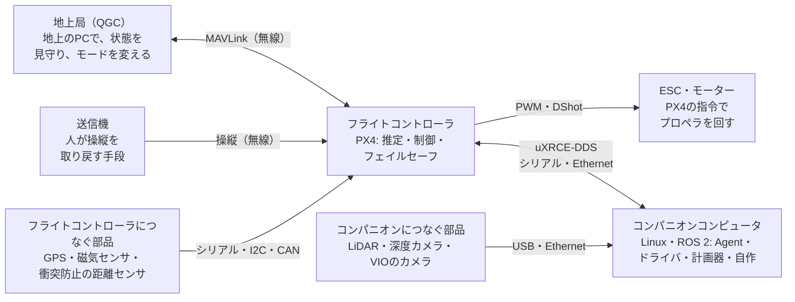

# 間章: シミュレーションから実機へ ― 製品化に向けた設計の考え方

[学習計画](learning_plan.md) の間章（任意の読み物）。[フェーズ6-2](phase6_2_replan_flight.md) の5節では、この教材の最終形を実機に移すとき、Gazeboから得ているデータがどこから来るか、動かすものをどこに置くか、PX4が気づかない止まり方は何かを見た。この章では、そこから一歩進めて、障害物を避けて飛ぶ機体を製品にするつもりで、センサの置き場所・安全の層・コンパニオンコンピュータのソフトウェア・試験の進め方を、どう考えて決めるかを整理する。

- 想定環境: 環境に依らない（読み物。コマンドは実行しない）
- 所要の目安: 1コマ
- 必須の範囲: なし（任意の章。読まなくても、教材はフェーズ6-2で一段落している）
- 前提: [フェーズ6-2](phase6_2_replan_flight.md) の5節まで。PX4の側の製品化の流れ（基板・機体の設定・調整・試験飛行）は、[間章（フライトコントローラ）](interlude_flight_controller.md) の3節で扱った。読んでいると分かりやすいが、前提にはしない
- 前提（親プロジェクト）: なし

> **この章の位置づけ**: 製品を開発するための手順書ではない。全体の見通しを付けるための読み物である。この教材では、実機の機体で試していない。PX4についての事実（衝突防止・オフボード制御・フェイルセーフ・uXRCE-DDS・コンパニオンコンピュータ・試験の手順）は、この教材で使うPX4 v1.17の公式の文書とソースに基づく。センサやコンパニオンコンピュータの製品の名前は、PX4の文書に載っているものと、一般的な例として挙げるもの（この教材では確かめていない）を書き分ける。設計の分け方や、見張りの作りなどの考え方は、筆者の整理で、公式の区分ではない。機体を飛ばす場所の法規・許可（日本なら航空法など）と、製品の認証・製造の品質管理は扱わない。国や用途によって違うので、それぞれの公式の情報で確かめる。細部が最新の公式の情報と食い違う場合は、公式を優先する。
>
> **期待する結果の出どころ**: このページには、コマンドを実行する手順が無いので、期待する結果も無い。

## 0. 学習目標と完了条件

この章を読み終えたら、次を自分の言葉で説明できる状態を目指す。

1. 実機の構成で、どの部品が、どこに、どの線でつながるかを説明できる（2節）。
2. センサを、フライトコントローラとコンパニオンコンピュータのどちらにつなぐかを、理由とともに決められる（3節）。
3. 自動で飛ぶ機体の安全を、外のプログラム・PX4・人の3つの層で考え、それぞれが受け持つことと、受け持てないことを説明できる（4節）。
4. コンパニオンコンピュータのソフトウェアを、実機で動かせる形に整えるときに決めることを挙げられる（5節）。
5. シミュレーションから実機の飛行まで、段階を分けて試す理由と、各段階で確かめることを説明できる（6節）。

**完了条件**: 9節の4つの問いに、答えを見ずに答えられる。

## 1. 机の上の成功から、空の上の成功へ

フェーズ6-2で、画面の中の機体は、新しい壁を見つけて経路を引き直し、回り込んで目的地に降りた。何度やり直しても、壊れるものは何も無い。PCの中では、ぶつかってもシミュレーションを起動し直せば元に戻る。

同じ仕組みを本物の機体に載せる日を想像してほしい。机の上には、フライトコントローラの基板と、手のひらほどのLinuxのコンピュータと、LiDARが並んでいる。線をどこにつなぐか、どのプログラムを、どの基板の上で動かすか。電源を入れたら、何が自動で立ち上がるべきか。飛んでいる最中に、LiDARのプログラムが止まったら、誰が気づいて、機体をどうするのか。プロペラが回る前に、何をどこまで確かめておけば安心か。

シミュレーションでは、こうした問いの多くを、Gazeboと1台のPCが黙って引き受けていた。実機では、これらを1つずつ、自分で決めることになる。この章では、その決め方の考え方を順に見ていく。ただし、シミュレーションを捨てるわけではない。ソフトウェアが未完成な段階の試し（PoC）や、実機で起きた不具合の切り分けには、この教材のシミュレーションの構成が、実機の後も役に立ち続ける（フェーズ6-2の5-4節）。

## 2. 実機の構成の例

自動で障害物を避けて飛ぶ機体の、よくある構成の例を図にする（筆者の整理。機体ごとに違う）。

同じ図（mermaid版）

図の中央と右の列が、機体に載る2つのコンピュータである。

- **フライトコントローラ**（中央の列）: PX4が、リアルタイムOS（決まった時間の中で処理を終えることを重視したOS）の上で、推定・制御・フェイルセーフを受け持つ（[フェーズ0](phase0_drone_px4.md) の3節）。加速度と角速度のセンサ（IMU）は、ふつう基板の上にある。GPS・磁気センサ・距離センサは、シリアル・I2C・CAN（どれも、部品どうしをつなぐ通信の方式。CANの上の規格がDroneCAN）の口につなぎ、PX4の中のドライバが読む。モーターへは、ESC（モーターの回転を電気で制御する部品）を通して、PWMやDShot（ESCへ回転の指令を送る信号の方式）で回転の指令を出す。
- **コンパニオンコンピュータ**（右の列）: Linuxの上で、ROS 2のノードを動かす。この教材のT3・T5・T6（Agent・計画器・`replan_flight`）と、T4の中継の代わりのドライバのノードが、ここに載る。LiDARやカメラは、USBかEthernetでつなぎ、そのドライバのノードが読む（フェーズ4の8節）。PX4の文書は、コンパニオンコンピュータを、計算の重い機能のための、機体に載せる別のコンピュータとして説明している。
- **2つのつなぎ方**: フライトコントローラとコンパニオンコンピュータの間は、uXRCE-DDS（この教材のAgentの道）で、速いシリアルかEthernetの線でつなぐ（フェーズ2の3節）。PX4の文書は、フライトコントローラがEthernetを持つなら、Ethernetを勧めている。
- **人の側**（左の列）: 地上局は、無線の通信機（テレメトリ）を通して、MAVLinkでPX4とやり取りする。PX4の文書によると、地上局やクラウドとの通信は、ふつうコンパニオンコンピュータを経由させる（MAVLink Router等の中継のプログラムを使う。図では、分かりやすさのために直接つないだ）。送信機は、人が操縦を取り戻すための、最後の手段である（4節）。

この図の中で、シミュレーションのときにGazeboと中継が代わりをしていたのは、上の段の2つの「つなぐ部品」と、下の段のESC・モーター、それに機体そのものである。データごとの対応は、フェーズ6-2の5-1節の表にまとめた。

## 3. センサの置き場所を決める

### 3-1. 決める観点

センサを、フライトコントローラとコンパニオンコンピュータのどちらにつなぐかは、次の観点で決める（筆者の整理）。

| 観点 | フライトコントローラに直接つなぐ | コンパニオンコンピュータにつなぐ |
|---|---|---|
| 遅れ | 小さい。PX4の文書によると、衝突防止では、直接つないだ距離センサの遅れを0とみなせる | 処理の分だけ大きい。同じ文書によると、外の画像の処理を通した値の遅れは、0.2秒にもなる |
| 相手が止まったとき | コンパニオンコンピュータが止まっても、PX4がセンサを読み続ける | コンパニオンコンピュータが止まると、値が途絶える |
| 扱える計算の重さ | 小さい。PX4の中のドライバと、決まった処理（衝突防止等）だけ | 大きい。地図づくり・経路の計画・画像の認識などのライブラリを使える |
| 使える仕組み | PX4の衝突防止・推定（下向きの距離センサで高さを測る等）。ただし、衝突防止はPosition mode（操縦桿の入力を加速度の目標にする方式）の中だけで働く（フェーズ5の1節と7節） | ROS 2の豊富なパッケージ（Nav2等）。PX4の推定や衝突防止に使わせるには、値をPX4へ渡す（3-3節） |
| 対応するセンサ | PX4がドライバを持つものに限る | Linuxで読めて、ROS 2のドライバのノードがあるもの |

### 3-2. よくある分け方

この観点から、次のように分けることが多い（筆者の整理）。

- **フライトコントローラへ**: 飛行そのものを支えるセンサと、計算の軽い最低限の安全のセンサ。GPS・磁気センサ、地面までの高さを測る下向きの距離センサ、手動の飛行のときの衝突防止に使う距離センサ。
- **コンパニオンコンピュータへ**: 計算の重いセンサ。経路の計画に使うLiDAR、深度カメラ（画素ごとの距離を測るカメラ）、VIO（カメラと慣性センサで位置を推定する方法）に使うカメラ。

1つのセンサは、ふつう、どちらか一方に直接つなぐ。シミュレーションでは、GazeboのLiDARの値が、PX4とROS 2の両方に配られていたが、実機では、それぞれに別のセンサを付けるか、一方で読んだ値を他方へ通信で渡す（3-3節）ことになる（フェーズ5の7節）。

製品の例を挙げておく。フライトコントローラにつなぐ距離センサでは、PX4 v1.17のソースの `src/drivers/distance_sensor/` に、LightWareの製品（衝突防止にそのまま使える回転式のSF45、ほかの距離計）、Benewakeの TFmini、STの VL53L1X などのドライバがある。コンパニオンコンピュータにつなぐセンサでは、2DのLiDARのSlamtecのRPLIDAR（ドライバのノードは `sllidar_ros2`）や北陽電機の測域センサ（`urg_node`）、深度カメラのIntel RealSense（`realsense-ros`）、3次元のLiDARのLivoxの製品などが、ROS 2で使われる例としてよく知られている（コンパニオンコンピュータの側の例は、この教材では確かめていない）。

どちらにつなぐ場合も、2DのLiDARが、センサの高さの面しか測らないこと（フェーズ4の2-1節）と、機体が傾くと測る面も傾くこと（フェーズ4の7節）は変わらない。面の上や下の障害物（電線・木の枝・低い台）を見る必要があるなら、3次元のLiDARや深度カメラを足す。

### 3-3. コンパニオンコンピュータから、PX4へ値を渡す

コンパニオンコンピュータで読んだり計算したりした値を、PX4の機能に使わせる道もある。uXRCE-DDSの `/fmu/in/` のトピックで、障害物までの区画ごとの距離（`/fmu/in/obstacle_distance`。衝突防止に使う）や、カメラなどで推定した機体の位置（`/fmu/in/vehicle_visual_odometry`。推定に使う）を渡せる（トピックの一覧は、[間章（フライトコントローラ）](interlude_flight_controller.md) の5-2節）。設計で押さえておきたいのは、この道の次の注意である。

- **試験の状況**: PX4の文書の衝突防止のページは、コンパニオンコンピュータから障害物の距離を渡す方法について、「今は試験されていない」と書いている。使うなら、自分の機体で、シミュレーションから順に確かめ直す前提になる。
- **遅れ**: 外の処理を通した値は、直接つないだセンサより遅れる（3-1節）。衝突防止には、その遅れをパラメータ `CP_DELAY` で教える。
- **相手が止まったとき**: コンパニオンコンピュータが止まると、値も途絶える。衝突防止は、距離の値が0.5秒届かないと水平の動きを止める（フェーズ5の7節）。
- **GPSの代わりの位置**: 屋内でVIOを使う場合は、PX4の文書のVIOのページに、推定の設定（`EKF2_EV_CTRL` 等）と、カメラを振動から守る取り付け方の注意がある。

反対の向き、つまり、フライトコントローラにつないだ距離センサの値を、ROS 2の側の計画に使う道も考えられる。ただし、PX4 v1.17の `dds_topics.yaml` の既定の一覧には、PX4からROS 2へ距離を出すトピック（`/fmu/out/obstacle_distance` や `/fmu/out/distance_sensor`）が無い。使うには、`dds_topics.yaml` にトピックを足して、PX4をビルドし直すことになる（変える場所と、実機向けのビルドの流れは、[間章（実機向けのファームウェアのビルド）](interlude_firmware_build.md) の5節。[間章（フライトコントローラ）](interlude_flight_controller.md) の4節の【D】の層の変更で、PX4の版を上げるたびに保守が要る）。また、PX4の中の障害物の距離は、5°ごとの区画にまとめた値（フェーズ4の2-1節）なので、`LaserScan` の約0.25°ごとの点と比べると粗く、地図づくりに使うには、区画の値を `LaserScan` などの形に直すノードも要る（この道は、この教材では確かめていない）。

### 3-4. コンパニオンコンピュータを選ぶ

PX4の文書は、コンパニオンコンピュータの例として、小さく電力の小さいものにRaspberry Piを、大きく計算の力の強いものに、NVIDIAのJetson・ModalAIのVOXL 2・NXPのNavQPlus・IntelのNUCなどを挙げている。Pixhawk（フライトコントローラの基板の規格）に合うフライトコントローラを差し込める台の基板（Holybroの Pixhawk Jetson Baseboard・Pixhawk RPi CM4 Baseboard、ARKの Jetson PAB Carrier）もあり、配線と準備が楽になる。選ぶときは、費用・重さ・消費電力・準備のしやすさ・要る計算の力を比べる、と同じ文書は書いている。

この教材の構成なら、計画器（Nav2の地図と計画）と、LiDARのドライバのノードと、Agentを、同時に動かせる計算の力が要る。どれだけ要るかは、計画の周期・地図の大きさ・センサの点の数で変わるので、候補の基板の上で、実際に動かして、計算の負荷と、計画にかかる時間（フェーズ6-2の6節の課題4の `planning_time`）を測ってから決める。

## 4. 安全の層を設計する

### 4-1. 3つの層

自動で飛ぶ機体の安全は、1か所に任せず、層を重ねて考える。この教材の構成に当てはめると、次の3つの層になる（筆者の整理）。

| 層 | 受け持つこと | 受け持てないこと |
|---|---|---|
| ①外のプログラム（コンパニオンコンピュータ） | 障害物を見つけて避ける（フェーズ6）。自分の入力（センサの値・経路・位置）が新しいかを見張り、おかしければ止まる（4-2節） | 自分自身が止まったときのこと。コンパニオンコンピュータの電源や、OSの異常 |
| ②PX4（フライトコントローラ） | オフボード制御の合図が途切れたときのフェイルセーフ（フェーズ3の2節）。電池・通信の途絶・ジオフェンス（決めた範囲から出た）などのフェイルセーフ（フェーズ0の9-2節）。Position mode（操縦桿の入力を加速度の目標にする方式）の中での衝突防止（フェーズ5） | 合図が届いている間の、目標の中身の正しさ。オフボード制御の間の障害物（衝突防止が働かない） |
| ③人（送信機・地上局） | 送信機のスイッチや地上局で、モードを切り替えて取り戻す。最後の手段としてのキルスイッチ（すべてのモーターをすぐ止める。飛んでいれば機体は落ちる） | 人が気づくまでの時間。目の届かない距離 |

②の「受け持てないこと」が、フェーズ6-2の5-3節で見た弱点である。PX4は、オフボード制御の合図が届いている限り、送られてくる目標を信じて飛ぶ。そして、オフボード制御の間は、組み込みの衝突防止が働かない。そのため、①の外のプログラムが、自分で自分の異常に気づく作りが要る。

③については、PX4の設定を確かめておく。送信機のスティックを動かすとPosition modeに移る設定（`COM_RC_OVERRIDE`）は、PX4の文書によると、Offboardのモードでは既定で無効である。オフボード制御が途切れたときの動作（`COM_OBL_RC_ACT`。PX4 v1.17のソースでは、Position・Altitude・Stabilized・Return・Land・Hold・Terminate・Disarmの8つの値がある）と、途切れたとみなすまでの時間（`COM_OF_LOSS_T`）も、運用に合わせて決める。

### 4-2. 外のプログラムの見張り

①の見張りは、たとえば次のように作る（筆者の整理）。

- **入力の新しさ**: `/scan`・経路・PX4の位置を最後に受け取った時刻を覚え、決めた時間（センサの周期の数倍など）より古くなったら、異常とみなす。フェーズ6-2の6節の課題6で、`/scan` の見張りを足す。
- **出す目標の確からしさ**: 今の位置から遠すぎる目標、決めた高さや範囲の外の目標を出さない。経路が無いときは、その場で止まる（`replan_flight` の `choose_target` は、経路が無いと、その場で止まる作りになっている）。
- **異常のときの動き**: その場で止まる目標を出したうえで、PX4に着陸を指示する（フェーズ3の2節の `VEHICLE_CMD_NAV_LAND`）。その場で待たせたいなら、Holdのモードへの切り替え（`VEHICLE_CMD_DO_SET_MODE` で、モードの番号を指定する）を使う手もある（この教材では試していない）。プログラムが自分で止まり続けるより、PX4の中のモードに任せた方が、プログラム自身の不具合の影響を受けにくい。
- **人の操作とぶつからない**: 人がモードを切り替えたら、プログラムは指令を出すのをやめる（`replan_flight` は、Offboardから別のモードに移ったら終わる作りになっている）。

Nav2の地図にも、センサの値が届く間隔を見張る設定（`expected_update_rate`）がある。ただし、この教材では使っておらず、値が届かなくなったときの計画器の動きは確かめていない。

### 4-3. 外部のモードという選択肢

この教材では、オフボード制御（PX4のOffboardのモードの中身を、外のプログラムが決める形）を使った。PX4には、ROS 2で作ったモードを、PX4の飛行モードの1つとして登録する仕組み（PX4 ROS 2 Interface Library の外部のモード）もある。外部のモードは、PX4のアームの条件やフェイルセーフと連動し、選ばれている間にモードのプログラムが止まったり応答しなくなったりすると、PX4のフェイルセーフが働き、PX4の中のモードに移る（PX4の文書の [PX4 ROS 2 Control Interface](https://github.com/PX4/PX4-Autopilot/blob/release/1.17/docs/en/ros2/px4_ros2_control_interface.md) と [Flight Modes](https://github.com/PX4/PX4-Autopilot/blob/release/1.17/docs/en/concept/flight_modes.md) のページ。間章（フライトコントローラ）の5-3節の「止まってもPX4の中のモードに戻れる」と同じことである）。地上局から名前で選べ、どのプログラムが機体を制御しているかがはっきりする点が、オフボード制御との違いである。ただし、プログラムが動き続けたまま、入力が古くなっている場合（フェーズ6-2の5-3節）に気づかないのは、オフボード制御と同じで、4-2節の見張りは、どちらの形でも要る（筆者の整理）。オフボード制御との詳しい比べ方と、使うときの制約（試験的な仕組みであること等）は、[間章（フライトコントローラ）](interlude_flight_controller.md) の5-3節にある。

## 5. コンパニオンコンピュータのソフトウェアを整える

フェーズ6-2では、8つのターミナルを開き、手で1つずつ起動した。実機では、電源を入れたら、決まった順に、決まった設定で立ち上がる必要がある。決めることを、項目ごとに挙げる（設計の考え方は筆者の整理で、ROS 2とLinuxの一般的な道具を使う）。

| 項目 | 決めること | この教材での入り口 |
|---|---|---|
| 起動の自動化 | 起動の順番（Agent → ドライバ → 計画器 → 自作のノード）と、計画器の有効化（自作のノードが `map` → `base_link` のTFを送り始めてから行う。フェーズ6-2の「つまずきやすい点」の、有効化で止まる場合）を、launchのファイルとNav2のライフサイクルの管理の部品（`lifecycle_manager`）でまとめる。コンパニオンコンピュータの電源を入れたら、OSの仕組み（Linuxのsystemd等）で自動で起動させる | フェーズ6-2の6節の課題5 |
| シミュレーションと実機の切り替え | トピックの名前・座標系の名前・取り付けの位置などをROS 2のパラメータにし、シミュレーション用と実機用のlaunchのファイルの違いを、中継とドライバのノードの差し替えだけにする | フェーズ6-1の4-3節の終わり |
| つなぎ方 | Agentの起動の形（シリアルなら口の名前と速さ、Ethernetならポート）と、PX4の側の設定（`UXRCE_DDS_CFG` 等）。DDSのドメインの番号（PX4の `UXRCE_DDS_DOM_ID` と、ROS 2の `ROS_DOMAIN_ID`）をそろえる | フェーズ2の3節 |
| 地上との通信 | 地上のPCでRViz2を見るなら、無線のLANの上でROS 2の通信が届く範囲と量を考える。届かせなくてよいトピックは、機体の中に閉じる（ROS 2 Jazzyの `ROS_AUTOMATIC_DISCOVERY_RANGE` 等） | なし（この教材では扱っていない） |
| 記録 | PX4の飛行のログ（ULog。SDカードに記録される）と、ROS 2の記録（rosbag2。`ros2 bag record`）を、両方残す。rosbag2に記録した `/fmu/out/` の `timestamp` は、Agentの動くコンピュータ（実機ではコンパニオンコンピュータ）の時刻に直されている（フェーズ2の4-2節）。ULogの時刻は起動からの時間のままなので、ULogに記録される時刻合わせの状態（`timesync_status`）のずれを使って合わせる（この教材では確かめていない） | フェーズ2の4-2節（時刻の直し方） |
| 版の固定 | PX4・`px4_msgs`・ROS 2のディストリビューション・Nav2の版を決めて固定する。PX4の版を上げるときは、`px4_msgs` も合わせ、シミュレーションで確かめ直す | 間章（フライトコントローラ）の3-2節の【8】 |

上の表の「地上との通信」の行は、この教材で扱っていない範囲が大きい。無線の通信は、途切れることを前提にする。機体の安全に要るやり取り（オフボード制御の合図など）は、機体の中のコンパニオンコンピュータとフライトコントローラの間だけで完結させ、地上との無線には頼らない作りにする（筆者の整理）。

## 6. 段階を分けて試す

実機の試験は、一度に全部を試さず、段階を分ける。前の段階で確かめたことを土台にし、問題が出たら、1つ前の段階に戻って原因を探す（筆者の整理。PX4の文書の試験の手順も参考にした）。

| 段階 | 確かめること | 次へ進む目安 |
|---|---|---|
| 【1】シミュレーション | 自作の部分の動き。フェイルセーフの応答（フェーズ6-2の6節の課題6のように、部品を止めて何が起きるか）。見張りの働き | 決めた止まり方を、すべて試した |
| 【2】机の上（プロペラを外す） | 配線と電源。ドライバの値（RViz2で `/scan` の形と向き）。座標系の向き（機体を手で回し、表示が同じ向きに回るか）。Agentのつながりと時刻合わせ（`/fmu/out/timesync_status`）。電源を入れたときの自動の起動 | 電源を入れるだけで、すべてが決まった状態になる |
| 【3】手動の飛行 | 送信機で、Position modeなどの手動のモードで飛ばす。機体の調整（間章（フライトコントローラ）の3-2節の【5】）。衝突防止を使うなら、フェーズ5と同じことを、壁の代わりの柔らかい目標で試す | 手動で安定して飛び、いつでも降ろせる |
| 【4】低く、広い場所でのオフボード | 障害物の無い広い場所で、低い高さで、自作のノードで飛ばす。送信機を持つ人が控え、取り戻す手順（モードの切り替え・キルスイッチ）を先に練習しておく。ジオフェンスを狭く設定する | 自作のノードで離陸・移動・着陸ができ、取り戻しも確かめた |
| 【5】フェイルセーフの試験 | 送信機の途絶・通信の途絶・電池の低下（PX4の試験の手順のMC_04）。自作の部分の止まり方（ノードを止める、LiDARの線を抜く） | 決めたとおりに止まる・帰る・降りる |
| 【6】障害物のある飛行 | 柔らかい障害物から始め、経路が引き直されるか、どれだけ離れて回るかを見る。ログ（ULogとrosbag2）で、シミュレーションとの違いを見比べる | 決めた条件で、繰り返し成功する |

PX4の文書は、試験の飛行の手順（テストカード）を用意している。手動のモード（MC_01）、自動の飛行（MC_02）、自動と手動の混在（MC_03）、フェイルセーフ（MC_04）、手動のモードでの屋内の飛行（MC_05）、オプティカルフロー（カメラで地面の動きを見て、速さを推定する方法）での飛行（MC_06）、VIO（MC_09）などがあり、どの段階で何を確かめるかの参考になる。

どの段階でも、シミュレーションに戻れることが強みになる。実機で起きた不具合を、ログを手がかりにシミュレーションで再現できれば、機体を壊さずに、何度でも直して試せる。

## 7. この教材の構成から始めるなら

この教材の最終形を出発点にするなら、次の順に進めるのが、移しやすい（筆者の整理）。各段落の詳しい中身は、括弧の中の節にある。

1. **シミュレーションのうちに、実機に移しやすい形にする**: `replan_flight` のGazeboに合わせた値をパラメータにし（フェーズ6-1の4-3節）、入力の見張りを足す（4-2節、フェーズ6-2の6節の課題6）。起動をlaunchのファイルとライフサイクルの管理の部品でまとめる（フェーズ6-2の6節の課題5）。
2. **構成を決める**: センサの置き場所（3節）と、コンパニオンコンピュータ（3-4節）を決める。フェーズ6-2の5-1節の表の「実機での出どころ」の列が、そろえる部品の一覧になる。
3. **PX4の側を整える**: 基板を選び、機体の設定と調整を行う（間章（フライトコントローラ）の3節）。オフボード制御が途切れたときの動作など、4-1節の設定を決める。
4. **差し替えて、段階を追って試す**: 中継をドライバのノードに差し替え（フェーズ6-2の5-2節）、6節の【2】から順に試す。

## 8. まとめ

- 実機では、フライトコントローラ（PX4）とコンパニオンコンピュータ（Linux・ROS 2）が、uXRCE-DDSでつながる。シミュレーションでGazeboと中継が代わりをしていた部分が、本物の部品とドライバになる（2節）。
- センサは、遅れ・相手が止まったときに働くか・計算の重さで、置き場所を決める。飛行を支える最低限のセンサはフライトコントローラへ、計算の重いセンサはコンパニオンコンピュータへ、が多い（3節）。
- 自動で飛ぶ間は、PX4の組み込みの衝突防止が働かず、PX4は合図が届く限り目標を信じる。外のプログラム・PX4・人の3つの層で安全を考え、外のプログラムには、自分の入力を見張る作りを足す（4節）。
- コンパニオンコンピュータでは、起動の自動化・シミュレーションと実機の切り替え・つなぎ方・記録・版の固定を決める（5節）。
- 実機の試験は、シミュレーション → 机の上 → 手動の飛行 → 低いオフボード → フェイルセーフ → 障害物、と段階を分け、問題が出たら前の段階とシミュレーションに戻る（6節）。

## 9. 確かめの問い

答えを見ずに、自分の言葉で答えてから開く。

**問い1**: 2DのLiDARを1つだけ載せる機体で、フェーズ6のような自動の回避と、手動で飛ばすときのPX4の衝突防止の両方を使いたい。LiDARをどちらにつなぎ、もう一方へはどうやって値を届けるか。そのとき、どんな注意があるか。

答え

1つのセンサは、ふつう一方に直接つなぐ（3-2節）。経路の計画に使うなら、コンパニオンコンピュータにつなぎ、ROS 2のドライバのノードで `/scan` を出す。PX4の衝突防止へは、コンパニオンコンピュータで区画ごとの距離に直し、`/fmu/in/obstacle_distance` で渡す道がある（3-3節）。ただし、PX4の文書は、コンパニオンコンピュータから渡す方法を「今は試験されていない」としているので、自分の機体で、シミュレーションから確かめ直す必要がある。また、この形では、コンパニオンコンピュータが止まると、衝突防止の値も途絶える（PX4は、値が途絶えると水平の動きを止める。フェーズ5の7節）。遅れも、直接つなぐより大きくなる（3-1節）。反対に、LiDARをフライトコントローラにつなぐ形では、衝突防止はPX4だけで動くが、ROS 2の側へ距離を出すトピックが既定の一覧に無いので、`dds_topics.yaml` に足してPX4をビルドし直す必要があり、届く値も5°ごとの区画で粗い（3-3節）。どちらの形にも弱みがあるので、手動の飛行の衝突防止を確実にしたいなら、フライトコントローラに別の距離センサを足すのがすっきりする。

**問い2**: 飛行中に、LiDARのドライバのノードだけが止まった。この教材の `replan_flight` のままだと、何が起き、PX4はどう反応するか。どの層で、どう防ぐか。

答え

地図に新しい障害物が書き込まれなくなり、計画器は古い地図で経路を引き続ける。`replan_flight` は合図を送り続けるので、PX4はオフボード制御が続いているとみなし、フェイルセーフに移らない（フェーズ6-2の5-3節）。オフボード制御の間は、組み込みの衝突防止も働かない（フェーズ6-2の5-3節）。防ぐのは①の外のプログラムの層で、`/scan` を最後に受け取った時刻を見張り、古くなったら、その場で止まり、PX4に着陸（Land）を指示する（Holdへの切り替えは、4-2節の別案）（4-2節）。最後の手段として、③の人が送信機でモードを切り替えられるようにしておく（4-1節）。

**問い3**: シミュレーションでは問題なく回り込めたのに、実機の机の上の試験で、RViz2の壁の点が、機体の左右で反対に表示された。どこを疑うか。

答え

LiDARの取り付けの向きと、座標系の設定を疑う。シミュレーションでは、LiDARの位置と向きが模型のファイルで決まっていたが、実機では、取り付けを測ってTF（`replan_flight` の `LIDAR_OFFSET` と `send_lidar_tf`）に書き、座標系の名前をドライバのノードの設定に合わせる（フェーズ4の8節、フェーズ6-1の4-3節）。センサが逆さまに付いている場合や、ドライバの角度の向きの決まりが違う場合も、左右が反対になる。机の上の段階（6節の【2】）で、機体を手で回して、表示が同じ向きに回るかを確かめておく。

**問い4**: 実機の試験で、最初から障害物のある場所で、自作のノードで飛ばしてはいけないのはなぜか。

答え

問題が出たときに、原因が、配線・ドライバ・座標系・機体の調整・自作のノード・障害物の見え方のどれにあるかを切り分けられないからである。段階を分ければ、前の段階で確かめたことを土台にして、新しく足したことだけを疑える。また、取り戻す手順やフェイルセーフを確かめる前に自動で飛ばすと、問題が起きたときに、機体を安全に止められない（6節）。

## 10. 用語集

この章で新しく出てきた用語を、英字で始まる用語をアルファベット順に、続けてそのほかの用語を50音順にまとめた。フェーズ0の用語（コンパニオンコンピュータ・ドライバ・フェイルセーフ等）は、[フェーズ0の12節](phase0_drone_px4.md#12-用語集) にある。

| 用語 | 意味 | 節 |
|---|---|---|
| DroneCAN | CANの上で、ESCやセンサとやり取りする規格 | 2 |
| ESC | モーターの回転を電気で制御する部品 | 2 |
| I2C・CAN | 部品どうしをつなぐ通信の方式 | 2 |
| IMU | 加速度と角速度を測るセンサ | 2 |
| Pixhawk | フライトコントローラの基板の規格 | 3-4 |
| PoC | 考えが実現できるかを、早い段階で試すこと（Proof of Concept） | 1 |
| PWM・DShot | ESCへ回転の指令を送る信号の方式 | 2 |
| rosbag2 | ROS 2のトピックの値を記録し、後で再生する仕組み（`ros2 bag`） | 5 |
| ULog | PX4の飛行のログの形式 | 5 |
| VIO | カメラの映像と慣性センサから、機体の位置と速度を推定する方法 | 3-2 |
| オプティカルフロー | カメラで地面の動きを見て、機体の速さを推定する方法 | 6 |
| キルスイッチ | すべてのモーターの出力をすぐ止める、送信機のスイッチ | 4-1 |
| 深度カメラ | 画素ごとに、物までの距離を測るカメラ | 3-2 |
| テストカード | PX4の文書が用意している、試験の飛行の手順 | 6 |
| テレメトリ | 機体と地上の間で、状態や指示をやり取りする無線の通信（とその機器） | 2 |
| リアルタイムOS | 決まった時間の中で処理を終えることを重視したOS | 2 |

## 次へ

学習計画（[`docs/learning_plan.md`](learning_plan.md)）に戻る。PX4の側の製品化の流れを詳しく見たい場合は、[間章（フライトコントローラ）](interlude_flight_controller.md) の3節と4節を読む。

## 出典

このページの技術的な記述は、次の文書とファイル（PX4 v1.17の版）を読んで、自分の言葉でまとめたもの（逐語の転載ではない）。PX4の文書（PX4 User Guide）のライセンスは [CC BY 4.0](https://creativecommons.org/licenses/by/4.0/)（Dronecode/PX4）である。

- PX4 User Guide（v1.17）
  - 構成とコンパニオンコンピュータ（2節・3-4節）: [Companion Computers](https://github.com/PX4/PX4-Autopilot/blob/release/1.17/docs/en/companion_computer/index.md)、[uXRCE-DDS](https://github.com/PX4/PX4-Autopilot/blob/release/1.17/docs/en/middleware/uxrce_dds.md)
  - センサの置き場所（3節）: [Collision Prevention](https://github.com/PX4/PX4-Autopilot/blob/release/1.17/docs/en/computer_vision/collision_prevention.md)（対応する距離センサ・遅れ・コンパニオンコンピュータから渡す方法）、[Visual Inertial Odometry](https://github.com/PX4/PX4-Autopilot/blob/release/1.17/docs/en/computer_vision/visual_inertial_odometry.md)
  - 外部のモード（4-3節）: [PX4 ROS 2 Control Interface](https://github.com/PX4/PX4-Autopilot/blob/release/1.17/docs/en/ros2/px4_ros2_control_interface.md)、[Flight Modes](https://github.com/PX4/PX4-Autopilot/blob/release/1.17/docs/en/concept/flight_modes.md)（中と外のモード）
  - 安全の層（4節）: [Offboard Mode](https://github.com/PX4/PX4-Autopilot/blob/release/1.17/docs/en/flight_modes/offboard.md)（合図・`COM_OF_LOSS_T`・`COM_OBL_RC_ACT`・`COM_RC_OVERRIDE`）、[Safety Configuration](https://github.com/PX4/PX4-Autopilot/blob/release/1.17/docs/en/config/safety.md)（キルスイッチ・ジオフェンス）
  - 試験（6節）: [Test Flights](https://github.com/PX4/PX4-Autopilot/blob/release/1.17/docs/en/test_and_ci/test_flights.md)、[MC_04 - Failsafe Testing](https://github.com/PX4/PX4-Autopilot/blob/release/1.17/docs/en/test_cards/mc_04_failsafe_testing.md)
- PX4 v1.17のソース（作成に使った環境に取得したもの）
  - 距離センサのドライバ（3-2節）: [`src/drivers/distance_sensor`](https://github.com/PX4/PX4-Autopilot/tree/release/1.17/src/drivers/distance_sensor)
  - ROS 2とPX4の間で値を渡すトピック（3-3節。`/fmu/out/obstacle_distance` と `/fmu/out/distance_sensor` が既定の一覧に無いことも、このファイルで確かめた）: [`src/modules/uxrce_dds_client/dds_topics.yaml`](https://github.com/PX4/PX4-Autopilot/blob/release/1.17/src/modules/uxrce_dds_client/dds_topics.yaml)
- Nav2の `expected_update_rate`（4-2節）: [Nav2](https://github.com/ros-navigation/navigation2)（`jazzy`、Apache License 2.0）の `nav2_costmap_2d` の `observation_buffer.hpp` で名前を確かめた。
- コンパニオンコンピュータにつなぐセンサとドライバのノードの例（3-2節）、起動の自動化・記録・地上との通信の道具（5節）は、一般に知られている情報を、筆者の言葉でまとめたもの（この教材では確かめていない）。
- 2節の構成、3-1節の観点、4節の層と見張り、5節の項目、6節の段階、7節の順番は、PX4の文書の記述を元にした筆者の整理である。
- 図（`img/interlude_s2r_system.svg`）は、この教材で作ったもの。
