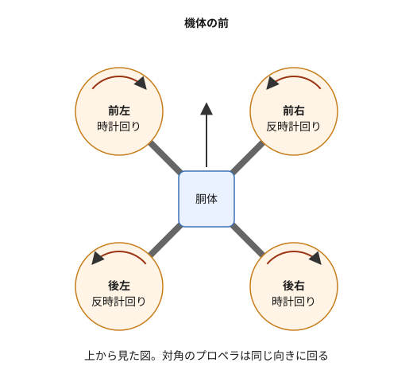
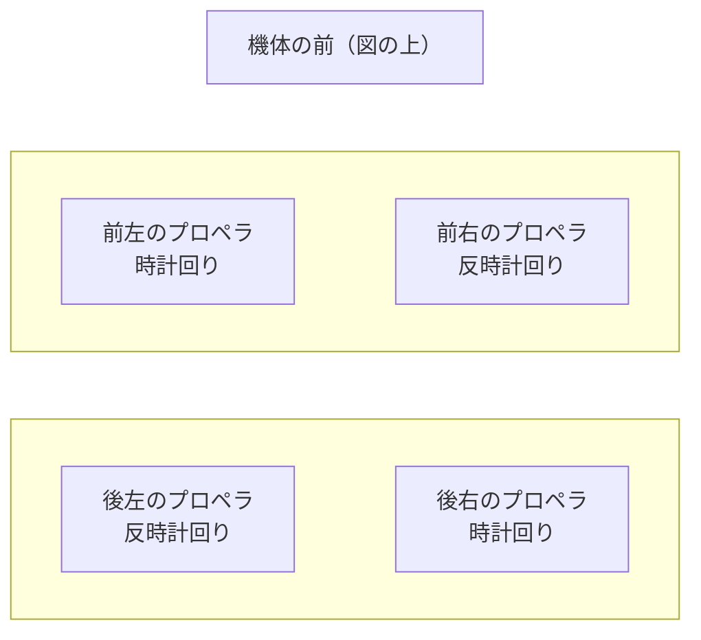
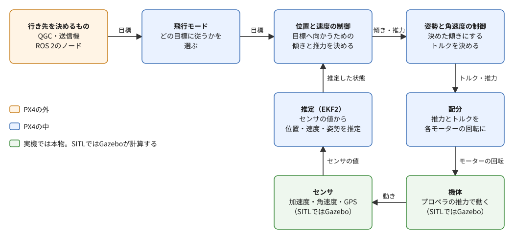
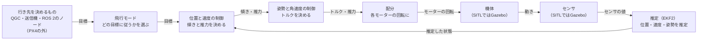
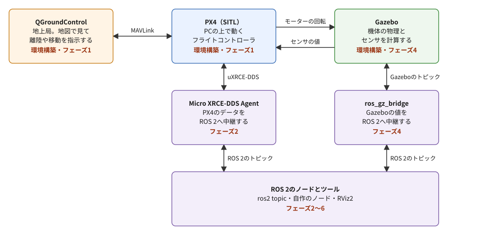
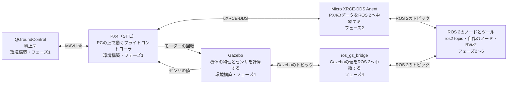
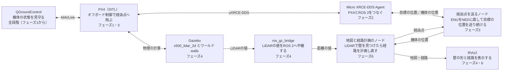

# フェーズ0: ドローンとPX4の用語と仕組み

[学習計画](learning_plan.md) のフェーズ1（PX4とGazeboで、ドローンを離陸・移動・着陸させる）に入る前の読み物。コマンドは実行せず、マルチコプターが飛ぶ仕組み、PX4が機体の中で何をしているか、飛行モード、PX4とほかのソフトウェアのつながり方、座標系、安全の仕組みを、先につかんでおく。前半の1〜9節がドローンとPX4そのものの話（ところどころに、この教材のどこで出会うかを添えた）、後半の10節がこの教材の完成形の話である。ここで覚えた用語は、フェーズ1以降のすべての手順書で、説明なしに使う。

- 想定環境: 環境に依らない（環境構築の前でも読める）。環境構築の6節で、PX4のシミュレーションとQGroundControlを一度動かした後だと、実感しやすい
- 所要の目安: 1コマ（読み物。手を動かす作業は無い）
- 必須の範囲: すべて

> **このページの位置づけ**: 目的は知識の地図を作ることで、完了条件は「コマンドが動く」ではなく「自分の言葉で説明できる」である。文章は自分の言葉で書いたが、PX4の事実関係（飛行モードの動き、アームの条件、フェイルセーフ、座標系、通信のポート等）は、この教材で使うPX4 v1.17の公式の文書に基づく。プロペラの回転の向きと、Gazeboの座標からPX4の座標への変換は、PX4 v1.17に付属する機体の模型とソースで確かめた。細部が最新の公式の情報と食い違う場合は、公式を優先する。
>
> **期待する結果の出どころ**: このページには、コマンドを実行する手順が無いので、期待する結果も無い。

## 0. 学習目標と完了条件

このページを読み終えたら、次を自分の言葉で説明できる状態を目指す。

1. マルチコプターが、4つのプロペラの回転の速さを変えるだけで、上昇・前進・横移動・向きの変更をする仕組み（2節）。
2. フライトコントローラとPX4の役割と、PX4の中で、目標から各モーターの回転までがどう流れるか（3節）。
3. 機体の中の制御（PX4）と、機体の外の知能（地上局やROS 2のノード）の分担（1節・3-3節）。
4. SITL（PX4をPCの上で動かすシミュレーション）で、PX4・Gazebo・QGroundControl・ROS 2がどうつながるか（4節・6節・7節）。
5. アームの意味と、主な飛行モード（Position・Hold・Takeoff・Land・Return・Offboard）の違い（5節）。
6. PX4の座標系（NED・FRD）と、ROS 2の座標系（ENU・FLU）の違いと、同じ位置の書き方の違い（8節）。
7. アームの条件とフェイルセーフが、何を守るためにあるか（9節）。
8. この教材の最終ゴールの構成で、どの部品をどのフェーズで学ぶか（10節）。

**完了条件**: 11節の4つの問いに、答えを見ずに答えられる。

## 1. 全体像: 機体の中の制御と、外の知能

風の吹く公園で、ドローンが空中の一点に止まっている様子を思い浮かべてほしい。見た目は静かだが、機体の中では、1秒間に何百回も「少し右に傾いた」「風で少し流された」を測っては、4つのモーターの回転の速さを細かく直し続けている。人が**送信機**（手に持つ無線の操縦機。2本のスティックで機体を操る）のスティックを離しても機体がその場に止まっていられるのは、この細かな調整を、機体に載ったソフトウェアと小さなコンピュータが肩代わりしているからである。この教材では、これをまとめて**フライトコントローラ**と呼ぶ（3-1節で、PX4の文書での呼び分けを見る）。この教材では、オープンソースのフライトコントローラのソフトウェアの**PX4**を使う。

一方、「どこへ飛ぶか」「壁があるからどの道を通るか」を決めるのは、別の仕事である。地図を見て行き先を指す地上の人や、カメラやLiDAR（レーザーで周りの物までの距離を測るセンサ）の値から障害物を見つけて道を選ぶプログラムがその役を担う。実際のドローンの開発でも、姿勢を保つような速くて間違えられない仕事は、実績のあるフライトコントローラに任せ、その外側で、行き先を決める知能を作る分担がよく取られる（親プロジェクトの [フェーズ0](https://github.com/SanghunIm1991/ros2MinimalPhysicalAi/blob/main/docs/phase0_overview.md) の4-4節でも、この分担を紹介している。参考）。

この教材は、この分担に沿って進む。フェーズ1では、行き先を地上局のソフトウェアのQGroundControl（QGC。6節）の地図の上で人が指す。フェーズ3では、行き先をROS 2のノード（ROS 2の上で動く、1つの役割を持ったプログラム）から送る。フェーズ6では、ROS 2のノードが、LiDARで見つけた壁を避ける道を自分で計画し直して、行き先を送る。どの段階でも、機体を傾けて飛ばす仕事はPX4が受け持ち、自分で書くのは「外の知能」の側だけである。

このページでは、まず機体の中を見る（2節で飛ぶ仕組み、3節でPX4の中の流れ）。次に、PCの上でPX4を動かすSITLと、外とのつながり方を見る（4節でSITL、5節で飛行モード、6節で地上局、7節でROS 2とのつながり）。最後に、座標系と安全の仕組み（8・9節）と、この教材の完成形（10節）を見る。

## 2. マルチコプターが飛ぶ仕組み

### 2-1. 推力と重さ

プロペラ（回転翼）は、回ると空気を下へ押し下げ、その反動で上向きの力を受ける。この力を**推力**と呼ぶ。推力は、回転が速いほど大きい。4つのプロペラの推力の合計が、機体の重さとちょうど釣り合うと、機体は空中で止まって浮かぶ（この状態を**ホバリング**と呼ぶ）。合計を重さより大きくすると上昇し、小さくすると下降する。

プロペラを複数持つ回転翼の機体を**マルチコプター**と呼び、プロペラが4つのものを**クアッドコプター**と呼ぶ。この教材で使うPX4のシミュレーションの機体 `x500` は、クアッドコプターである。

### 2-2. プロペラの配置と回転の向き

`x500` のプロペラは、上から見て、前後の軸から斜め45°の4か所（前左・前右・後左・後右）にある。この並びを**クアッドX**と呼ぶ（「X」の字の先にプロペラがあるため）。

同じ図（mermaid版）

（上から見た図。対角のプロペラは同じ向きに回る）

回転の向きが2つずつ逆なのには理由がある。プロペラを回すと、その反動で、機体は逆の向きに回されようとする（モーターが空気をかき回す力の反作用）。4つが同じ向きに回ると、機体はその場でくるくる回ってしまう。対角の2つずつを逆向きに回すと、この反動が打ち消し合い、機体の向きが保たれる。図の向きは、PX4 v1.17に付属するGazeboの `x500` の模型の設定で確かめたものである。

### 2-3. 回転の速さを変えて動く

マルチコプターには、飛行機のような舵（かじ）が無い。動きはすべて、4つのプロペラの回転の速さの組み合わせで作る。

| 動き | 回転の速さの変え方 | 何が起きるか |
|---|---|---|
| 上昇・下降 | 4つとも同じだけ速く（遅く）する | 推力の合計が重さより大きく（小さく）なる |
| 前へ進む | 後ろの2つを速く、前の2つを遅くする | 機首が下がるように傾き、推力が斜め前を向く（プロペラは空気を斜め後ろへ押す）。推力の前向きの成分で、機体は前へ進む |
| 右へ進む | 左の2つを速く、右の2つを遅くする | 右側が下がるように傾き、右へ進む |
| 右へ向きを変える（上から見て時計回り） | 反時計回りの2つ（前右・後左）を速く、時計回りの2つ（前左・後右）を遅くする | 反動の釣り合いが崩れ、機体は、速くした2つの回転と逆の向き（時計回り）に回る。推力の合計は保つ |

機体の傾きと向きには、決まった呼び名がある。機首を上げ下げする回転を**ピッチ**、左右に傾ける回転を**ロール**、上から見て向きを変える回転を**ヨー**と呼ぶ。ロール・ピッチ・ヨーの角度をまとめて、機体の**姿勢**と呼ぶ。

表の2〜3行目のとおり、マルチコプターは、**横へ進むために、まず傾く**。前へ速く進むほど、大きく前に傾く。止まるときは、逆に傾けてブレーキをかける。

### 2-4. 人の手だけでは難しい理由

4つのモーターの回転の速さを人が直接操るのは、ほぼ不可能である。機体はわずかな傾きでもすぐに流され、風に押され、傾きを戻そうとして行き過ぎる。だから、送信機のスティックの意味（「前へ進みたい」「この高さを保ちたい」）を、4つのモーターへの細かな指令に直す仕事を、フライトコントローラが受け持つ。次の3節で、その中身を見る。

## 3. フライトコントローラとPX4

### 3-1. フライトコントローラとは

**フライトコントローラ**は、機体のセンサの値を読み、機体の今の状態（位置・速度・姿勢）を推定し、目標の状態に近づけるように、モーターへの指令を決め続けるソフトウェアと、それを動かす小さなコンピュータ（基板）である。この教材では、この2つをまとめてフライトコントローラと呼ぶ。PX4の文書では、フライトコントローラ（FC）は基板を指し、ソフトウェアの部分は**フライトスタック**と呼んで、呼び分けている。

**PX4**は、オープンソースのフライトスタックである。実機では、Pixhawkなどの基板の上で、NuttXというリアルタイムOS（決まった時間の中で処理を終えることを重視したOS）の上で動く。マルチコプターのほかに、固定翼の飛行機・VTOL（垂直に離着陸できる飛行機）・地上の車両なども扱える。環境構築の4-3節では、マイコン向けのツールチェーンを省く（`--no-nuttx`）。この教材では実機の基板を使わず、PCの上でPX4を動かすからである（4節のSITL）。

PX4は、最低限のセンサとして、ジャイロ（角速度を測る）・加速度計・磁気センサ（方位を測る）・気圧計（高さを測る）を使う。GPSなどの衛星測位があると、地球の上の位置が分かり、5節の自動のモードの多くが使えるようになる。

### 3-2. PX4の中の流れ

PX4の中は、役割ごとに分かれた多数のモジュール（部品のプログラム）でできている。モジュールどうしは、**uORB**という、PX4の中の出版・購読（publish/subscribe）の仕組みでデータをやり取りする。ROS 2のトピック（名前の付いた通り道に、送る側がデータを出し、受ける側が受け取る仕組み）と似た考え方を、PX4の中で使っていると思えばよい。7節で、このuORBのトピックの一部を、ROS 2のトピックとして外に出す。

目標から各モーターの回転までの、マルチコプターの主な流れは次のとおりである。

同じ図（mermaid版）

- **飛行モード**: 目標を、どこから受け取るかを決める（送信機のスティックか、地上局の指示か、ROS 2のノードか）。5節で詳しく見る。
- **位置と速度の制御**: 目標の位置・速度に近づけるには、どれだけ加速すればよいかを決め、それを「どちらへどれだけ傾け、推力の合計をいくつにするか」に直す。2-3節の「横へ進むために、まず傾く」を、ここで計算している。
- **姿勢と角速度の制御**: 決めた傾きにするために、機体を回す力（**トルク**）を決める。外側の制御が内側の制御に目標を渡す、この入れ子の形を**カスケード制御**と呼ぶ。内側ほど速い周期で動く。
- **配分**: 推力の合計と3つの軸のトルクを、各モーターの回転の速さに直す。2-3節の表の計算を、機体の形に合わせて行う部分である。
- **推定（EKF2）**: センサの値はどれもノイズを含み、測れるものも限られる。複数のセンサの値を組み合わせて、今の位置・速度・姿勢を推定する。EKF2は、PX4の推定のモジュールの名前（拡張カルマンフィルタという推定の手法による）である。制御は、センサの生の値ではなく、この推定した状態を使う（図では位置と速度の制御への矢印だけを描いたが、姿勢の制御も推定した状態を使う）。

このページで中身の計算を覚える必要は無い。大事なのは、外から渡すのは**目標**（位置・速度など）だけで、傾きやモーターの回転は、PX4が自分で決めることである。フェーズ3で、ROS 2のノードから送るのも、目標の位置である。

### 3-3. 機体の中と外の分担

PX4の文書では、機体に載せて、フライトコントローラとは別に「より高い水準の判断」をするコンピュータを、**コンパニオンコンピュータ**（またはオフボードのコンピュータ）と呼ぶ。多くはLinuxで動き、カメラの画像の処理や、経路の計画など、フライトコントローラには重い仕事を受け持つ。コンパニオンコンピュータは、ROS 2などを使ってPX4に目標を送り、PX4の状態を受け取る。

この教材では、実機のコンパニオンコンピュータの代わりに、同じPCの上で動くROS 2のノードが、この役を担う。

## 4. SITL: PCの上でPX4を動かす

**SITL**（Software In The Loop）は、PX4を、実機の基板の代わりにPCの上でふつうのプログラムとして動かし、機体とセンサを物理シミュレータで計算する形である。この教材の物理シミュレータは**Gazebo**（Harmonic）である。環境構築の6節で実行する `make px4_sitl gz_x500` は、PX4のSITLと、Gazeboの中の `x500` を一緒に起動するコマンドである。起動したPX4は、ターミナルにPX4のシェル（`pxh>` のプロンプト）を開く。ここにコマンドを打つと、PX4に直接指示できる（フェーズ1で、離陸・着陸やモードの切り替えに使う）。

SITLの中では、3-2節の図の「機体」と「センサ」の箱を、Gazeboが計算する。PX4は、モーターの回転の指令をGazeboへ送り、Gazeboは、そのとおりに回したプロペラで機体を動かし、センサの値（加速度・角速度・GPS等）をPX4へ返す。PX4の側から見ると、本物の機体を飛ばしているのと同じように動く。

PX4とGazeboは**ロックステップ**で動く。シミュレーションの時刻を、両者が足並みをそろえて1歩ずつ進める仕組みで、PCが重くて計算が遅れても、シミュレーションの中の時間がその分ゆっくり進むだけで、制御が乱れない。PX4のGazeboのシミュレーションでは、ロックステップを止められない。

この教材で使う一式は、次のようにつながる。

同じ図（mermaid版）

各箱の最後の行（「フェーズ」や「環境構築」で始まる行）は、その部品を導入する（または使い方を学ぶ）フェーズである。PX4とつながる道は3本ある。地上局とは**MAVLink**（6節）、ROS 2とは**uXRCE-DDS**（7節）、Gazeboとは、Gazeboの通信の仕組み（gz-transport）でつながる。この教材では、PX4とROS 2の間にMAVLinkを使わない。ROS 2の側からPX4を扱う道を、uXRCE-DDSの1本にそろえている。

Gazeboの中の値を、PX4を通さずに直接ROS 2へ出すこともできる。そのための中継のノードが `ros_gz_bridge` で、フェーズ4では、LiDARの値をこの道でROS 2へ出す。

## 5. アームと飛行モード

### 5-1. アームとディスアーム

モーターに電力を入れ、プロペラを回せる状態にすることを**アーム**、電力を切ることを**ディスアーム**と呼ぶ。機体は、地上ではディスアームの状態にあり、飛ぶ前に必ずアームする。

アームした機体は危険である。プロペラがいつ回り始めてもおかしくない状態で、多くの機体は、アームするとすぐに回り出す。そのため、PX4は、アームしている時間をできるだけ短くするように作られている。既定では、アームしてから10秒以内に離陸しないと、自動でディスアームする。着陸した後も、2秒ほどで自動でディスアームする。機体の状態に問題があるとき（9節のアームの条件）は、そもそもアームできない。

### 5-2. 飛行モード

**飛行モード**は、PX4が、目標をどこから受け取り、どこまで自動で飛ぶかを決める動作の状態である。大きく、送信機のスティックで操縦し、PX4がそれを助ける**手動のモード**と、PX4が自分で飛ぶ**自動のモード**に分かれる。

この教材で使う、または知っておくモードは次のとおりである。表の「行き先を決めるのは」の列が、モードを見分ける一番の手がかりになる。

| モード | 種類 | 何をするか | 行き先を決めるのは | この教材で出会う場面 |
|---|---|---|---|---|
| Position | 手動 | スティックの倒し具合で加速する。スティックを離すと、ブレーキをかけてその場に止まり、風があっても位置を保つ | 操縦する人（その場その場のスティックの入力） | フェーズ5（QGroundControlからの操縦の入力で、壁に向かって飛ばす） |
| Takeoff | 自動 | 垂直に上がり、決めた高さで止まる（その後はHoldに切り替わる） | PX4（高さは設定で決まる） | フェーズ1 |
| Hold | 自動 | その場の位置と高さで止まって浮かぶ | PX4（今の位置） | フェーズ1。9節のフェイルセーフでも使われる |
| Land | 自動 | その場に着陸し、着陸した少し後にディスアームする | PX4（今の位置の真下） | フェーズ1 |
| Return | 自動 | 必要なら安全な高さまで上がり、最も近い安全な着陸地点（ホームの位置か、前もって決めた地点）へ戻って着陸する。ホームの位置は、PX4が帰る場所として覚えている位置 | PX4（着陸地点） | 9節のフェイルセーフで使われる |
| Mission | 自動 | 地上局から送った飛行計画の経由点を、順に回る | 前もって作った飛行計画 | この教材では扱わない（経由点を回るのは、フェーズ3でオフボード制御で行う） |
| Offboard | 自動 | 機体の外のプログラムが送る、位置・速度などの目標に従う | 機体の外のプログラム（この教材ではROS 2のノード） | フェーズ3・6 |

手動のモードには、ほかに、高さだけを保つAltitude、傾きだけを保つStabilized、宙返りなどをするためのAcroがある。この教材では使わない。

モードの切り替えは、送信機のスイッチか、地上局から行う。モードによっては、使える条件がある。たとえば、Position・Hold・Returnは、機体の位置の推定（GPS等）が要り、推定ができていないと、そのモードに切り替えられない。SITLでは、GazeboがGPSの値も計算するので、この条件は満たされる。

**オフボード制御**（Offboardのモードで飛ばすこと）には、ほかのモードに無い約束がある。外のプログラムは、「自分は動いている」という合図（ROS 2では `OffboardControlMode` という型のメッセージ）を、毎秒2回より多く送り続けなければならない。合図が毎秒2回を下回ると、PX4は外のプログラムが止まったとみなし、少し待った後に、Offboardのモードから抜けて、着陸などの安全のための動作に移る（9節のフェイルセーフ）。また、Offboardのモードに切り替える前に、合図を少なくとも1秒は送っておく必要がある。フェーズ3で、ノードが目標を送り続ける形になっているのは、このためである。

## 6. 地上局とMAVLink

**地上局**（GCS: Ground Control Station）は、地上で機体の状態を見守り、機体に指示を出すためのシステムである。この教材では、PX4と同じDronecode（PX4などのドローン向けのオープンソースのソフトウェアをまとめて支える団体）のプロジェクトの地上局のソフトウェア、**QGroundControl**（QGC）を使う。QGCでは、地図の上で機体の位置と向きを見て、離陸・地点への移動・着陸を指示し、飛行モードを切り替え、PX4の設定（パラメータ）を読み書きできる。QGCの地図の上の、矢じりの形の印が、機体の位置と向きを表す。

QGCとPX4は、**MAVLink**という、ドローン向けの軽いメッセージの規格でやり取りする。機体の位置・姿勢・電池の残り、モードの切り替えやアームの指示などが、決まった形のメッセージとして行き来する。SITLでは、PX4は、地上局に向けてUDPの14550番のポートへ、ほかのプログラム向け（MAVSDKやMAVROSなど、MAVLinkで機体を扱うためのライブラリ）にUDPの14540番のポートへ、MAVLinkを送る。環境構築の6節で、WSLの中で起動したQGCが、設定なしでシミュレーションの機体につながるのは、QGCが14550番のポートで待ち受けているからである。

ROS 2からMAVLinkで機体を扱うパッケージ（MAVROS）もあるが、この教材では使わない（4節のとおり、ROS 2とPX4の間はuXRCE-DDSにそろえる）。uXRCE-DDSとの違いは、Tips集（作成予定）で扱う。

## 7. uXRCE-DDS: PX4とROS 2をつなぐ

**uXRCE-DDS**は、PX4の中のuORBのトピック（3-2節）を、ROS 2のトピックとして読み書きできるようにする仕組みである。2つの部品でできている。

- **クライアント**: PX4の中で動く部品（`uxrce_dds_client`）。決められた一覧のuORBのトピックを、外へ出し、外から受け取る。PX4のビルドに既定で含まれ、SITLでは、PX4の起動と一緒に自動で動き始める。
- **エージェント**（Micro XRCE-DDS Agent）: PCの側（実機ではコンパニオンコンピュータの側）で動くプログラム。クライアントの代わりに、ROS 2の通信の世界（DDS）にトピックを出し、購読する。SITLでは、UDPの8888番のポートで、クライアントとつながる。フェーズ2で導入する。

PX4が出すトピックは、ROS 2の側では `/fmu/out/` で始まる名前（例: 機体の位置・速度・姿勢の `/fmu/out/vehicle_odometry`）で、PX4へ送るトピックは `/fmu/in/` で始まる名前で見える。型の版が上がったトピックには、名前の末尾に版の印が付く（例: 機体の状態の `/fmu/out/vehicle_status_v1`）。トピックの中身の型は、**`px4_msgs`** というROS 2のパッケージで定義されている。型は、PX4の版ごとに変わることがあるので、`px4_msgs` は、使うPX4の版に合うもの（この教材ではv1.17に合う `release/1.17`）を使う。フェーズ2で、このパッケージをビルドし、`ros2 topic` で機体の位置を見る。

PX4のトピックを購読するときには、受け取り方の設定（QoS）を、ROS 2の既定から変える必要がある。理由と書き方は、フェーズ2で、トピックを実際に見るときに説明する。

## 8. 座標系: NED・FRDと、ENU・FLU

### 8-1. 2つの決め方

位置や速度を数で書くには、どの向きをx・y・zにするかを決めておく必要がある。PX4とROS 2は、この決め方が違う。

| 対象 | PX4 | ROS 2の慣習 |
|---|---|---|
| 世界（地面に固定した座標） | **NED**: xが北（North）、yが東（East）、zが下（Down） | **ENU**: xが東（East）、yが北（North）、zが上（Up） |
| 機体（機体に固定した座標） | **FRD**: xが前（Forward）、yが右（Right）、zが下（Down） | **FLU**: xが前（Forward）、yが左（Left）、zが上（Up） |

NEDとFRDは、航空の分野で昔から使われてきた決め方で、下向きを正にするので、高く上がるほどzは負になる。ENUとFLUは、ROSの規約（REP 105）で決められた、ロボットの分野の決め方で、上向きを正にする。PX4のトピックは、型の定義に特に書かれていない限り、すべてNED・FRDで値を持つ。

### 8-2. 同じ位置の書き方の違い

離陸した地点を原点にして、「北へ1m、上へ2m」の位置を書くと、次のようになる。

| 決め方 | x | y | z |
|---|---|---|---|
| NED（PX4） | 1（北へ1m） | 0（東へ0m） | −2（下へ−2m、つまり上へ2m） |
| ENU（ROS 2） | 0（東へ0m） | 1（北へ1m） | 2（上へ2m） |

ENUからNEDへは、xとyを入れ替え、zの符号を反対にすればよい。ENUの (x, y, z) は、NEDでは (y, x, −z) になる。逆向き（NEDからENU）も同じ計算である。

機体の座標では、FLUからFRDへは、yとzの符号を反対にする。FLUの (x, y, z) は、FRDでは (x, −y, −z) になる。

向き（ヨーの角度）も違う。NEDでは北を0°として、上から見て時計回りに測る。ENUでは東を0°として、上から見て反時計回りに測る。そのため、北を向いた機体の向きは、NEDでは0°、ENUでは90°になる。一般に「NEDの向き＝90°−ENUの向き」である（PX4は向きを−180°〜180°で扱うので、結果がこの範囲の外に出たら360°を足し引きする）。

### 8-3. どこで変換するか

この教材の一式には、3つの決め方が混ざる。

- **Gazebo**: 世界はENU、機体はFLUで計算する。PX4とGazeboの間の変換（ENUからNED、FLUからFRD）は、PX4の側のGazeboとつなぐ部品が行う。この教材で書く必要は無い。
- **PX4のトピック**（`/fmu/out/`・`/fmu/in/`）: NED・FRD。ROS 2のノードが受け取る値も、送る目標も、この決め方である。
- **ROS 2のほかの道具**（RViz2、`ros_gz_bridge` で出したセンサの値等）: ENU・FLUを前提にする。

フェーズ2で `ros2 topic` で機体の高さを見ると、上昇するほど値が負に大きくなる。フェーズ3で、ROS 2のノードからPX4へ目標の位置を送るときは、ENUで考えた位置を、送る前にNEDに直す。フェーズ4・6で、LiDARの値（FLU）と機体の位置（NED）を同じ地図に描くときも、どちらかにそろえる。座標の取り違えはよく起きる誤りなので、値を見るたびに「これはどの決め方か」を確かめる習慣を付けたい。

## 9. 安全の仕組み

### 9-1. アームの条件

PX4は、機体の状態が健全でないとき（センサの異常、推定ができていない等）は、アームを拒む。拒んだ理由は、QGCの画面に表示される。

もう1つ、大事な条件がある。PX4は既定で、**地上局（QGC）か、操縦の送信機のどちらかがつながっていないと、アームできない**。自動で飛んでいる機体に問題が起きたとき、人が手動で操縦を取り戻す手段を、常に残しておくためである。SITLには送信機が無いので、この教材では、どの段階でもQGCをつないでおく。フェーズ3でROS 2のノードからアームするときも、先にQGCをつないでおかないと、アームできない。

### 9-2. フェイルセーフ

**フェイルセーフ**は、飛行中に何かがうまくいかなくなったとき、機体を守るためにPX4が自動で行う動作である。主なきっかけは次のとおりである。

- 電池の残りが少なくなった
- 送信機（または地上局からの操縦の入力）とのつながりが切れた
- 地上局とのつながりが切れた
- 位置の推定ができなくなった（GPSを失った等）
- オフボード制御で、外のプログラムからの合図が途切れた（5-2節の、毎秒2回の約束が守られない）
- 決めた飛行範囲（ジオフェンス）の外に出た

多くのフェイルセーフは、きっかけが起きると、まずHoldで少しの間その場に止まり、人がモードを切り替えて取り戻す余地を残す。その間に何もしなければ、設定した動作（Return・Land・Holdなど）に移る。複数のきっかけが重なったときは、より厳しい動作が選ばれる。どのきっかけでどの動作をするかは、QGCの安全の設定の画面や、PX4のパラメータで変えられる。

フェーズ3以降でROS 2のノードを止めると、機体がOffboardのモードから抜けて、着陸などに移るのは、このフェイルセーフが働くからである。故障ではなく、正しく働いた結果である。

## 10. この教材のゴール（完成形の構成）

9節までは、ドローンとPX4そのものの話だった（ところどころに、この教材のどこで出会うかを添えた）。ここからは、この教材が何を作り、それをどの順番で学ぶかを見ていく。

最初のゴールはフェーズ1で、Gazeboの中のドローンを、PX4とQGCで離陸させ、地図の上で指した地点へ移動させ、着陸させる。ここではプログラムを書かない。最終ゴールはフェーズ6で、2DのLiDAR（レーザーで、水平の1つの面の上の周りの物までの距離を測るセンサ）を付けた機体を、壁のあるワールドで飛ばす。飛行中にLiDARが壁を見つけたら、ROS 2のノードが経路を計画し直し、機体は壁にぶつからずに回り込んで目的地に着く。

ノードやトピックを1つずつ学んでいる間は、それが何の役に立つのかが見えにくい。そこで、先に完成形を見ておく。次の図は、最終ゴールのフェーズ6で動かす一式の見通しである（フェーズ6のノードの分け方は、手順書を作るときに決めるので、変わることがある）。各箱の最後の行（「フェーズ」や「全段階」で始まる行）は、その部品を導入する（または作る、使い方を学ぶ）フェーズを示す。

同じ図（mermaid版）

図の上の段（QGC・PX4・Gazebo）は、ROS 2のノードではない。PX4とGazeboは、それぞれ自分の通信の仕組みで動き、ROS 2とは、中段の2つの中継（Micro XRCE-DDS AgentとROS 2の `ros_gz_bridge`）を通してつながる。下の段が、ROS 2のノードとツールである。

この構成の要は、**機体を飛ばす仕事と、行き先を決める仕事を分けること**である。経由点を送るノードは、PX4に目標の位置を送り続けるだけで、機体の傾きやモーターの回転には関わらない。地図と経路計画のノードは、経由点を決めるだけで、PX4のトピックの形やNEDを知らなくてよい。この分け方なら、フェーズ3で作った「決まった経由点を回るノード」の経由点の出どころを、フェーズ6で経路計画のノードに差し替えるだけで、最終ゴールに近づける。

各部品で使う技術と、それを学ぶフェーズは次のとおりである。

| 部品 | 使う技術 | 学ぶフェーズ |
|---|---|---|
| PX4（SITL）とGazebo | PX4のシミュレーションの起動、Gazeboの画面の見方 | 環境構築・フェーズ1 |
| QGroundControl | 離陸・地点への移動・着陸の指示、飛行モードの表示 | 環境構築・フェーズ1 |
| Micro XRCE-DDS Agent と `px4_msgs` | PX4のトピックをROS 2に出す、`ros2 topic` で機体の状態を見る、QoSの指定、NEDの値の読み方 | フェーズ2 |
| 経由点を送るノード | オフボード制御（合図を送り続ける、アーム、モードの切り替え）、ENUからNEDへの変換 | フェーズ3 |
| センサ付きの機体と壁のワールド | `x500_lidar_2d` とワールド `walls` での起動 | フェーズ4 |
| `ros_gz_bridge` と RViz2 | LiDARの値をROS 2へ中継する、距離の値を壁の形として表示する | フェーズ4 |
| PX4に組み込みの衝突防止 | Positionのモードで、壁の手前で止まる機能を試し、できることとできないことを知る | フェーズ5 |
| 地図と経路計画のノード | LiDARの値から障害物の地図を作り、経路を計画し、壁を見つけたら計画し直す（既存のパッケージを使えるかを確かめてから決める） | フェーズ6 |

フェーズ5は、フェーズ6と比べるための段階である。PX4に組み込みの衝突防止は、Positionのモードで人が操縦するときに働き、壁に近づくと減速して止まるが、目的地までの道を計画し直しはしない。その「先」を、フェーズ6でROS 2の側に作る。

## 11. 確かめの問い

学習計画のフェーズ0の完了条件の問いである。答えを見ずに、自分の言葉で答えてから開く。

**問い1**: クアッドXのマルチコプターで、プロペラの回転の速さを変えると、機体はどう傾き、どう進むか。前へ進む場合と、右へ向きを変える場合で答える。

答え

前へ進むには、後ろの2つのプロペラを速く、前の2つを遅くする。機首が下がるように傾くと、推力が斜め前を向く（プロペラは空気を斜め後ろへ押す）。推力の前向きの成分で、機体は前へ進む（2-3節）。右へ向きを変える（上から見て時計回り）には、反時計回りの2つ（前右・後左）を速く、時計回りの2つ（前左・後右）を遅くする。プロペラの回転の反動の釣り合いが崩れ、機体は時計回りに回る。推力の合計は保つので、高さは変わらない（2-2節・2-3節）。

**問い2**: なぜ、地上局（QGC）をつながないと、シミュレーションの機体をアームできないのか。

答え

PX4は既定で、地上局か操縦の送信機のどちらかがつながっていないと、アームを拒む。自動で飛んでいる機体に問題が起きたとき、人が手動で操縦を取り戻す手段を、常に残しておくためである。SITLには送信機が無いので、QGCをつなぐ必要がある（9-1節）。

**問い3**: オフボード制御（Offboardのモード）とPositionのモードは、だれが行き先を決める点で違うか。

答え

Positionのモードでは、操縦する人が、その場その場のスティックの入力で、どちらへ進むかを決める（スティックを離すと、PX4がその場に止める）。Offboardのモードでは、機体の外のプログラム（この教材ではROS 2のノード）が、位置・速度などの目標を送って行き先を決める。どちらの場合も、機体を傾けてモーターを回す仕事はPX4が行う（3-2節・5-2節）。

**問い4**: 離陸した地点を原点にして、「北へ1m・上へ2m」の位置は、NEDとENUでどう書かれるか。

答え

NEDでは (1, 0, −2)、ENUでは (0, 1, 2) になる。NEDはxが北・zが下なので、上へ2mはz＝−2になる。ENUはxが東・yが北・zが上なので、北へ1mはy＝1になる（8-2節）。

## 12. 用語集

このページで出てきた用語を、英字で始まる用語をアルファベット順に、続けてそのほかの用語を50音順にまとめた。

| 用語 | 意味 | 節 |
|---|---|---|
| EKF2 | PX4の推定のモジュール。複数のセンサの値から、位置・速度・姿勢を推定する | 3-2 |
| ENU／FLU | ROS 2の慣習の座標の決め方。世界は東・北・上、機体は前・左・上 | 8 |
| Gazebo | 機体の物理とセンサを計算する、3Dの物理シミュレータ。この教材ではHarmonicを使う | 4 |
| MAVLink | ドローン向けの軽いメッセージの規格。この教材では、QGCとPX4の間で使う | 6 |
| NED／FRD | PX4の座標の決め方。世界は北・東・下、機体は前・右・下 | 8 |
| PX4 | オープンソースのフライトスタック（フライトコントローラのソフトウェア） | 3-1 |
| `px4_msgs` | PX4のトピックの型を定義したROS 2のパッケージ。PX4の版に合わせて使う | 7 |
| QGroundControl（QGC） | この教材で使う地上局のソフトウェア | 6 |
| SITL | PX4をPCの上で動かし、機体とセンサを物理シミュレータで計算するシミュレーションの形 | 4 |
| uORB | PX4の中のモジュールどうしがデータをやり取りする、出版・購読の仕組み | 3-2 |
| uXRCE-DDS | PX4の中のuORBのトピックを、ROS 2のトピックとして読み書きできるようにする仕組み。PX4の中のクライアントと、PCの側のエージェントでできている | 7 |
| アーム／ディスアーム | モーターに電力を入れてプロペラを回せる状態にすること／電力を切ること | 5-1 |
| エージェント（Micro XRCE-DDS Agent） | uXRCE-DDSの、PCの側で動くプログラム。UDPの8888番でPX4とつながる | 7 |
| オフボード制御 | Offboardのモードで、機体の外のプログラムから目標を送って飛ばすこと | 5-2 |
| カスケード制御 | 外側の制御が内側の制御に目標を渡す、入れ子の形の制御 | 3-2 |
| クアッドX | 4つのプロペラを、上から見て前後の軸から斜め45°の4か所に置いた並び | 2-2 |
| コンパニオンコンピュータ | 機体に載せて、フライトコントローラとは別に、より高い水準の判断をするコンピュータ | 3-3 |
| ジオフェンス | 前もって決めた、飛んでよい範囲 | 9-2 |
| 姿勢（ロール・ピッチ・ヨー） | 機体の傾きと向き。左右の傾き・前後の傾き・上から見た向き | 2-3 |
| 地上局（GCS） | 地上で機体の状態を見守り、指示を出すシステム。この教材ではQGroundControl | 6 |
| 推力 | プロペラが空気を押し下げた反動で受ける、上向きの力 | 2-1 |
| 送信機 | 手に持つ無線の操縦機。スティックで機体を操る | 1 |
| トルク | 機体を回そうとする力 | 3-2 |
| ノード（ROS 2） | ROS 2の上で動く、1つの役割を持ったプログラム | 1 |
| 配分 | 推力の合計とトルクを、各モーターの回転の速さに直す処理 | 3-2 |
| 飛行モード | PX4が、目標をどこから受け取り、どこまで自動で飛ぶかを決める動作の状態 | 5-2 |
| フェイルセーフ | 飛行中に問題が起きたとき、機体を守るためにPX4が自動で行う動作 | 9-2 |
| フライトコントローラ | センサの値から機体の状態を推定し、目標に近づけるようにモーターへの指令を決め続けるソフトウェアと基板（この教材での呼び方。PX4の文書では基板を指す） | 1・3-1 |
| フライトスタック | フライトコントローラのソフトウェアの部分（PX4の文書での呼び方） | 3-1 |
| ホームの位置 | PX4が、Returnのモードで帰る場所として覚えている位置 | 5-2 |
| ホバリング | 推力の合計と重さが釣り合い、空中で止まって浮かぶこと | 2-1 |
| マルチコプター／クアッドコプター | プロペラを複数持つ回転翼の機体／プロペラが4つのもの | 2-1 |
| ロックステップ | シミュレーションの時刻を、PX4とGazeboが足並みをそろえて進める仕組み | 4 |

## 次へ

環境構築がまだなら、[環境構築の手順書](setup_px4_gazebo.md) へ進む。済んでいれば、学習計画（[`docs/learning_plan.md`](learning_plan.md)）のフェーズ1（[PX4とGazeboで、ドローンを離陸・移動・着陸させる](phase1_first_flight.md)）へ進む。

## 出典

このページの技術的な記述は、次の文書とファイル（PX4 v1.17の版）を読んで、自分の言葉でまとめたもの（逐語の転載ではない）。PX4の文書（PX4 User Guide）のライセンスは [CC BY 4.0](https://creativecommons.org/licenses/by/4.0/)（Dronecode/PX4）である。

- PX4 User Guide（v1.17）
  - 全体: [Basic Concepts](https://github.com/PX4/PX4-Autopilot/blob/release/1.17/docs/en/getting_started/px4_basic_concepts.md)
  - 制御の流れ（3-2節）: [Controller Diagrams](https://github.com/PX4/PX4-Autopilot/blob/release/1.17/docs/en/flight_stack/controller_diagrams.md)、[Control Allocation](https://github.com/PX4/PX4-Autopilot/blob/release/1.17/docs/en/concept/control_allocation.md)、[uORB Messaging](https://github.com/PX4/PX4-Autopilot/blob/release/1.17/docs/en/middleware/uorb.md)
  - SITL（4節・6節）: [Simulation](https://github.com/PX4/PX4-Autopilot/blob/release/1.17/docs/en/simulation/index.md)、[Gazebo Simulation](https://github.com/PX4/PX4-Autopilot/blob/release/1.17/docs/en/sim_gazebo_gz/index.md)
  - 飛行モード（5節）: [Flight Modes (Multicopter)](https://github.com/PX4/PX4-Autopilot/blob/release/1.17/docs/en/flight_modes_mc/index.md)、[Position](https://github.com/PX4/PX4-Autopilot/blob/release/1.17/docs/en/flight_modes_mc/position.md)、[Takeoff](https://github.com/PX4/PX4-Autopilot/blob/release/1.17/docs/en/flight_modes_mc/takeoff.md)、[Hold](https://github.com/PX4/PX4-Autopilot/blob/release/1.17/docs/en/flight_modes_mc/hold.md)、[Land](https://github.com/PX4/PX4-Autopilot/blob/release/1.17/docs/en/flight_modes_mc/land.md)、[Return](https://github.com/PX4/PX4-Autopilot/blob/release/1.17/docs/en/flight_modes_mc/return.md)、[Offboard Mode](https://github.com/PX4/PX4-Autopilot/blob/release/1.17/docs/en/flight_modes/offboard.md)
  - アームと安全（5-1節・9節）: [Prearm, Arm, Disarm Configuration](https://github.com/PX4/PX4-Autopilot/blob/release/1.17/docs/en/advanced_config/prearm_arm_disarm.md)、[Safety Configuration (Failsafes)](https://github.com/PX4/PX4-Autopilot/blob/release/1.17/docs/en/config/safety.md)、[ROS 2 Offboard Control Example](https://github.com/PX4/PX4-Autopilot/blob/release/1.17/docs/en/ros2/offboard_control.md)
  - ROS 2とのつながりと座標系（7節・8節）: [uXRCE-DDS](https://github.com/PX4/PX4-Autopilot/blob/release/1.17/docs/en/middleware/uxrce_dds.md)、[ROS 2 User Guide](https://github.com/PX4/PX4-Autopilot/blob/release/1.17/docs/en/ros2/user_guide.md)
- PX4 v1.17のソースと、付属するGazeboの模型（作成に使った環境に取得したもの）
  - プロペラの回転の向き（2-2節）: 機体 `x500` の模型の設定（`Tools/simulation/gz/models/x500/model.sdf` の、各ロータの `turningDirection` と、`x500_base` の各ロータの位置）
  - ROS 2の側のトピックの名前と、版の印（7節）: [`src/modules/uxrce_dds_client/dds_topics.yaml`](https://github.com/PX4/PX4-Autopilot/blob/release/1.17/src/modules/uxrce_dds_client/dds_topics.yaml)（出すトピックの一覧）と、[`src/modules/uxrce_dds_client/utilities.hpp`](https://github.com/PX4/PX4-Autopilot/blob/release/1.17/src/modules/uxrce_dds_client/utilities.hpp)（型の版が0でないとき、名前の末尾に `_v` と版の数を付ける）
  - Gazeboの座標からPX4の座標への変換（8-3節）: [`src/modules/simulation/gz_bridge/GZBridge.cpp`](https://github.com/PX4/PX4-Autopilot/blob/release/1.17/src/modules/simulation/gz_bridge/GZBridge.cpp)（ENUからNED、FLUからFRDへの変換）と、ワールドの設定（`Tools/simulation/gz/worlds/default.sdf` の `world_frame_orientation` が `ENU`）
- ROSの座標系の規約: [REP 105: Coordinate Frames for Mobile Platforms](https://www.ros.org/reps/rep-0105.html)
- 2節のマルチコプターの飛び方（推力・反動・傾けて進むこと）は、一般的な物理の説明を、筆者の言葉で書いたもの。
- 図（`img/phase0_*.svg`）は、この教材で作ったもの。
