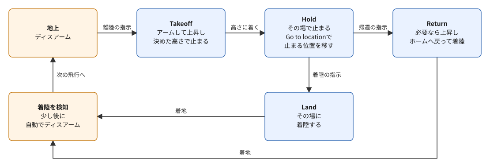
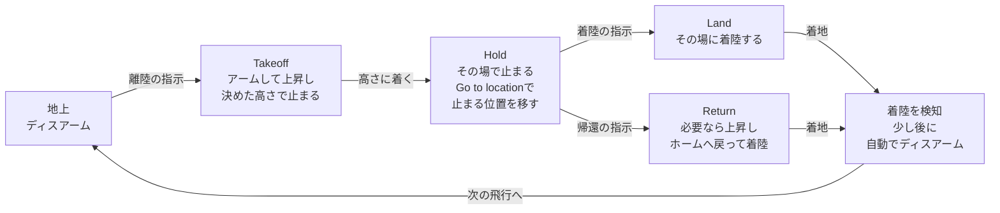
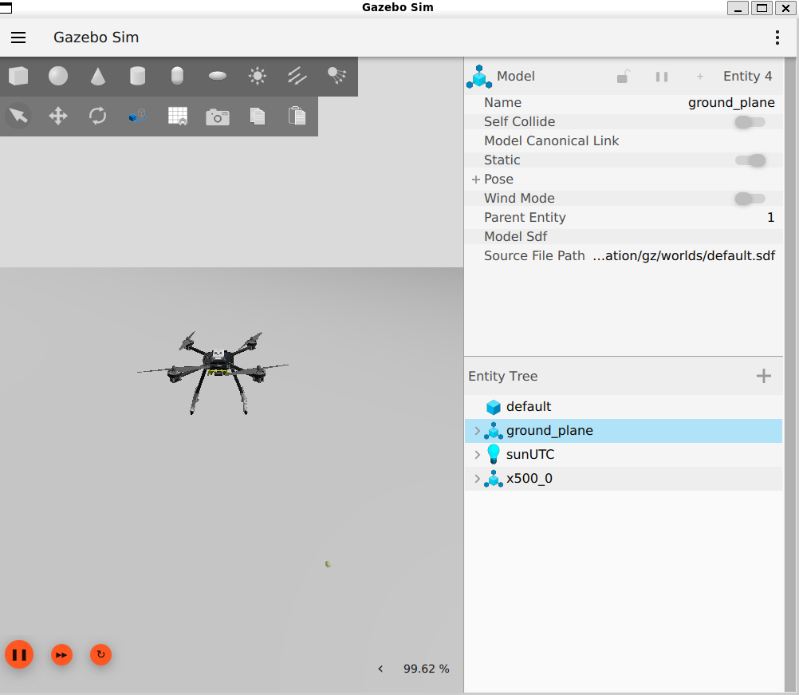

# フェーズ1: PX4とGazeboで、ドローンを離陸・移動・着陸させる

[学習計画](learning_plan.md) の最初のゴールに当たる手順書。環境構築で入れたPX4のシミュレーションとQGroundControl（QGC）を使い、Gazeboの中のドローンを離陸させ、地図の上で指した地点へ移動させ、着陸させる。同じことの一部を、PX4のシェルのコマンドでも行い、飛行モードが切り替わる様子を、QGCとPX4のシェルの表示で確かめる。プログラムは書かない。ここで身に付けるPX4のシミュレーションの起動・止め方と、QGCでの離陸・着陸は、フェーズ2以降のすべての手順書で使う。

- 想定環境: [環境構築](setup_px4_gazebo.md) を終えたWSL2のUbuntu 24.04
- 所要の目安: 1コマ
- 必須の範囲: 1〜7節（8節の課題は任意）

> **この手順書の位置づけ**: [フェーズ0](phase0_drone_px4.md) の、5節（アームと飛行モード）・6節（地上局とMAVLink）・8節（座標系）を、実際に動かして確かめる。用語の意味は、フェーズ0で確かめる。
>
> **期待する結果の出どころ**: 2節・5節・6節のT1（PX4のシミュレーション）の表示（`commander status` と `listener` の表示を含む）、7節の止めたときの表示、2節のQGCの警告とメッセージ、3節のGazeboの右クリックのメニュー、4節のQGCの起動した直後の表示（状態・飛行モード・方位）、5-1節の離陸の高さの初めの値は、筆者の環境で確かめたもの。3節の、リセットのボタンで機体が消えることは、筆者の環境で、フェーズ5のワールド（壁のワールド）で確かめた。5節・6節の、飛んでいる間のQGCとGazeboの様子は、PX4 v1.17のソースと、PX4・Gazebo・QGroundControlの公式の文書から想定したもの（実際の表示と違っていたら直す）。時刻・位置の値・ログのファイル名とバイト数は、実行ごとに変わる。

## 0. 学習目標と完了条件

この手順書を終えると、次のことができるようになる。

1. PX4のシミュレーションとQGCを起動し、止められる（2節・7節）。
2. Gazeboの画面で、視点を動かし、機体を追いかけて見られる（3節）。
3. QGCの画面で、機体の状態（飛べるか）・飛行モード・高さを読み取れる（4節）。
4. QGCで、離陸・地図の上の地点への移動・着陸を指示できる（5節）。
5. PX4のシェルで、機体の状態を見て、離陸・帰還・着陸を指示できる（6節）。
6. 飛行の間の飛行モードの移り変わりを、QGCとPX4のシェルの表示で説明できる（1節の図、5節・6節）。

**完了条件**（すべて満たしたら完了）:

1. QGCの指示で、機体が離陸し、地図で指した地点へ移動し、着陸する（5節）。
2. そのときの飛行モードの変化（Takeoff → Hold → Land）をQGCの表示で、Holdで止まっていることを `commander status` で、アーム・離陸と着陸の検知・ディスアームをT1の表示で確かめられる（5節）。
3. PX4のシェルの `commander` のコマンドで、離陸させ、帰還させ（Return）、もう一度離陸させてその場に着陸させ、着陸の後にディスアームしたことを、`commander status` で確かめられる（6節）。

## 1. 全体像

この手順書では、2つのターミナルを使う。T1でPX4のシミュレーション（PX4のSITLとGazebo）を起動し、T2でQGCを起動する。ターミナルの番号は、[READMEの「ターミナルの番号」](../README.md#ターミナルの番号)のとおり、T1〜T4がどの手順書でも同じプログラムで、T5以降がそのページの作業用である。この手順書では、T1とT2だけを使う。T1の最後の行に出る `pxh>` は、PX4のシェルのプロンプトで、5節と6節ではここにコマンドを打つ。この手順書では、打つコマンドの前に `pxh> ` を付けて書くが、`pxh>` はプロンプトなので打たない（`pxh> commander status` とまるごと打つと、`Invalid command: pxh>` と表示される）。

1回の飛行で、飛行モードとアームは、次のように移り変わる。



<details>
<summary>同じ図（mermaid版）</summary>



</details>

各矢印の指示は、QGCのボタンでも、PX4のシェルのコマンドでも出せる。この手順書で使うものは次のとおりである。

| 指示 | QGC（5節） | PX4のシェル（6節） |
|---|---|---|
| 離陸の指示（アームして離陸） | 左の **Takeoff** のボタン | `commander takeoff` |
| 止まる位置を移す | 地図をクリックして **Go to location** | 無い（`commander` のコマンドには、地点を指す指示が無い） |
| 帰還の指示 | 左の **Return**（RTL）のボタン | `commander mode auto:rtl` |
| 着陸の指示 | 左の **Land** のボタン | `commander land` |

QGCの **Go to location** は、PX4の中では、Holdのモードのまま、止まる位置を指した地点に移す指示として扱われる（PX4 v1.17のソースで確かめた）。そのため、移動の間も、飛行モードの表示はHoldのままである。

## 2. 起動する

環境構築の6節と同じ手順で、PX4のシミュレーションとQGCを、別々のターミナルで起動する。

```bash
# T1
source ~/px4-venv/bin/activate

cd ~/PX4-Autopilot

make px4_sitl gz_x500

# T2
cd ~/qgc

./QGroundControl-x86_64.AppImage
```

**期待する結果**（T1の最後の部分だけの抜粋。起動の途中の表示と、その読み方は、環境構築の6節にある。`No connection to the GCS` の行の数は、QGCがつながるまでの時間で変わる）:

```text
INFO  [px4] Startup script returned successfully
pxh> WARN  [health_and_arming_checks] Preflight Fail: No connection to the GCS
WARN  [health_and_arming_checks] Preflight Fail: No connection to the GCS
INFO  [mavlink] partner IP: 127.0.0.1
INFO  [commander] Ready for takeoff!
```

Gazeboのウィンドウが開き、地面の上に機体（`x500`）が現れる。QGCのウィンドウが開き、機体につながると、T1に `partner IP: 127.0.0.1`（MAVLinkの相手が、同じPCの中に見つかった）と `Ready for takeoff!` が表示される。T1で Enter を押すと、`pxh>` のプロンプトが改めて表示され、コマンドを打てる状態になる。

T2のQGCの表示には、環境構築の6節で見た警告のほかに、`"Bing Tile Above Zoom Level"`（地図の画像が、その拡大の倍率では用意されていない）や、`QGCPressure`（PCの気圧のセンサが無い）の警告が出ることがある。どれも、シミュレーションの機体を飛ばすのには関係ない。

QGCの起動の直後には、毎回、シリアルポートの権限についてのメッセージ（`The current user does not have the correct permissions to access serial devices.`）が表示される。環境構築の5節のとおり、シミュレーションとはUDPでつなぐのでシリアルポートは使わない。メッセージを閉じてよく、勧められるコマンド（`dialout` への追加とModemManagerの削除）も実行しない。

## 3. Gazeboの画面の見方

Gazeboのウィンドウは、3Dの画面（シーン）と、右の一覧（エンティティツリー。ワールドの中の物の一覧）、3Dの画面の下の再生の操作でできている。機体は、エンティティツリーの中で `x500_0` という名前で見える（模型の名前 `x500` に、PX4のインスタンスの番号 `0` を付けた名前。T1の `INFO  [gz_bridge] world: default, model: x500_0` の行と同じ）。



上の画像は、5-1節で離陸した後のGazeboのウィンドウである。右の上半分は、選んだ物の情報（ここでは地面の `ground_plane`）、右の下半分の **Entity Tree** がエンティティツリーで、`x500_0` が機体である。左下の3つのボタンは、左から一時停止（再生中は ‖ の形）・1歩ずつ進める・リセットで、3Dの画面の右下の数（RTF。Real Time Factor）は、シミュレーションの時間が、現実の時間の何倍の速さで進んでいるかを表す（100 % に近いほど、現実と同じ速さ。PCの速さや負荷で、実行ごとに変わる）。

シーンの視点は、マウスで次のように動かす（Gazebo Harmonicの公式の文書による）。

| 操作 | 視点の動き |
|---|---|
| 左ボタンでドラッグ | 平行移動 |
| ホイールを回す、または右ボタンでドラッグ | 拡大・縮小 |
| ホイールを押しながらドラッグ（Shiftを押しながら左ボタンでドラッグでもよい） | 回転 |
| 機体を右クリックし、**Follow Options** から **Follow** を選ぶ | 視点が機体を追いかける（機体が動いても、画面の中央に保つ） |
| 機体を右クリックして **Move to** | 視点を機体のところへ移す（追いかけはしない） |

5節で機体を飛ばす前に、機体を右クリックして **Follow Options** から **Follow** を選んでおくと、機体が移動しても画面から外れない。右クリックのメニューには **Remove**（機体を消す）もあるので、押し間違えないように気を付ける。消してしまったら、T1を止めて起動し直す。

PX4のシミュレーションでは、Gazeboは再生の状態で始まる（PX4がGazeboを起動するときに、すぐに再生する指定をしているため）。下の再生のボタンで一時停止すると、PX4もGazeboの時計で動いているので（フェーズ0の4節のロックステップ）、PX4の時間も止まる。リセットのボタン（3つのボタンの右端）を押すと、ワールドが読み込んだ直後の状態に戻り、PX4が後から足した機体（環境構築の6節の表示の、`Spawning Gazebo model` の行で足したもの）が消える。この手順書では、一時停止もリセットも使わない。リセットを押して機体が消えたら、T1を止めて起動し直す。

機体は、Gazeboの世界のxの向きを向いて現れる。フェーズ0の8-3節のとおり、Gazeboの世界はENUなので、xの向きは東である。つまり、機体は東を向いて現れる。

## 4. QGCの画面の見方

QGCは、起動すると、飛行の画面（Fly View）を表示する。この手順書で見るのは、次の部分である。

- **上のツールバーの左寄り**: 機体の状態（Flight Status）と、今の飛行モード（Flight Mode）。機体の状態は、飛べる状態なら **Ready**（QGCの文書では Ready To Fly と書かれている）と表示される。QGCの文書によると、ほかに、飛べない理由があれば **Not Ready**、アームしていれば **Armed**、飛んでいれば **Flying**、着陸中なら **Landing** と表示される。Not Readyのときは、表示をクリックすると理由が出る。
- **地図**: 機体の位置と向き（矢じりの形の印）。地図はドラッグで動かせ、ホイールで拡大・縮小できる。
- **左の縦のボタンの列**（Fly Tools）: **Takeoff**（飛んでいる間は **Land** に変わる）・**Return**（RTL）など。
- **値の表示**（Telemetry Values）: 高さ・速さなど。
- **姿勢の計器**（Attitude/Compass）: 機体の傾きと向き（方位）。

**期待する結果**（起動して機体につながった直後。方位の値は実行ごとに少し変わる）: 上のツールバーの左端の **Q** のアイコンの右に、機体の状態の **Ready** と、飛行モードの **Hold** が並ぶ。方位の計器は、`E`（東）の向きの付近の、95°前後を指す。

方位は、北を0°として、上から見て時計回りに測った角度である（フェーズ0の8-2節のNEDの向きと同じ測り方）。3節のとおり、機体は東を向いて現れるので、90°に近い値になる。ちょうど90°にならないのは、PX4が、向きを磁気センサなどの値から推定しているためで（フェーズ0の3-2節の推定）、数度のずれは問題ない。

## 5. QGCで飛ばす

### 5-1. 離陸する

1. 左の **Takeoff** のボタンを押す。
2. 右に出る縦のスライダーで、離陸の高さを決める（そのままでもよい）。最初は **10 ft** と表示される（QGCの単位の設定がフィートの場合。メートルの場合は約3m）。
3. 確定のボタンを、押したまま離さずにいて、指示が受け付けられるまで待つ（安全のための確認。QGCで、取り消しにくい指示はこの形で確定する）。

**期待する結果**（T1。抜粋）:

```text
INFO  [commander] Armed by external command
INFO  [tone_alarm] arming warning
INFO  [commander] Takeoff detected
```

機体がアームしてプロペラが回り始め、真上に上昇して、決めた高さで止まる。QGCのFlight Statusは **Armed** から **Flying** に、飛行モードは **Takeoff** から、高さに着いた後に **Hold** に変わる。`Armed by external command` は、外（ここではQGC）からの指示でアームしたことを、`arming warning` は、アームしたことを知らせる警告音（実機ではブザーが鳴る）を出したことを、`Takeoff detected` は、PX4が、機体が地面を離れたことを検知したことを示す。

アームの前後に、`ERROR [sensors] Accel #0 fail:  TIMEOUT!`（加速度計の値が、決めた時間の中に届かなかった）が出ることがある。PCの処理が一時的に遅れると出る表示で、続けて離陸できれば問題ない。また、`gz_frame_id ... not defined in SDF` の警告（環境構築の6節で、起動のときに見たものと同じ内容）が、飛行の途中に、もう一度まとめて出ることがある。これも飛行には影響しない。

QGCは、高さをフィート（ft）で表示することがある。1ftは約0.3mなので、10ftは約3mである。メートルで表示したい場合は、QGCのアプリの設定（左上の **Q** のアイコンから **Application Settings**）の **General** の **Units** で、**Distance** を **Meters** にする。QGCから離陸させると、スライダーで決めた高さまで上がる。6-2節のように、PX4のシェルから離陸させると、PX4のパラメータ `MIS_TAKEOFF_ALT` の既定の2.5mまで上がる。高さは、QGCの値の表示か、Gazeboの画面で確かめる。

### 5-2. 地図で指した地点へ移動する

1. QGCの地図の上で、機体から少し離れた地点をクリックする。
2. 出てきた一覧から **Go to location** を選ぶ。
3. 確定のボタンを、押したまま離さずにいて、受け付けられるまで待つ。

**期待する結果**: 機体が、指した地点へ向かって水平に飛び、その上で止まる。飛行モードの表示は **Hold** のままである（1節のとおり、Holdの止まる位置を移す指示だから）。Gazeboの画面では、機体が少し前に傾いて進み、止まるときに逆に傾いてブレーキをかける様子が見える（フェーズ0の2-3節）。

止まったら、T1で、機体の状態をPX4のシェルで見る（`commander status` の表示の読み方は、6-1節で詳しく見る）。

```text
pxh> commander status
```

**期待する結果**（最初の4行）:

```text
INFO  [commander] Armed
INFO  [commander] navigation mode: Hold
INFO  [commander] user intended navigation mode: Hold
INFO  [commander] in failsafe: no
```

1行目の `Armed` はアームしていること、2行目の `Hold` は、今の飛行モードがHoldであることを示す。QGCの飛行モードの表示と同じである。

### 5-3. 着陸する

1. 左の **Land** のボタンを押す。
2. 確定のボタンを、押したまま離さずにいて、受け付けられるまで待つ。

**期待する結果**（T1。抜粋。バイト数は実行ごとに変わる）:

```text
INFO  [commander] Landing detected
INFO  [commander] Disarmed by landing
INFO  [tone_alarm] notify neutral
INFO  [logger] closed logfile, bytes written: 108551532
```

飛行モードが **Land** に変わり、機体がその場で真下に降りて着地する。`Landing detected` は、PX4が着地を検知したことを、`Disarmed by landing` は、着地の後に自動でディスアームしたことを示す（フェーズ0の5-1節。着陸から約2秒）。`notify neutral` は、終わったことを知らせる音を、`closed logfile` は、飛行の記録（ログ）のファイルを閉じたことを示す。QGCのFlight Statusは、**Landing** を経て、**Ready** に戻る。

## 6. PX4のシェルで飛ばす

T1の `pxh>` のプロンプトに、PX4のコマンドを打つ（1節のとおり、`pxh>` は打たない）。飛行モードとアームを扱うのは、`commander` というモジュールのコマンドである。QGCは、つないだままにしておく（フェーズ0の9-1節のとおり、地上局がつながっていないとアームできない）。シェルで出した指示の結果も、QGCの画面に表示される。

### 6-1. 機体の状態を見る

```text
pxh> commander status
```

**期待する結果**（5節で着陸した後に打った場合。最後の2行は、PX4の処理の時間の計測で、数は実行ごとに変わるので `...` で省いた）:

```text
INFO  [commander] Disarmed
INFO  [commander] navigation mode: Hold
INFO  [commander] user intended navigation mode: Hold
INFO  [commander] in failsafe: no
commander: cycle: ...
commander: preflight check: ...
```

1行目がアームの状態、2行目が今の飛行モードである。3行目は、人や地上局が選んだ飛行モードで、ふだんは2行目と同じになる。フェイルセーフ（フェーズ0の9-2節）が働くと、2行目だけがフェイルセーフの動作のモードに変わり、4行目が `yes` になる。5節で着陸した後は、飛行モードがHoldに戻っている（PX4は、ディスアームすると、最後に選ばれた飛行モードのうち、アームを妨げないもので、離陸のモード（Takeoff）でもないもの（ここではHold）に戻す。LandとReturnは、アームを妨げるモードとして扱われるので、戻り先にならない）。最後の2行（`cycle`・`preflight check`）は、`commander` の処理の回数と時間の計測で、この手順書では読まなくてよい。

### 6-2. 離陸して、高さを見る

```text
pxh> commander takeoff
```

**期待する結果**（T1。ログのファイル名の日付と時刻は、実行ごとに変わる。`arming warning` と `Using default takeoff altitude` の行は、順番が入れ替わることがある）:

```text
pxh> INFO  [commander] Armed by internal command
INFO  [tone_alarm] arming warning
INFO  [navigator] Using default takeoff altitude: 2.5 m
INFO  [logger] Start file log (type: full)
INFO  [logger] [logger] ./log/2026-10-31/12_55_59.ulg
INFO  [logger] Opened full log file: ./log/2026-10-31/12_55_59.ulg
INFO  [commander] Takeoff detected
```

5-1節と同じように、機体がアームして離陸し、2.5mの高さで止まる。`commander takeoff` は、Takeoffのモードに切り替えてから、アームする。1行目の先頭の `pxh> ` は、コマンドを打った後に出たプロンプトで、その後ろにPX4の表示が続いている（環境構築の6節の `Ready for takeoff!` と同じ）。

`Armed by internal command` は、PX4の中（ここではシェル）からの指示でアームしたことを示す。5-1節のQGCからの指示では `external command`（外からの指示）だった。`Using default takeoff altitude: 2.5 m` は、離陸の高さを指定しなかったので、既定の `MIS_TAKEOFF_ALT`（5-1節）の2.5mを使う、という意味である。`logger` の3行は、アームしたので、新しい飛行の記録（ログ）のファイルを開いたことを示す。このファイルは、着陸してディスアームすると閉じられる（5-3節の `closed logfile`）。

高さに着いたら、PX4の中の、機体の位置のトピック（フェーズ0の3-2節のuORBのトピック）を1回表示する。

```text
pxh> listener vehicle_local_position
```

**期待する結果**（抜粋。全部で約60行。値は実行ごとに変わり、`x`・`y` は5-2節で移動した先によって変わる）:

```text
TOPIC: vehicle_local_position
 vehicle_local_position
    timestamp: 434684000 (0.008000 seconds ago)
    ...
    ref_lat: 47.397971
    ref_lon: 8.546164
    x: -12.11189
    y: 41.94363
    z: -2.50223
    ...
    ref_alt: 0.21130
    ...
    xy_valid: True
    z_valid: True
    ...
```

`x`・`y`・`z` は、NEDの座標（フェーズ0の8節）の位置で、単位はmである。原点は、PX4の推定（EKF2）が動き始めたときの機体の位置で、この手順書では、Gazeboで機体が現れた地点である。5-2節で移動した先で着陸し、そこから離陸したので、`x`・`y` は、5-2節で移動した分だけ0から離れている（この例では、`x` が約−12なので北へ−12m、つまり南へ約12m、`y` が約42なので東へ約42m）。地面の高さは同じなので、2.5mの高さにいると、`z` は約−2.5になる。NEDのzは下が正だからである。

`timestamp` は、PX4が起動してからの時間（マイクロ秒）である。`ref_lat`・`ref_lon`・`ref_alt` は、原点の緯度・経度・海抜（m）で、緯度・経度は、Gazeboのワールドのファイル（`Tools/simulation/gz/worlds/default.sdf`）に書かれた場所（スイスのチューリッヒの付近）と同じである。このワールドの地面は、海抜がほぼ0mである。`xy_valid`・`z_valid` が `True` なのは、水平と高さの位置の推定が使える状態であることを示す。

### 6-3. 地点へ移動させてから、帰還させる

`commander` のコマンドには、地図の上の地点を指して移動させる指示が無い。そこで、移動は5-2節と同じようにQGCの **Go to location** で行い、帰還（Return）をシェルで指示する。

```text
pxh> commander mode auto:rtl
```

Go to locationで指す地点は、離陸した地点から10m以内にする。それより離れていると、帰還のときに、まず帰還先より60m上（パラメータ `RTL_RETURN_ALT` の既定）まで上昇してから戻り、30m（`RTL_DESCEND_ALT`）を経て降りるので、着陸までに時間がかかる（PX4 v1.17のソースの `rtl.cpp` で確かめた。10m以内なら、上がるのは距離と同じくらいの高さまでである）。

**期待する結果**（T1。10m以内の地点から帰還させた場合。バイト数は実行ごとに変わる）:

```text
pxh> INFO  [navigator] RTL: start return at 3 m (3 m above destination)
INFO  [navigator] RTL: land at destination
INFO  [commander] Landing detected
INFO  [commander] Disarmed by landing
INFO  [tone_alarm] notify neutral
INFO  [logger] closed logfile, bytes written: 14137281
```

飛行モードが **Return** に変わり、機体が、ホームの位置（離陸した地点）の上へ戻って、着陸する（10m以内の地点からなら、少し上がってから戻る）。`RTL: start return at 3 m (3 m above destination)` は、帰還先より3m上の高さで戻る、という意味である。前の数は海抜の高さで、6-2節のとおり、このワールドの地面は海抜がほぼ0mなので、括弧の中の数と同じくらいになる。どちらも、整数に切り上げて表示される（PX4 v1.17のソースの `rtl_direct.cpp`）。帰還を始めた位置が離陸した地点から遠いほど、この数は大きくなる。`RTL: land at destination` は、帰還先の上に着いたので、着陸を始めたことを示す。着陸すると、5-3節と同じように、`Landing detected` と `Disarmed by landing` が表示される。

`auto:rtl` の `rtl` は、Return To Launch（離陸した所へ戻る）の頭文字である。`commander mode` に渡せる飛行モードの名前は、`commander` とだけ打つと表示される使い方の説明にある（例: Holdは `auto:loiter`、Landは `auto:land`、Takeoffは `auto:takeoff`、Positionは `posctl`、Offboardは `offboard`）。

### 6-4. 帰還の後の状態を見る

```text
pxh> commander status
```

**期待する結果**: 1行目が `Disarmed` に戻る。2行目は、Holdに戻る（6-1節のとおり、Returnは戻り先にならないので、その前に選ばれていたHoldに戻る）。

### 6-5. その場に着陸させる

もう一度離陸させ、今度は、その場に着陸させる。

```text
pxh> commander takeoff
```

2.5mの高さで止まったら、着陸を指示する。

```text
pxh> commander land
```

**期待する結果**（T1。`commander takeoff` の表示は6-2節と同じなので省いた。バイト数は実行ごとに変わる）:

```text
pxh> INFO  [commander] Landing at current position
INFO  [commander] Landing detected
INFO  [commander] Disarmed by landing
INFO  [tone_alarm] notify neutral
INFO  [logger] closed logfile, bytes written: 7408103
```

飛行モードが **Land** に変わり、機体がその場で真下に降りて着地する。`Landing at current position` は、今いる位置に着陸する、という意味である。5-3節と同じように、`Landing detected` と `Disarmed by landing` が表示される。帰還（Return）と違い、離陸した地点へは戻らない。着地した後に `commander status` を打つと、1行目が `Disarmed` になっている。

## 7. 止める

T2のQGCのウィンドウを閉じ、T1で Ctrl+C を押す。

**期待する結果**（T1の最後の部分）:

```text
PX4 Exiting...
pxh> Exiting NOW.
ninja: build stopped: interrupted by user.
make: *** [Makefile:227: px4_sitl] Interrupt
```

環境構築の6節と同じ表示である。`interrupted by user` と `Interrupt` は、Ctrl+Cで止めたことを示す表示で、止め方として正しいので問題ない。

`pxh>` で `shutdown` と打っても、PX4は `Exiting NOW.` と表示して止まるが、T1はコマンドを打てる状態（Ubuntuのプロンプト）に戻らない。そのときは、続けて Ctrl+C を押す。

```text
pxh> shutdown
Exiting NOW.

^Cninja: build stopped: interrupted by user.
make: *** [Makefile:227: px4_sitl] Interrupt
```

`^C` は、Ctrl+Cを押したことを示す。

## 8. 課題（任意）

1. 5-1節で、離陸の高さを5m（単位がフィートなら約16ft）にして離陸し、6-2節の `listener vehicle_local_position` で、`z` が約−5になることを確かめる。
2. 飛んでいる間に、QGCの上のツールバーの飛行モードの表示をクリックし、一覧から **Land** を選んでみる。左のボタンで着陸を指示したときと、同じことが起きるかを確かめる。

## つまずきやすい点

- **Takeoffのボタンを押しても離陸しない**: QGCのFlight Statusが **Not Ready** になっていないかを見る。クリックすると、理由が表示される。
- **`commander takeoff` で離陸しない**: QGCがつながっているかを確かめる（つながっていないと、アームできない）。
- **機体が画面から外れて見えなくなった**: シーンの機体を右クリックし、**Follow Options** から **Follow** を選ぶ（3節）。
- **確定のボタンを押しても何も起きない**: 押してすぐ離すと、確定しない。受け付けられるまで、押したままにする。
- **`pxh>` でコマンドを打っている途中に、PX4の表示が割り込む**: 打ちかけの文字は、消えずに入力に残っている（`pxh> shINFO  [logger] ...` のように、PX4の表示の前に見える）。この状態で Enter を押すと、打ちかけの文字がそのままコマンドとして扱われ、`Invalid command: sh` のように表示される。そのときは、コマンドを改めて打ち直す。

## 次へ

学習計画（[`docs/learning_plan.md`](learning_plan.md)）のフェーズ2（ROS 2から、機体の状態を見る）へ進む。手順書は [`docs/phase2_ros2_observe.md`](phase2_ros2_observe.md) である（下書き）。

## 出典

この手順書の技術的な記述は、次の文書とファイルを読んで、自分の言葉でまとめたもの（逐語の転載ではない）。

- PX4 User Guide（v1.17。[CC BY 4.0](https://creativecommons.org/licenses/by/4.0/)、Dronecode/PX4）: [Gazebo Simulation](https://github.com/PX4/PX4-Autopilot/blob/release/1.17/docs/en/sim_gazebo_gz/index.md)、[Flight Modes (Multicopter)](https://github.com/PX4/PX4-Autopilot/blob/release/1.17/docs/en/flight_modes_mc/index.md)、[Takeoff](https://github.com/PX4/PX4-Autopilot/blob/release/1.17/docs/en/flight_modes_mc/takeoff.md)、[Land](https://github.com/PX4/PX4-Autopilot/blob/release/1.17/docs/en/flight_modes_mc/land.md)、[Return](https://github.com/PX4/PX4-Autopilot/blob/release/1.17/docs/en/flight_modes_mc/return.md)
- PX4 v1.17のソース（作成に使った環境に取得したもの）
  - `commander` のコマンドの一覧と、離陸・着陸の扱い、状態の表示: [`src/modules/commander/Commander.cpp`](https://github.com/PX4/PX4-Autopilot/blob/release/1.17/src/modules/commander/Commander.cpp)（`takeoff` はTakeoffのモードに切り替えてからアームする。地点への移動の指示（`VEHICLE_CMD_DO_REPOSITION`）は、Holdのモードへの切り替えとして扱う。アーム・ディスアーム・離陸と着陸の検知の表示）
  - Returnの高さ（6-3節）: [`src/modules/navigator/rtl.cpp`](https://github.com/PX4/PX4-Autopilot/blob/release/1.17/src/modules/navigator/rtl.cpp)（`calculate_return_alt_from_cone_half_angle`）と [`src/modules/navigator/rtl_params.c`](https://github.com/PX4/PX4-Autopilot/blob/release/1.17/src/modules/navigator/rtl_params.c)（`RTL_RETURN_ALT` は60m、`RTL_DESCEND_ALT` は30m、`RTL_MIN_DIST` は10m、`RTL_CONE_ANG` は45°）
  - 位置の原点（6-2節）: [`msg/versioned/VehicleLocalPosition.msg`](https://github.com/PX4/PX4-Autopilot/blob/release/1.17/msg/versioned/VehicleLocalPosition.msg)。Landの後に前のモードに戻すこと（6-1節）: [`src/modules/commander/UserModeIntention.cpp`](https://github.com/PX4/PX4-Autopilot/blob/release/1.17/src/modules/commander/UserModeIntention.cpp)
  - 離陸の高さの既定: [`src/modules/navigator/mission_params.c`](https://github.com/PX4/PX4-Autopilot/blob/release/1.17/src/modules/navigator/mission_params.c)（`MIS_TAKEOFF_ALT` は2.5m）
  - Gazeboの起動（すぐに再生する指定と、機体の名前 `x500_0`）: [`ROMFS/px4fmu_common/init.d-posix/px4-rc.gzsim`](https://github.com/PX4/PX4-Autopilot/blob/release/1.17/ROMFS/px4fmu_common/init.d-posix/px4-rc.gzsim)
- Gazeboの画面の操作: Gazebo Harmonicの文書の [Understanding the GUI](https://github.com/gazebosim/docs/blob/master/harmonic/GUI_tutorial.md)（Open Robotics）
- QGCの画面と操作: QGroundControl v5.1.5の文書の [General Settings](https://github.com/mavlink/qgroundcontrol/blob/v5.1.5/docs/en/qgc-user-guide/settings_view/general.md)（単位の設定）・[Fly View](https://github.com/mavlink/qgroundcontrol/blob/v5.1.5/docs/en/qgc-user-guide/fly_view/fly_view.md)・[Fly View Toolbar](https://github.com/mavlink/qgroundcontrol/blob/v5.1.5/docs/en/qgc-user-guide/fly_view/fly_view_toolbar.md)・[Fly Tools](https://github.com/mavlink/qgroundcontrol/blob/v5.1.5/docs/en/qgc-user-guide/fly_view/fly_tools.md)
- 図（`img/phase1_modes.svg`）は、この教材で作ったもの。
- 3節の画像（`img/phase1_gazebo.png`）は、筆者の環境で撮影したGazebo（Open Source Robotics Foundation、Apache License 2.0）の画面である。写っている機体の模型 `x500` は、PX4に付属するGazeboの模型（[PX4-gazebo-models の `models/x500_base`](https://github.com/PX4/PX4-gazebo-models/tree/main/models/x500_base)。そのフォルダの `LICENSE` によると、Copyright (c) 2022, Rudis Laboratories、BSD 3-Clause License）で、模型のファイルそのものは、このリポジトリに含まない。
