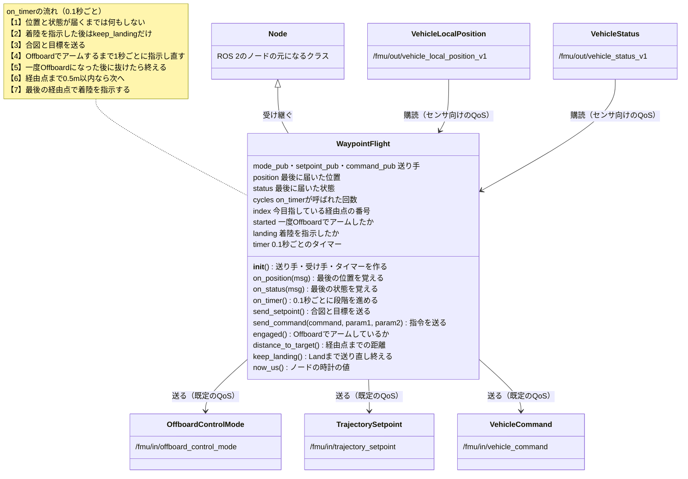

# フェーズ3: ROS 2から指令して、機体を飛ばす

[学習計画](learning_plan.md) のフェーズ3の手順書。ROS 2のノードから、PX4にオフボード制御の指令を送り、機体を離陸させ、決めた経由点を順に回らせ、着陸させる。QGCはつないで見守るだけで、飛ばすのはノードの指令だけである。フェーズ0の5-2節（オフボード制御の約束）と8節（座標系）を、ここでコードにする。フェーズ6では、このノードを元に、経由点の出どころを経路計画に差し替えたノードを書く（このノードの座標の変換の関数も、そのまま読み込んで使う）。

- 想定環境: [フェーズ3-0](phase3_0_node_qos.md) を終えたWSL2のUbuntu 24.04
- 所要の目安: 1〜2コマ
- 必須の範囲: 1〜7節（8節の課題は任意）
- 前提（親プロジェクト）: [フェーズ2](https://github.com/SanghunIm1991/ros2MinimalPhysicalAi/blob/main/docs/phase2_packages.md) の2-2節・2-4節・2-5節（フェーズ3-0と同じ）

> **この手順書の位置づけ**: PX4の公式のサンプル（[`px4_ros_com`](https://github.com/PX4/px4_ros_com) のオフボード制御の例）と同じ流れ（合図を送り続け、1秒たったらOffboardに切り替えてアームする）を、この教材で一から書いた。公式のPythonの例は、`px4_ros_com` の `main` のブランチにだけあり、v1.17では名前に `_v1` が付く位置と状態のトピック（フェーズ0の7節）を、印の無い名前で購読しているので、v1.17ではそのまま使えない。
>
> **期待する結果の出どころ**: サンプルのコードは、ROS 2のリンタ（`ament_flake8`）と、Pythonの文法の点検を通したもの。型の項目と定数は、`px4_msgs`（`release/1.17`）とPX4 v1.17のソースで確かめた。4-2節のクラス図（SVG）は、生成スクリプトの機械点検（はみ出し・重なり・線の交差）を通したもので、見た目は未確認。4-1節のパッケージの作成、5節のビルドとノードのログ、6節の `ros2 topic hz` と `ros2 topic echo` の表示は、筆者の環境で動かして確かめたもの。5節の、QGCとGazeboの画面の様子とT1の表示、QGCのLandやCtrl+Cで途中で止めたときの動きは、PX4 v1.17のソースと公式の文書から想定したもの。時刻は実行ごとに変わる。ビルドの時間はPCによって変わるので `<time>` と書いた。

## 0. 学習目標と完了条件

この手順書を終えると、次のことができるようになる。

1. オフボード制御の約束（合図を送り続けること、切り替えの前に1秒送ること、アームの条件）を、コードの中で示せる（2節・4節）。
2. ENUで考えた経由点と向きを、PX4に送るNEDに直せる（3節）。
3. ROS 2のノードから、PX4にモードの切り替え・アーム・着陸の指令を送れる（4節）。
4. ノードの指令だけで、機体に経由点を順に回らせ、着陸させられる（5節）。

**完了条件**: 機体が、ROS 2のノードの指令だけで、5mの高さまで上がり、四角形の4つの角を回って真上に戻り、着陸し、ディスアームする（5節）。

## 1. 全体像

ノードとPX4の間は、フェーズ2で作ったAgentを通して、次の5つのトピックでつながる。送る3つは名前が `/fmu/in/` で始まり、受ける2つは `/fmu/out/` で始まる。

| 向き | トピック | 型 | 何を伝えるか |
|---|---|---|---|
| ノード → PX4 | `/fmu/in/offboard_control_mode` | [`px4_msgs/msg/OffboardControlMode`](https://github.com/PX4/px4_msgs/blob/release/1.17/msg/OffboardControlMode.msg) | 「自分は動いている」という合図と、何で指令するか（ここでは位置） |
| ノード → PX4 | `/fmu/in/trajectory_setpoint` | [`px4_msgs/msg/TrajectorySetpoint`](https://github.com/PX4/px4_msgs/blob/release/1.17/msg/TrajectorySetpoint.msg) | 目標の位置と向き（NED） |
| ノード → PX4 | `/fmu/in/vehicle_command` | [`px4_msgs/msg/VehicleCommand`](https://github.com/PX4/px4_msgs/blob/release/1.17/msg/VehicleCommand.msg) | モードの切り替え・アーム・着陸などの指令 |
| PX4 → ノード | `/fmu/out/vehicle_local_position_v1` | [`px4_msgs/msg/VehicleLocalPosition`](https://github.com/PX4/px4_msgs/blob/release/1.17/msg/VehicleLocalPosition.msg) | 今の位置（NED） |
| PX4 → ノード | `/fmu/out/vehicle_status_v1` | [`px4_msgs/msg/VehicleStatus`](https://github.com/PX4/px4_msgs/blob/release/1.17/msg/VehicleStatus.msg) | 今の飛行モードとアームの状態 |

ノードは、0.1秒ごとに、次の順で進む。

1. 合図（`OffboardControlMode`）と、今の経由点の目標（`TrajectorySetpoint`）を送る。これは、最後まで毎回送る。
2. 10回送った後（1秒後）に、Offboardへの切り替えとアームの指令（`VehicleCommand`）を送る。Offboardになってアームするまで、1秒ごとに送り直す。
3. Offboardでアームしたら、今の位置と経由点の距離を見て、0.5m以内に着いたら、次の経由点に進む。一度Offboardになった後で、別のモード（QGCのLandの指示や、フェイルセーフ）に移ったら、ノードを終える。
4. 最後の経由点に着いたら、着陸の指令を送る（Landのモードになるまで、1秒ごとに送り直す）。ディスアームしたら、ノードを終える。

この手順書では、5つのターミナルを使う。

| ターミナル | 動かすもの | 仮想環境 `~/px4-venv` |
|---|---|---|
| T1 | PX4のシミュレーション（`make px4_sitl gz_x500`） | 使う |
| T2 | QGroundControl | 使わない |
| T3 | Micro XRCE-DDS Agent | 使わない |
| T5 | パッケージの作成とビルド、自作のノード | 使わない |
| T6 | 観察のコマンド（`ros2 topic`） | 使わない |

ターミナルの番号は、[READMEの「ターミナルの番号」](../README.md#ターミナルの番号)のとおり、T1〜T4がどの手順書でも同じプログラムで、T5以降がそのページの作業用である。この手順書では、LiDARの中継（T4）を使わないので、T4は開かない。

## 2. オフボード制御の約束

フェーズ0の5-2節で見た約束を、ここで具体的にする。

- **合図を送り続ける**: PX4は、`OffboardControlMode` が毎秒2回より多く届かないと、外のプログラムが止まったとみなし、Offboardのモードから抜けて、フェイルセーフ（フェーズ0の9-2節）に移る（PX4 v1.17のソースでは、最後の合図から一定の時間（パラメータ `COM_OF_LOSS_T`、既定1秒）届かないと、途切れたとみなす）。このノードは、0.1秒ごと（毎秒10回）に送る。
- **切り替えの前に1秒送る**: PX4は、合図が少なくとも1秒届いてからでないと、Offboardへの切り替えを受け付けない。このノードは、10回送った後に切り替えを指示し、受け付けられるまで1秒ごとに指示し直す。
- **目標も一緒に送る**: 合図の `position` を `True` にすると、「位置で指令する」という意味になる。そのときは、目標の位置を `TrajectorySetpoint` で送る（PX4の文書によると1回送れば足りるが、このノードは合図と一緒に送り続ける）。`TrajectorySetpoint` の速度・加速度は、0のまま送る。0は「目標の速度0」として位置の制御に足されるだけで、位置の指令の邪魔はしない。使わないことをはっきり示したい場合は、NaN（数ではないことを表す値。型の定義のコメントのとおり、NaNの項目は制御に使われない）にする。
- **QGCをつないでおく**: フェーズ0の9-1節のとおり、地上局がつながっていないと、アームできない。

モードの切り替えとアームは、`VehicleCommand` で指示する。この手順書で使う指令は次のとおりである（数は型の定義の定数）。

| 指令 | `command` | 引数 | 意味 |
|---|---|---|---|
| モードの切り替え | `VEHICLE_CMD_DO_SET_MODE`（176） | `param1` に1、`param2` に6 | PX4のモードの番号で切り替える。6はOffboard |
| アーム | `VEHICLE_CMD_COMPONENT_ARM_DISARM`（400） | `param1` に1 | 1でアーム、0でディスアーム |
| 着陸 | `VEHICLE_CMD_NAV_LAND`（21） | なし | その場に着陸する（Landのモードに切り替わる） |

`param2` の6は、PX4のモードの番号（`px4_custom_mode.h` の `PX4_CUSTOM_MAIN_MODE_OFFBOARD`）である。`param1` の1は、「`param2` の番号をPX4のモードの番号として読む」という意味である。

## 3. ENUで考え、NEDで送る

経由点は、ROS 2の慣習のENU（東・北・上）で考えたほうが分かりやすい。一方、PX4に送る `TrajectorySetpoint` の位置と向きは、NED（北・東・下）でなければならない（フェーズ0の8節）。そこで、ノードの中に、直すための関数を2つ置く。

- **位置**: ENUの (東, 北, 上) を、NEDの (北, 東, −上) に直す（フェーズ0の8-2節）。たとえば、「東へ5m・上へ5m」はENUで (5, 0, 5)、NEDで (0, 5, −5) になる。
- **向き**: ENUの向き（東が0、上から見て反時計回り）を、NEDの向き（北が0、時計回り）に直す。「NEDの向き＝90°−ENUの向き」（フェーズ0の8-2節）を、ラジアンで計算し、−π〜πの範囲に収める。このノードは、機首を東に向ける（ENUで0）ので、NEDではπ/2（90°）を送る。フェーズ1の3節のとおり、機体は東を向いて現れるので、向きはほとんど変わらない。

位置の原点は、PX4の推定が動き始めたときの機体の位置（フェーズ1の6-2節）で、PX4を起動している間は変わらない。経由点は、この原点から測る。前の飛行で別の地点に降りていると、機体は原点から離れたところにいるので、最初の経由点（原点の真上）へ、斜めに飛ぶことになる。そこで、5節では、PX4のシミュレーションを起動し直して、機体を原点（Gazeboで機体が現れた地点）に戻してから使う。

## 4. パッケージとノードを作る

### 4-1. パッケージを作る

フェーズ3-0と同じように、`~/px4_ws/src` に、Pythonのパッケージ `drone_offboard` を作る。

```bash
# T5
cd ~/px4_ws/src

ros2 pkg create --build-type ament_python \
  --license Apache-2.0 \
  --maintainer-name learner --maintainer-email noreply@example.com \
  --dependencies rclpy px4_msgs \
  --node-name waypoint_flight \
  drone_offboard
```

**期待する結果**（`<username>` は、各自のユーザー名）:

```text
going to create a new package
package name: drone_offboard
destination directory: /home/<username>/px4_ws/src
package format: 3
version: 0.0.0
description: TODO: Package description
maintainer: ['learner <noreply@example.com>']
licenses: ['Apache-2.0']
build type: ament_python
dependencies: ['rclpy', 'px4_msgs']
node_name: waypoint_flight
creating folder ./drone_offboard
creating ./drone_offboard/package.xml
creating source folder
creating folder ./drone_offboard/drone_offboard
creating ./drone_offboard/setup.py
creating ./drone_offboard/setup.cfg
creating folder ./drone_offboard/resource
creating ./drone_offboard/resource/drone_offboard
creating ./drone_offboard/drone_offboard/__init__.py
creating folder ./drone_offboard/test
creating ./drone_offboard/test/test_copyright.py
creating ./drone_offboard/test/test_flake8.py
creating ./drone_offboard/test/test_pep257.py
creating ./drone_offboard/drone_offboard/waypoint_flight.py
```

フェーズ3-0の2節と同じ形で、パッケージの名前とノードの名前だけが違う。最後の行の `waypoint_flight.py` が、次の4-2節で書き換える雛形である。

### 4-2. ノードを書く

コードは長いので、先に、ノードのクラス `WaypointFlight` の作りを図で見ておく。


<details>
<summary>同じ図（mermaid版）</summary>



mermaid版には、定数と、座標の変換の関数を載せていない（SVGの図の左下と右下）。

</details>

図の中央がクラスで、上の区画が、ノードが覚えておく値（属性）、下の区画が、メソッドである。左の2つの型を購読し（受け手の作り方はフェーズ3-0と同じ）、右の3つの型をPX4へ送る。動きの中心は `on_timer` で、下の補足の順に、毎回（0.1秒ごとに）上から判断していく。1節の4つの段階は、この中の3〜7に当たる。ほかのメソッドは、`on_timer` から呼ばれる部品である。

雛形の `waypoint_flight.py` の中身を、次のように書き換える。

ファイル: `~/px4_ws/src/drone_offboard/drone_offboard/waypoint_flight.py`

```python
import math

from px4_msgs.msg import OffboardControlMode
from px4_msgs.msg import TrajectorySetpoint
from px4_msgs.msg import VehicleCommand
from px4_msgs.msg import VehicleLocalPosition
from px4_msgs.msg import VehicleStatus
import rclpy
from rclpy.executors import ExternalShutdownException
from rclpy.node import Node
from rclpy.qos import qos_profile_sensor_data

# 回る経由点。ENU（東・北・上、m）で、PX4の位置の原点から測る。
WAYPOINTS_ENU = [
    (0.0, 0.0, 5.0),
    (5.0, 0.0, 5.0),
    (5.0, 5.0, 5.0),
    (0.0, 5.0, 5.0),
    (0.0, 0.0, 5.0),
]
YAW_ENU = 0.0          # 機首の向き（ENU。東が0、反時計回りが正、rad）
REACHED_DIST = 0.5     # 経由点に着いたとみなす距離（m）
PERIOD = 0.1           # 合図と目標を送る周期（s）。10Hz
RETRY_CYCLES = 10      # 指令を送る間隔（周期の数。10回で1秒）


# ENUの位置（東・北・上）を、NEDの位置（北・東・下）に直す。
def enu_to_ned(east, north, up):
    return north, east, -up


# ENUの向き（東が0、反時計回り）を、NEDの向き（北が0、時計回り）に直す。
def enu_yaw_to_ned(yaw):
    ned = math.pi / 2.0 - yaw
    return math.atan2(math.sin(ned), math.cos(ned))


# 経由点を順にPX4へ送り、回り終えたら着陸させるノード。
class WaypointFlight(Node):
    # 送るトピック3つ、受けるトピック2つと、周期のタイマーを作る。
    def __init__(self):
        super().__init__('waypoint_flight')
        self.mode_pub = self.create_publisher(
            OffboardControlMode, '/fmu/in/offboard_control_mode', 10)
        self.setpoint_pub = self.create_publisher(
            TrajectorySetpoint, '/fmu/in/trajectory_setpoint', 10)
        self.command_pub = self.create_publisher(
            VehicleCommand, '/fmu/in/vehicle_command', 10)
        self.create_subscription(
            VehicleLocalPosition, '/fmu/out/vehicle_local_position_v1',
            self.on_position, qos_profile_sensor_data)
        self.create_subscription(
            VehicleStatus, '/fmu/out/vehicle_status_v1',
            self.on_status, qos_profile_sensor_data)
        self.position = None
        self.status = None
        self.cycles = 0
        self.index = 0
        self.started = False
        self.landing = False
        self.timer = self.create_timer(PERIOD, self.on_timer)

    # 位置が届くたびに呼ばれ、最後に届いたものを覚えておく。
    def on_position(self, msg):
        self.position = msg

    # 状態が届くたびに呼ばれ、最後に届いたものを覚えておく。
    def on_status(self, msg):
        self.status = msg

    # 今のPX4の時刻の代わりに、ノードの時計の値をマイクロ秒で返す。
    def now_us(self):
        return self.get_clock().now().nanoseconds // 1000

    # PX4に指令（モードの切り替え・アーム・着陸など）を1回送る。
    def send_command(self, command, param1=0.0, param2=0.0):
        msg = VehicleCommand()
        msg.command = command
        msg.param1 = param1
        msg.param2 = param2
        msg.target_system = 1
        msg.target_component = 1
        msg.source_system = 1
        msg.source_component = 1
        msg.from_external = True
        msg.timestamp = self.now_us()
        self.command_pub.publish(msg)

    # 「位置で指令する」という合図と、今の経由点の目標を送る。
    def send_setpoint(self):
        mode = OffboardControlMode()
        mode.position = True
        mode.timestamp = self.now_us()
        self.mode_pub.publish(mode)

        sp = TrajectorySetpoint()
        sp.position = list(enu_to_ned(*WAYPOINTS_ENU[self.index]))
        sp.yaw = enu_yaw_to_ned(YAW_ENU)
        sp.timestamp = self.now_us()
        self.setpoint_pub.publish(sp)

    # 今の位置から、今の経由点（NED）までの距離を返す。
    def distance_to_target(self):
        tx, ty, tz = enu_to_ned(*WAYPOINTS_ENU[self.index])
        p = self.position
        return math.sqrt((p.x - tx) ** 2 + (p.y - ty) ** 2 + (p.z - tz) ** 2)

    # Offboardのモードで、アームしているか。
    def engaged(self):
        return (self.status.nav_state ==
                VehicleStatus.NAVIGATION_STATE_OFFBOARD and
                self.status.arming_state ==
                VehicleStatus.ARMING_STATE_ARMED)

    # 着陸を指示した後に呼ばれ、Landになるまで指令を送り直し、
    # ディスアームしたらノードを終える。
    def keep_landing(self):
        if self.status.arming_state == VehicleStatus.ARMING_STATE_DISARMED:
            self.get_logger().info('着陸してディスアームした。終わる')
            raise SystemExit
        land = VehicleStatus.NAVIGATION_STATE_AUTO_LAND
        if self.status.nav_state != land and self.cycles % RETRY_CYCLES == 0:
            self.send_command(VehicleCommand.VEHICLE_CMD_NAV_LAND)

    # タイマーから0.1秒ごとに呼ばれ、合図と目標を送り、段階を進める。
    def on_timer(self):
        if self.position is None or self.status is None:
            return
        self.cycles += 1
        if self.landing:
            self.keep_landing()
            return

        self.send_setpoint()
        if not self.engaged():
            if self.started:
                self.get_logger().info('Offboardから別のモードに移った。終わる')
                raise SystemExit
            if self.cycles % RETRY_CYCLES == 0:
                self.send_command(
                    VehicleCommand.VEHICLE_CMD_DO_SET_MODE, 1.0, 6.0)
                self.send_command(
                    VehicleCommand.VEHICLE_CMD_COMPONENT_ARM_DISARM, 1.0)
                self.get_logger().info('Offboardへの切り替えとアームを指示した')
            return
        self.started = True

        if self.distance_to_target() > REACHED_DIST:
            return
        self.get_logger().info(
            f'経由点 {self.index} {WAYPOINTS_ENU[self.index]} に着いた')
        if self.index + 1 < len(WAYPOINTS_ENU):
            self.index += 1
        else:
            self.send_command(VehicleCommand.VEHICLE_CMD_NAV_LAND)
            self.get_logger().info('すべて回ったので、着陸を指示した')
            self.landing = True


# エントリポイント（setup.py の entry_points から呼ばれる）。
# ノードを作って spin で回し、終わる条件か Ctrl+C で後片付けして終わる。
def main(args=None):
    rclpy.init(args=args)
    node = WaypointFlight()
    try:
        rclpy.spin(node)
    except (KeyboardInterrupt, ExternalShutdownException, SystemExit):
        pass
    finally:
        node.destroy_node()
        rclpy.try_shutdown()
```

- **定数**: `WAYPOINTS_ENU` が回る経由点で、原点の真上5mから、東へ5m、北へ5m、西へ5m、南へ5mと四角形を回って、真上に戻る。`REACHED_DIST` は、経由点に着いたとみなす距離である。
- **`__init__`**: 送る3つのトピックの送り手は、QoSを `10`（ROS 2の既定）にする。受ける2つのトピックの受け手は、`qos_profile_sensor_data` にする（フェーズ3-0の6節）。
- **`send_command`**: `VehicleCommand` を組み立てて送る。`target_system` と `target_component` は、指令を受け取る機体（PX4のシミュレーションは1）を、`source_system` と `source_component` は、送り手を表す。`from_external` を `True` にすると、PX4の外から来た指令として扱われる。
- **`send_setpoint`**: 合図（`position` を `True`）と、今の経由点をNEDに直した目標を送る。`timestamp` には、ノードの時計の値をマイクロ秒で入れる（PX4の公式のサンプルと同じ形）。
- **`engaged`**: 飛行モードがOffboardで、アームしているかを返す。
- **`keep_landing`**: 着陸を指示した後に使う。Landのモードになるまで、1秒ごとに着陸の指令を送り直し、ディスアームしたら、`SystemExit` でノードを終える。
- **`on_timer`**: 1節の4つの段階を、0.1秒ごとに進める。位置と状態がまだ届いていない間は、何もしない。Offboardでアームするまでは、1秒ごと（`RETRY_CYCLES` の10回ごと）に切り替えとアームを指示し直す。一度Offboardになったこと（`started`）を覚えておき、その後でOffboardでなくなったら、ノードを終える。着陸を指示した後は、合図と目標を送るのをやめる（Landのモードでは、合図は要らない）。
- **ノードの終え方**: `SystemExit` は、`main` の `except` で受けて、後片付けをする。`SystemExit` は、ふつうの例外（`Exception` の仲間）ではないので、`rclpy` がコールバックの中で捕まえずに、`rclpy.spin` の外まで届く。`ValueError` などのふつうの例外に置き換えると、この形では終われない。

公式のサンプルとの違いは次のとおりである（どちらも、この教材の目的に合わせて変えた）。

| 点 | 公式のPythonのサンプル（`px4_ros_com` の `main`） | このノード |
|---|---|---|
| 受ける位置と状態のトピック | `/fmu/out/vehicle_local_position`・`/fmu/out/vehicle_status` | `/fmu/out/vehicle_local_position_v1`・`/fmu/out/vehicle_status_v1`（v1.17の名前） |
| 飛び方 | 5m上昇して、着陸する | 5m上昇し、経由点を順に回って、着陸する |
| 経由点の書き方 | NEDで直接書く | ENUで書き、送る前にNEDに直す（3節） |
| 送り手のQoS | `BEST_EFFORT`・`TRANSIENT_LOCAL` | ROS 2の既定（`10`）。PX4の受け手とつながる（フェーズ3-0の6節） |

## 5. 動かす

PX4のシミュレーションは、起動し直してから使う（位置の原点を、機体が現れた地点にするため。3節）。フェーズ2の3節と同じように、T1でPX4のシミュレーション、T2でQGC、T3でAgentを起動する。

```bash
# T1
source ~/px4-venv/bin/activate

cd ~/PX4-Autopilot

make px4_sitl gz_x500

# T2
cd ~/qgc

./QGroundControl-x86_64.AppImage

# T3
source ~/px4_ws/install/setup.bash

MicroXRCEAgent udp4 -p 8888
```

QGCが機体につながり、T1に `Ready for takeoff!` が表示されるまで待つ。

T5で、パッケージをビルドして、ノードを起動する。

```bash
# T5
cd ~/px4_ws

colcon build --packages-select drone_offboard

source ~/px4_ws/install/setup.bash

ros2 run drone_offboard waypoint_flight
```

**期待する結果**（ノードのログの時刻は、実行ごとに変わる）:

```text
Starting >>> drone_offboard
Finished <<< drone_offboard [<time>]

Summary: 1 package finished [<time>]
[INFO] [1793453401.437769171] [waypoint_flight]: Offboardへの切り替えとアームを指示した
[INFO] [1793453408.402741112] [waypoint_flight]: 経由点 0 (0.0, 0.0, 5.0) に着いた
[INFO] [1793453410.502696491] [waypoint_flight]: 経由点 1 (5.0, 0.0, 5.0) に着いた
[INFO] [1793453412.702292441] [waypoint_flight]: 経由点 2 (5.0, 5.0, 5.0) に着いた
[INFO] [1793453414.802465470] [waypoint_flight]: 経由点 3 (0.0, 5.0, 5.0) に着いた
[INFO] [1793453416.802967515] [waypoint_flight]: 経由点 4 (0.0, 0.0, 5.0) に着いた
[INFO] [1793453416.803600320] [waypoint_flight]: すべて回ったので、着陸を指示した
[INFO] [1793453428.102261337] [waypoint_flight]: 着陸してディスアームした。終わる
```

ログの括弧の中の3つの数は、`WAYPOINTS_ENU` に書いた経由点（ENUの東・北・上）である。「Offboardへの切り替えとアームを指示した」が1行だけなのは、最初の指示（ノードの起動から1秒後）で、Offboardへの切り替えとアームが通ったことを示す（通らなければ、1秒ごとに同じ行が繰り返される。つまずきやすい点）。この例では、指示から約7秒で真上5mの経由点0に着き、その後は、5m先の経由点に2秒ほどずつで着いている。最後の行の後、ノードは自分で終わり、T5にプロンプトが戻る（`SystemExit` で終わるので、エラーの表示は出ない）。

ノードを起動して約1秒後に、機体がアームして、真上に5m上がる。QGCの飛行モードの表示は **Offboard** になる。その後、機体は東へ5m、北へ5m、西へ5m、南へ5mと四角形を回り、真上の地点に戻ると、飛行モードが **Land** に変わって着陸する。ディスアームすると、ノードは自分で終わる。QGCの地図では、機体の印が四角形を描いて動く。T1には、フェーズ1の5節と同じ `Armed by external command`・`Takeoff detected`・`Landing detected`・`Disarmed by landing` が表示される。

もう一度飛ばすときは、PX4のシミュレーションを起動し直さずに、T5で、同じノードを起動し直してよい。

```bash
# T5
source ~/px4_ws/install/setup.bash

ros2 run drone_offboard waypoint_flight
```

四角形は、原点の真上（経由点4）で終わり、そこに真下へ着陸するので、機体は原点の近くにいる。そのため、最初の経由点（原点の真上）へは、ほぼ真上に上がる（3節）。表示は、時刻のほかは、上と同じになる。

途中で止めたいときは、QGCの左の **Land** のボタンで着陸を指示する。飛行モードがLandに変わると、ノードは「Offboardから別のモードに移った。終わる」と出して終わり、機体はその場に着陸する。

T5でノードを Ctrl+C で止めると、合図が途切れるので、PX4はフェイルセーフ（フェーズ0の9-2節）に移り、Offboardのモードから抜ける。PX4 v1.17の既定の設定では、少しの間Holdで止まった後、送信機がつながっていないので、Returnで離陸した地点へ戻って着陸する（何をするかは、パラメータ `COM_OBL_RC_ACT`・`NAV_RCL_ACT` と、送信機の有無で決まる）。

## 6. 観察する

ノードが飛ばしている間に、T6で、ノードとトピックを観察する（T6でも、最初に `source ~/px4_ws/install/setup.bash` を実行する）。

```bash
# T6
source ~/px4_ws/install/setup.bash

ros2 topic hz /fmu/in/offboard_control_mode

ros2 topic echo /fmu/out/vehicle_status_v1 --field nav_state
```

**期待する結果**（抜粋。数は実行ごとに変わる）:

```text
$ ros2 topic hz /fmu/in/offboard_control_mode
average rate: 9.989
        min: 0.096s max: 0.104s std dev: 0.00210s window: 12
average rate: 9.943
        min: 0.096s max: 0.113s std dev: 0.00334s window: 22
average rate: 10.002
        min: 0.092s max: 0.113s std dev: 0.00357s window: 33
...
$ ros2 topic echo /fmu/out/vehicle_status_v1 --field nav_state
14
---
14
---
...
18
---
18
---
...
14
---
...
```

`ros2 topic hz` は、約1秒ごとに、受け取った間隔をまとめて表示する。`average rate` は1秒あたりの回数（ここでは約10回。合図を0.1秒ごとに送っているので、毎秒10回）、`min`・`max` は間隔の最小と最大、`std dev` は間隔のばらつき、`window` は計算に使った回数である。PX4は、最後の合図から1秒（パラメータ `COM_OF_LOSS_T` の既定）たっても次の合図が届かないと、合図が途切れたとみなし、Offboardのモードから抜ける準備に入る（フェーズ0の5-2節。PX4 v1.17のソースの `offboardCheck.cpp`）。

`max` が急に数秒になり、`average rate` が下がり始めることがある。合図が届かない間があった（ノードが合図を送れなかった、または `ros2 topic hz` が受け取れなかった）ことを示す。`ros2 topic hz` は、Ctrl+Cで止めるまで、それまでのすべての間隔から平均を出すので、一度下がった `average rate` は、10に戻るまでに時間がかかる。また、5節の着陸を指示した後は、ノードは合図を送らない（`on_timer` の `keep_landing`）。そのため、着陸の間とノードが終わった後は、表示が増えなくなる。

`ros2 topic hz` を Ctrl+C で止めてから、`ros2 topic echo` を実行すると、飛行中は14（`NAVIGATION_STATE_OFFBOARD`）、着陸の間は18（`NAVIGATION_STATE_AUTO_LAND`）が流れる（フェーズ2の4-3節の表）。着陸してディスアームした後は、14に戻る。PX4は、ディスアームすると、最後に選ばれた飛行モードのうち、アームを妨げないもので、離陸のモード（Takeoff）でもないもの（ここではOffboard）に戻すからである。LandとReturnは、アームを妨げるモードとして扱われるので、戻り先にならない（フェーズ1の6-1節と同じ仕組み。PX4 v1.17のソースの `UserModeIntention.cpp` と `ModeUtil/mode_requirements.cpp`）。地面でディスアームしている間は、飛行モードがOffboardでも、機体は動かない。

## 7. 止める

T6の `ros2 topic echo` を Ctrl+C で止める。ノードは、着陸してディスアームすると自分で終わる。T2のQGCのウィンドウを閉じ、T1のPX4のシミュレーション、T3のAgentの順に Ctrl+C で止める。

## 8. 課題（任意）

1. `WAYPOINTS_ENU` を書き換えて、三角形を回らせる。ENUで考えた形のとおりに、QGCの地図の上で機体が動くことを確かめる。
2. `YAW_ENU` を `math.pi / 2`（ENUで北）にして、機首が北を向いたまま回ることを、QGCの方位の計器（0°付近になる）で確かめる。
3. `enu_to_ned` を使わずに、`WAYPOINTS_ENU` の値をそのまま `sp.position` に入れると、機体がどう動くかを、ENUとNEDの違いから予想する。予想を書いてから、確かめる（地面より下を目標にしてしまう点に注意して、上の値の符号を考える）。

## つまずきやすい点

- **ノードを起動しても、機体がアームしない（「Offboardへの切り替えとアームを指示した」が1秒ごとに繰り返される）**: 指令が拒まれているか、届いていない。拒まれた理由は、QGCの画面とT1に表示される。QGCがつながっているか（T1に `Ready for takeoff!` が出たか）を確かめる。T3のAgentとT1のPX4がつながっていないと、指令がPX4に届かない（フェーズ2の3節）。
- **アームしたが、すぐに降りる・Offboardにならない**: 合図が届いていない。T6で `ros2 topic hz /fmu/in/offboard_control_mode` を見る。
- **「経由点 0 に着いた」が出ない**: 位置と状態が届いていない。トピックの名前（`_v1`）と、受け手のQoS（`qos_profile_sensor_data`）を確かめる（フェーズ3-0の5節）。
- **機体が思わぬ方向へ飛ぶ**: ENUとNEDの取り違えを疑う。`enu_to_ned` を通しているかを確かめる。前の飛行で別の地点に降りたまま使うと、機体が原点から離れているので、最初の経由点へ斜めに飛ぶ。PX4のシミュレーションを起動し直して、機体を原点に戻す（3節）。

## 次へ

学習計画（[`docs/learning_plan.md`](learning_plan.md)）のフェーズ4（センサの値を見る）へ進む。手順書は [`docs/phase4_lidar.md`](phase4_lidar.md) である（下書き）。

## 出典

- オフボード制御の約束（合図の周期、切り替えの前の1秒、アームの条件）: PX4 User Guide（v1.17、[CC BY 4.0](https://creativecommons.org/licenses/by/4.0/)、Dronecode/PX4）の [Offboard Mode](https://github.com/PX4/PX4-Autopilot/blob/release/1.17/docs/en/flight_modes/offboard.md) と [ROS 2 Offboard Control Example](https://github.com/PX4/PX4-Autopilot/blob/release/1.17/docs/en/ros2/offboard_control.md) を読んで、自分の言葉でまとめたもの。
- 合図が途切れたとみなす時間（6節）: PX4 v1.17のソース [`src/modules/commander/HealthAndArmingChecks/checks/offboardCheck.cpp`](https://github.com/PX4/PX4-Autopilot/blob/release/1.17/src/modules/commander/HealthAndArmingChecks/checks/offboardCheck.cpp) と [`src/modules/commander/commander_params.c`](https://github.com/PX4/PX4-Autopilot/blob/release/1.17/src/modules/commander/commander_params.c)（`COM_OF_LOSS_T` は1秒）。ディスアームの後の飛行モード（6節）: [`src/modules/commander/UserModeIntention.cpp`](https://github.com/PX4/PX4-Autopilot/blob/release/1.17/src/modules/commander/UserModeIntention.cpp)。
- 型の項目と定数: [PX4/px4_msgs](https://github.com/PX4/px4_msgs)（`release/1.17`、BSD 3-Clause License、PX4 Development Team）の定義。Offboardのモードの番号: PX4 v1.17のソース [`src/modules/commander/px4_custom_mode.h`](https://github.com/PX4/PX4-Autopilot/blob/release/1.17/src/modules/commander/px4_custom_mode.h)。PX4が受け取るトピックの一覧と名前: [`src/modules/uxrce_dds_client/dds_topics.yaml`](https://github.com/PX4/PX4-Autopilot/blob/release/1.17/src/modules/uxrce_dds_client/dds_topics.yaml)。
- 流れの参考にしたサンプル: [`px4_ros_com`](https://github.com/PX4/px4_ros_com) の `main` のブランチの `src/examples/offboard_py/offboard_control.py`（BSD 3-Clause License、PX4 Development Team）。コードは写しておらず、同じ流れを、この教材で一から書いた。
- サンプルのコードは、この教材で書いたもの（Apache License 2.0）。
- 図（`img/phase3_class.svg`）は、この教材で作ったもの。
