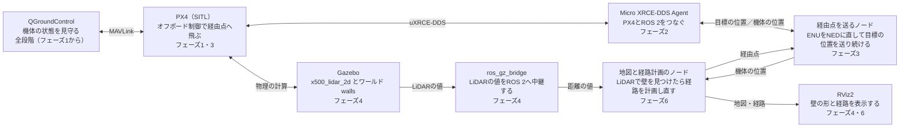
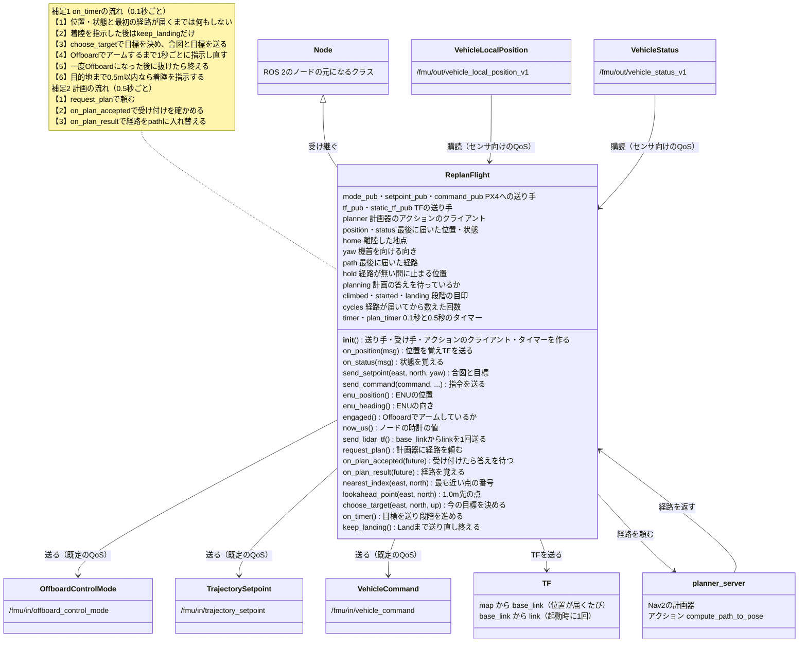

# フェーズ6-1: 地図と経路の計画器を用意し、ノードを書く

[学習計画](learning_plan.md) のフェーズ6の前半の手順書。フェーズ6は、この教材の最終ゴールに当たる。LiDARの値から障害物の地図を作り、目的地までの経路を計画して飛び始め、飛行中に新しい壁が見つかったら、経路を計画し直して回り込む。地図と経路の計画には、ROS 2の移動ロボット向けのパッケージ群Nav2の部品を使い、計画した経路を、フェーズ3のオフボード制御で機体に送る。

フェーズ6は分量が多いので、2つの手順書に分けた。この手順書（フェーズ6-1）では、全体の構成と仕組みを学んでから、Nav2を導入し、計画器の設定ファイルと自作のノードを書いて、ビルドするところまでを行う。シミュレーションを起動して飛ばすのは、[フェーズ6-2](phase6_2_replan_flight.md) である。

- 想定環境: [フェーズ5](phase5_collision_prevention.md) を終えたWSL2のUbuntu 24.04
- 所要の目安: 1〜2コマ
- 必須の範囲: 1〜4節
- 前提（親プロジェクト）: [フェーズ2](https://github.com/SanghunIm1991/ros2MinimalPhysicalAi/blob/main/docs/phase2_packages.md) の2-2節・2-4節・2-5節（フェーズ3と同じ）

> **この手順書の位置づけ**: フェーズ6（6-1と6-2）は、フェーズ3（オフボード制御）、フェーズ4（LiDARの値をROS 2へ中継する）、フェーズ5（組み込みの衝突防止にできないこと）を組み合わせる。Nav2は、本来は地面を走るロボットのためのパッケージ群で、フェーズ6では、その中の地図（コストマップ）と経路の計画器だけを使う。Nav2全体の使い方（自己位置の推定・走行の制御・行動の木など）は扱わない。
>
> **期待する結果の出どころ**: （作成中）サンプルのコードは、ROS 2のリンタ（`ament_flake8`）と、Pythonの文法の点検を通したもの。Nav2の設定の名前と既定値、アクションの型は、Nav2の `jazzy` のブランチのソースで確かめた。3-1節のNav2の導入の表示は、筆者の環境で確かめたもの（Nav2 1.3.13）。Nav2の設定の名前・プラグインの名前・アクションの型は、導入した版でも同じであることを確かめた。4-4節のビルドの表示は、フェーズ3と4節のファイルを、手順書のとおりに使い捨てのワークスペースに置いてビルドしたもの（2026-11-01。実行ファイル `replan_flight` ができ、Pythonでモジュールを読み込めることも確かめた）。3-2節の `mkdir` の表示（何も表示されない）は想定したもの。つまずきやすい点の `colcon list` の表示（`(ros.ament_python)` と `(python)`）は、筆者の環境で起きたつまずきを調べたときの表示で、使い捨ての環境ではまだ確かめていない。

## 0. 学習目標と完了条件

この手順書を終えると、次のことができるようになる。

1. LiDARの値から、障害物の地図（コストマップ）を作る仕組みを説明できる（2節）。
2. 地図の上で経路を計画する計画器に、ROS 2のアクションで経路を頼む仕組みを説明でき、そのためのノードを書ける（2節・4節）。
3. 機体の位置をTF（座標系の間の位置関係）で知らせ、LiDARの値を地図の座標に置けるようにする仕組みを説明できる（2節・4節）。
4. 自作のノード `replan_flight` のクラス `ReplanFlight` の属性とメソッドの役割を、クラス図を使って説明できる（4-2節）。

**完了条件**（すべて満たしたら完了）:

1. 4-4節のビルドが通り、実行ファイル `replan_flight` ができる。
2. 4-2節のクラス図を見ながら、「計画器から新しい経路が届いてから、機体へ送る目標が変わるまで」を、メソッドの名前を使って説明できる。

この手順書では、ターミナルを1つだけ使う。

| ターミナル | 使うこと | 仮想環境 `~/px4-venv` |
|---|---|---|
| T6 | Nav2の導入、ファイルの作成、ビルド | 使わない |

T6は、フェーズ6-2で自作のノードを動かすターミナルと同じ番号である（[READMEの「ターミナルの番号」](../README.md#ターミナルの番号)のとおり、T5以降はそのページの作業用で、フェーズ6-1と6-2で番号をそろえた）。

## 1. 全体像

### 1-1. 最終ゴールの構成（再掲）

フェーズ0の10節で見た、最終ゴールの構成の図を再掲する。フェーズ6では、ここまでのフェーズで動かした部品をすべて使う。


<details>
<summary>同じ図（mermaid版）</summary>



</details>

フェーズ6では、図の「地図と経路計画のノード」に、Nav2の計画器 `planner_server` を使い、「経由点を送るノード」を、フェーズ3のノードを元に、自作のノード `replan_flight` として書く。図の中で、フェーズ6で新しく加わるのは、この2つと、RViz2での地図と経路の表示である。ほかの部品は、フェーズ1〜4と同じものを、同じように起動する。

フェーズ6の2つの手順書の分担は、次のとおりである。

| 手順書 | 何をするか | 使うターミナル |
|---|---|---|
| フェーズ6-1（この手順書） | 構成と仕組み（地図・計画器・アクション・ライフサイクル・TF・時刻）を学び、Nav2を導入し、計画器の設定ファイルと自作のノードを書いて、ビルドする | T6だけ |
| [フェーズ6-2](phase6_2_replan_flight.md) | シミュレーション・中継・計画器・自作のノード・RViz2を起動し、計画器を有効にして飛ばし、経路が引き直されるのを観察する | T1〜T8 |

### 1-2. 何を作るか

フェーズ5で見たとおり、PX4の組み込みの衝突防止は、決めた向きの動きを止めたり、少し曲げたりするだけで、回り道を探さない。この手順書では、ROS 2の側で、次の3つを繰り返す。

1. **地図を作る**: LiDARの値から、どこに障害物があるかの地図を作り続ける。
2. **経路を計画する**: 今の位置から目的地まで、地図の上の障害物を避ける経路を、0.5秒ごとに計画し直す。
3. **経路をたどる**: 経路の上の少し先の点を目標にして、オフボード制御で機体を進める。

まだ見ていない場所は「何も無い」とみなして計画する。飛んでいる途中で壁が見つかると、地図に壁が加わり、次の計画で経路が変わる。

### 1-3. 部品とつながり

| 部品 | 何をするか | 出どころ |
|---|---|---|
| PX4のシミュレーション | 機体を飛ばす。位置と状態を出し、オフボード制御の指令を受ける | フェーズ4と同じ（`gz_x500_lidar_2d_walls`） |
| Micro XRCE-DDS Agent | PX4とROS 2をつなぐ | フェーズ2 |
| `parameter_bridge` | LiDARの値を `/scan` に中継する | フェーズ4（時刻の設定を1つ足す） |
| `planner_server`（Nav2） | 中に地図（グローバルコストマップ）を持ち、頼まれたら経路を計画して返す | Nav2のパッケージ |
| 自作のノード `replan_flight` | 機体の位置をTFで知らせ、計画器に経路を頼み、経路をたどる目標をPX4へ送る | この手順書で書く |
| RViz2 | LiDARの値・地図・経路を表示する | フェーズ4 |

トピック・アクション・TFのつながりは次のとおりである。

| 送り手 | 受け手 | 何を | どの形で |
|---|---|---|---|
| `parameter_bridge` | `planner_server`（地図）・RViz2 | LiDARの値 | トピック `/scan` |
| `replan_flight` | `planner_server`（地図）・RViz2 | 地図から見た機体の位置と、機体から見たLiDARの位置 | TF（`map` → `base_link` → `link`） |
| `replan_flight` | `planner_server` | 「今の位置から目的地までの経路を」という頼み | アクション `compute_path_to_pose` |
| `planner_server` | `replan_flight` | 計画した経路 | アクションの答え（[`nav_msgs/msg/Path`](https://github.com/ros2/common_interfaces/blob/jazzy/nav_msgs/msg/Path.msg)） |
| `planner_server` | RViz2 | 地図と、計画した経路 | トピック `/global_costmap/costmap`・`/plan` |
| `replan_flight` | PX4 | 合図・目標・指令 | フェーズ3と同じ `/fmu/in/` のトピック |

`replan_flight` は、フェーズ3のノードの経由点を、計画器が返す経路に置き換えたもので、TFを送る仕事も受け持つ（1-1節の図の「経由点を送るノード」に当たる）。

## 2. 地図と経路の計画

### 2-1. コストマップ

Nav2の地図は、平面を細かい格子（この手順書では10cm角）に分け、格子の1つずつに「通りにくさ」（コスト）を持たせたもので、コストマップと呼ぶ。コストマップは、役割の違う層（レイヤー）を重ねて作る。この手順書では、次の2つの層を使う。

| 層 | 何をするか |
|---|---|
| 障害物の層（`ObstacleLayer`） | LiDARの点が当たった格子を「障害物」にする。LiDARの光が通り抜けた格子は「空いている」に戻す（前に見えた障害物が、もう無いと分かったときに消すため） |
| 膨らませる層（`InflationLayer`） | 障害物の周りの格子に、障害物に近いほど高いコストを付ける。機体には大きさがあるので、障害物のすぐ横を通る経路を避けさせる |

障害物の層は、LiDARの点を、TFを使って地図の座標に置き直す。そのために、「地図から見て、機体はどこにいて、どちらを向いているか」（`map` → `base_link`）と、「機体から見て、LiDARはどこにあるか」（`base_link` → `link`）のTFが要る。このTFは、自作のノードが、PX4の位置から作って送る（4節）。

障害物の層は、点の高さも見て、決めた範囲の外の点を捨てる。Nav2の既定は、地面を走るロボットに合わせて、高さ2mまでである。この手順書の機体は3mの高さを飛ぶので、高さの上限を20mに上げる。なお、自作のノードが送るTFには機体の向きだけを入れ、傾きは入れないので、LiDARの点は、地図の上では、どれもLiDARの高さに置かれる。機体が大きく傾いて、LiDARの光が地面に当たると、その点も壁と同じ障害物として書き込まれる（3mの高さでは、18m以内の地面に当たるのは、約10°以上傾いたときである）。

### 2-2. 計画器とアクション

経路の計画は、計画器の `planner_server` が行う。この手順書では、計画のやり方に、格子の上で最短の道を探すNavFnを、A\*（エースター）という探し方で使う。A\*は、目的地までの直線の距離を手がかりにして、目的地に近づきそうな格子から順に調べる探し方である。

計画は、ROS 2のアクション `compute_path_to_pose`（型は [`nav2_msgs/action/ComputePathToPose`](https://github.com/ros-navigation/navigation2/blob/jazzy/nav2_msgs/action/ComputePathToPose.action)）で頼む。アクションは、ROS 2の通信の形の1つで、頼み（ゴール）を送ると、少し時間がかかってから答え（結果）が返ってくる。トピックと違い、頼みと答えが1対1で対応する。ここでは、頼みに目的地の位置を入れ、答えとして、経路（`nav_msgs/msg/Path`。位置の並び）と、失敗したときの理由の番号（`error_code`）を受け取る。

### 2-3. ライフサイクル

Nav2の部品は、ライフサイクルノードと呼ばれる、状態を持つノードである。起動しただけでは「未設定」の状態で、何もしない。「設定」（configure）で設定ファイルを読み込んで準備し、「有効化」（activate）で働き始める。ふつうは、Nav2のライフサイクルの管理の部品（`lifecycle_manager`）や、まとめて起動するlaunchのファイルが、この切り替えを自動で行う。この手順書では、仕組みを見るために、`ros2 lifecycle` のコマンドで手で切り替える（フェーズ6-2の1-3節）。

### 2-4. 時刻をそろえる

フェーズ4の5-2節で見たとおり、`parameter_bridge` が出すLiDARの値の時刻は、Gazeboの中の時計（シミュレーションが始まってからの時間）である。一方、自作のノードが送るTFの時刻は、PCの時計である。障害物の層は、LiDARの値の時刻のTFを探すので、2つの時計がずれていると、TFが見つからず、LiDARの値を地図に置けない。

この手順書では、`parameter_bridge` のパラメータ `override_timestamps_with_wall_time` を `true` にして、LiDARの値の時刻を、PCの時計の値に付け替える。これで、すべての時刻が、PCの時計にそろう。もう1つのやり方として、Gazeboの時計を `/clock` のトピックで流し、すべてのノードをその時計で動かす方法（`use_sim_time`）もあるが、PX4に送る指令の時刻の扱いが変わるので、この手順書では使わない。

この付け替えは、Gazeboの時計とPCの時計がずれるシミュレーションだけで要る対処である。実機では、LiDARのドライバのノードが、ふつう、コンパニオンコンピュータの時計で時刻を付ける（フェーズ4の8節）。そのため、実機では、ふつう、この設定は要らない（ドライバの時刻の付け方による。フェーズ4の8節）。

## 3. 準備する

### 3-1. Nav2を導入する

Nav2を、aptで導入する（ターミナルは、0節の表のT6を使う）。

```bash
# T6
sudo apt update

sudo apt install ros-jazzy-navigation2
```

**期待する結果**（抜粋。`<username>` は、各自のユーザー名。パッケージの数・容量・版は、既に入っているものと、導入する時期によって変わる）:

```text
$ sudo apt update
[sudo] password for <username>:
...
Reading package lists... Done
Building dependency tree... Done
Reading state information... Done
All packages are up to date.
$ sudo apt install ros-jazzy-navigation2
...
The following NEW packages will be installed:
  ...
  ros-jazzy-nav2-costmap-2d ros-jazzy-nav2-map-server
  ros-jazzy-nav2-mppi-controller ros-jazzy-nav2-msgs ros-jazzy-nav2-navfn-planner ros-jazzy-nav2-planner ros-jazzy-nav2-regulated-pure-pursuit-controller
  ...
  ros-jazzy-nav2-waypoint-follower ros-jazzy-navigation2 ros-jazzy-ompl ros-jazzy-opennav-docking ros-jazzy-opennav-docking-bt ros-jazzy-opennav-docking-core
  ros-jazzy-robot-localization ros-jazzy-smclib xfonts-encodings xfonts-utils xtl-dev
0 upgraded, 106 newly installed, 0 to remove and 0 not upgraded.
Need to get 76.5 MB of archives.
After this operation, 472 MB of additional disk space will be used.
Do you want to continue? [Y/n] Y
...
Setting up ros-jazzy-navigation2 (1.3.13-1noble.20260921.033624) ...
Processing triggers for man-db (2.12.0-4build2) ...
...
```

最初の `[sudo] password` は、管理者の権限で実行するためのパスワードの入力で、打った文字は表示されない。`sudo apt update` は、パッケージの一覧を新しくする（`All packages are up to date.` は、更新の要るパッケージが無いことを示す）。`sudo apt install` は、入れるパッケージの一覧（`The following NEW packages will be installed:`）と、取得する量と使う容量を表示し、`Do you want to continue? [Y/n]` と聞く。`Y` を打ってEnterを押す（大文字の `Y` が既定なので、Enterだけでもよい）と、取得（`Get:`）・展開（`Unpacking`）・設定（`Setting up`）が進み、プロンプトに戻る。エラー（`E:` で始まる行）が出なければ成功である。

`ros-jazzy-navigation2` は、Nav2の部品をまとめたパッケージで、この手順書で使う `planner_server`（`ros-jazzy-nav2-planner`）・コストマップ（`ros-jazzy-nav2-costmap-2d`）・NavFn（`ros-jazzy-nav2-navfn-planner`）・アクションの型（`ros-jazzy-nav2-msgs`）が、一覧に含まれる。ほかにも、この手順書では使わない部品（制御器・自己位置の推定・行動の木など。[Nav2の全体像の間章](interlude_nav2.md) の1-1節）と、それらが使うライブラリが、まとめて入る。最後の `Setting up ros-jazzy-navigation2 (1.3.13-...)` の数が、入ったNav2の版である。

### 3-2. 計画器の設定ファイルを書く

フェーズ3で作ったパッケージ `drone_offboard` の中に、設定のフォルダを作り、計画器とコストマップの設定を書く。

```bash
# T6
mkdir -p ~/px4_ws/src/drone_offboard/config
```

**期待する結果**: 何も表示されない。

ファイル: `~/px4_ws/src/drone_offboard/config/planner.yaml`

```yaml
planner_server:
  ros__parameters:
    expected_planner_frequency: 1.0
    planner_plugins: ["GridBased"]
    GridBased:
      plugin: "nav2_navfn_planner::NavfnPlanner"
      use_astar: true
      allow_unknown: true
      tolerance: 0.5

global_costmap:
  global_costmap:
    ros__parameters:
      global_frame: map
      robot_base_frame: base_link
      update_frequency: 5.0
      publish_frequency: 1.0
      width: 35
      height: 40
      origin_x: -15.0
      origin_y: -20.0
      resolution: 0.1
      robot_radius: 0.5
      track_unknown_space: false
      always_send_full_costmap: true
      plugins: ["obstacle_layer", "inflation_layer"]
      obstacle_layer:
        plugin: "nav2_costmap_2d::ObstacleLayer"
        min_obstacle_height: 0.0
        max_obstacle_height: 20.0
        observation_sources: scan
        scan:
          topic: /scan
          data_type: "LaserScan"
          marking: true
          clearing: true
          inf_is_valid: true
          min_obstacle_height: 0.0
          max_obstacle_height: 20.0
          obstacle_max_range: 18.0
          raytrace_max_range: 20.0
      inflation_layer:
        plugin: "nav2_costmap_2d::InflationLayer"
        inflation_radius: 1.2
        cost_scaling_factor: 3.0
```

- **`planner_server`**: 計画のやり方に、NavFnをA\*で使う（`use_astar`）。`tolerance` は、目的地の格子が通れないときに、近くの通れる格子を目的地の代わりにしてよい距離（m）である。
- **`global_costmap`**: 計画器の中の地図の設定である。名前を2回重ねるのは、地図が、計画器の中に `global_costmap` という名前の別のノードとして作られるためである。
  - `global_frame` と `robot_base_frame` は、地図の座標系と機体の座標系の名前で、自作のノードが送るTF（4節）の名前と合わせる。
  - `width`・`height`・`origin_x`・`origin_y` で、地図の範囲を、東へ−15〜20m、北へ−20〜20mにする。計画器は、地図の外を通る経路を引かない。東の端を20mにしたのは、東西に17m延びる壁3（東の端は21.5m）が地図の東の端まで届くようにして、壁3の東の端を回る道を、わざと地図の外に出すためである（フェーズ6-2の2-1節。フェーズ6-2の6節の課題1で、地図を広げたときの違いを確かめる）。
  - `robot_radius` は機体の半径（m）で、x500のプロペラの先までの約0.4mに、少し余裕を足した。
  - `track_unknown_space` を `false` にすると、まだ見ていない格子を「空いている」とみなす。まだ見ていない向きにも経路を引けるようにするためである（1-2節）。
- **`obstacle_layer`**: 障害物の層の設定である（2-1節）。
  - 高さの範囲（`min_obstacle_height`・`max_obstacle_height`）は、層の全体と、`scan` の両方に書く。
  - `inf_is_valid` を `true` にすると、何にも当たらなかった向き（距離が `inf`）も、「その向きは遠くまで空いている」という情報として使う。
  - `obstacle_max_range` は障害物として置く点の最大の距離、`raytrace_max_range` は空いていると戻す最大の距離（m）である。18mにしたのは、壁1の南の角から、壁3の南の面を地図の東の端まで一度に見られるようにするためである（フェーズ6-2の2-1節）。
- **`inflation_layer`**: 障害物の周り1.2mまでの格子に、近いほど高いコストを付ける（2-1節）。

壁のワールドの壁の配置は、フェーズ4の3-1節の表のとおりである。

## 4. ノードを書く

### 4-1. 依存を足す

`drone_offboard` の `package.xml` に、このノードが使うパッケージを足す（フェーズ3で書いた `rclpy` と `px4_msgs` の行の後に足す）。

ファイル: `~/px4_ws/src/drone_offboard/package.xml`（足す行）

```xml
  <depend>geometry_msgs</depend>
  <depend>nav2_msgs</depend>
  <depend>tf2_ros_py</depend>
```

`setup.py` の `entry_points` に、実行ファイル `replan_flight` を足す。

ファイル: `~/px4_ws/src/drone_offboard/setup.py`（`entry_points` の部分）

```python
    entry_points={
        'console_scripts': [
            'waypoint_flight = drone_offboard.waypoint_flight:main',
            'replan_flight = drone_offboard.replan_flight:main',
        ],
    },
```

### 4-2. クラス図で、ノードの組み立てを見る

4-3節で書くノードは、フェーズ3のノードより長く、メソッドも多い。長いコードを読む前に、次の図で、クラス `ReplanFlight` が何を覚えておき（属性）、何を受け取り、何を送るかと、メソッドの役割の分け方を見て、大枠をつかんでおく。


<details>
<summary>同じ図（mermaid版）</summary>



mermaid版には、定数と、クラスの外の関数（SVGの図の左下と右下）、メソッドの役割の分け方（SVGの図の「■」の見出し）、計画器の頼みと答えの中身、補足の一部（上昇中は離陸した地点の真上を目標にすること、計画が失敗したら `path` を空にしてその場で止まること、残りの長さが3m以上変わったら「引き直した」と出すこと）を載せていない。SVGとmermaid版のどちらにも、ログを1回だけ出すための目印（`waiting_logged`・`rejected_logged`）は載せていない。

</details>

図の中央がクラスで、上の区画が属性、その下の6つの区画が、役割ごとに分けたメソッドである。左の2つの型と右の3つの型は、フェーズ3のノードと同じで（[フェーズ3](phase3_offboard.md) の4-2節のクラス図）、右に新しく加わったのが、TFと計画器である。

このノードの動きは、2つのタイマーが別々に進める2つの流れでできている（図の下の補足）。

- **補足2（計画の流れ、0.5秒ごと）**: `request_plan` が計画器に頼み、答えが届くと `on_plan_result` が `path` を新しい経路に入れ替える。アクションの答えは、すぐには返らないので、頼む関数と答えを受け取る関数が分かれている。
- **補足1（段階を進める流れ、0.1秒ごと）**: `on_timer` が、毎回 `choose_target` で目標を決めて、PX4へ送る。`choose_target` は、そのときの `path` の上の1.0m先の点を目標にする。

2つの流れは、主に属性の `path` でつながっている（ほかに、どちらの流れも、最後に届いた位置 `position` を使い、`on_timer` が着陸を始めて `landing` を立てると、`request_plan` は計画を頼まなくなる）。計画の流れが `path` を入れ替えると、次の `on_timer` から、新しい経路の上の点が目標になる。これが、「経路が引き直されると、機体がそのまま新しい経路へ曲がる」仕組みである（4-3節の最後の段落）。完了条件の2は、この流れを、`request_plan` → `on_plan_result` → `path` → `on_timer` → `choose_target` → `lookahead_point` → `send_setpoint` の順に説明できればよい。

### 4-3. ノードを書く

4-2節のクラス図と見比べながら読むと、どのメソッドがどの役割の区画に当たるかが分かる。

ファイル: `~/px4_ws/src/drone_offboard/drone_offboard/replan_flight.py`

```python
import math

from drone_offboard.waypoint_flight import enu_to_ned
from drone_offboard.waypoint_flight import enu_yaw_to_ned
from geometry_msgs.msg import TransformStamped
from nav2_msgs.action import ComputePathToPose
from px4_msgs.msg import OffboardControlMode
from px4_msgs.msg import TrajectorySetpoint
from px4_msgs.msg import VehicleCommand
from px4_msgs.msg import VehicleLocalPosition
from px4_msgs.msg import VehicleStatus
import rclpy
from rclpy.action import ActionClient
from rclpy.executors import ExternalShutdownException
from rclpy.node import Node
from rclpy.qos import qos_profile_sensor_data
from tf2_ros import StaticTransformBroadcaster
from tf2_ros import TransformBroadcaster

GOAL_ENU = (8.0, -6.0)   # 目的地（ENUの東・北、m）。PX4の位置の原点から測る
ALTITUDE = 3.0           # 飛ぶ高さ（m）
LOOKAHEAD = 1.0          # 経路の上で、この距離だけ先の点を目標にする（m）
REACHED_DIST = 0.5       # 目的地に着いたとみなす水平の距離（m）
LIDAR_OFFSET = (0.12, 0.0, 0.02)  # 本体の中心から見たLiDARの部品の位置（前・左・上、m）
PERIOD = 0.1             # 合図と目標を送る周期（s）。10Hz
PLAN_PERIOD = 0.5        # 経路の計画を頼む周期（s）
REPLAN_LOG_DIFF = 3.0    # 残りの長さがこれ以上変わったら「引き直した」と出す（m）
RETRY_CYCLES = 10        # 指令を送る間隔（周期の数。10回で1秒）


# 向き（ENUのyaw）だけの回転を、クォータニオンの (z, w) で返す。
def yaw_to_quaternion(yaw):
    return math.sin(yaw / 2.0), math.cos(yaw / 2.0)


# 機体の位置をTFで知らせ、Nav2に経路を頼み、経路をたどって目的地へ飛ぶノード。
class ReplanFlight(Node):
    # PX4とのトピック、TFの送り手、計画器のアクションのクライアント、タイマーを作る。
    def __init__(self):
        super().__init__('replan_flight')
        self.mode_pub = self.create_publisher(
            OffboardControlMode, '/fmu/in/offboard_control_mode', 10)
        self.setpoint_pub = self.create_publisher(
            TrajectorySetpoint, '/fmu/in/trajectory_setpoint', 10)
        self.command_pub = self.create_publisher(
            VehicleCommand, '/fmu/in/vehicle_command', 10)
        self.create_subscription(
            VehicleLocalPosition, '/fmu/out/vehicle_local_position_v1',
            self.on_position, qos_profile_sensor_data)
        self.create_subscription(
            VehicleStatus, '/fmu/out/vehicle_status_v1',
            self.on_status, qos_profile_sensor_data)
        self.tf_pub = TransformBroadcaster(self)
        self.static_tf_pub = StaticTransformBroadcaster(self)
        self.send_lidar_tf()
        self.planner = ActionClient(
            self, ComputePathToPose, 'compute_path_to_pose')
        self.position = None
        self.status = None
        self.home = None
        self.yaw = 0.0
        self.path = []
        self.hold = None
        self.planning = False
        self.climbed = False
        self.cycles = 0
        self.started = False
        self.landing = False
        self.waiting_logged = False
        self.rejected_logged = False
        self.timer = self.create_timer(PERIOD, self.on_timer)
        self.plan_timer = self.create_timer(PLAN_PERIOD, self.request_plan)

    # 機体（base_link）から見たLiDAR（link）の位置を、動かないTFとして1回送る。
    def send_lidar_tf(self):
        t = TransformStamped()
        t.header.stamp = self.get_clock().now().to_msg()
        t.header.frame_id = 'base_link'
        t.child_frame_id = 'link'
        t.transform.translation.x = LIDAR_OFFSET[0]
        t.transform.translation.y = LIDAR_OFFSET[1]
        t.transform.translation.z = LIDAR_OFFSET[2]
        t.transform.rotation.w = 1.0
        self.static_tf_pub.sendTransform(t)

    # 位置が届くたびに呼ばれ、覚えておき、地図（map）から見た機体の位置をTFで送る。
    def on_position(self, msg):
        self.position = msg
        if self.home is None:
            self.home = self.enu_position()[:2]
            self.yaw = self.enu_heading()
        east, north, up = self.enu_position()
        t = TransformStamped()
        t.header.stamp = self.get_clock().now().to_msg()
        t.header.frame_id = 'map'
        t.child_frame_id = 'base_link'
        t.transform.translation.x = east
        t.transform.translation.y = north
        t.transform.translation.z = up
        qz, qw = yaw_to_quaternion(self.enu_heading())
        t.transform.rotation.z = qz
        t.transform.rotation.w = qw
        self.tf_pub.sendTransform(t)

    # 状態が届くたびに呼ばれ、最後に届いたものを覚えておく。
    def on_status(self, msg):
        self.status = msg

    # 今の位置を、ENU（東・北・上）で返す。
    def enu_position(self):
        p = self.position
        return p.y, p.x, -p.z

    # 今の機首の向きを、ENUのyaw（東が0、反時計回り）で返す。
    # NEDからENUへの向きの変換は、ENUからNEDへの変換と同じ式になる。
    def enu_heading(self):
        return enu_yaw_to_ned(self.position.heading)

    # ノードの時計の値をマイクロ秒で返す（フェーズ3と同じ）。
    def now_us(self):
        return self.get_clock().now().nanoseconds // 1000

    # PX4に指令を1回送る（フェーズ3と同じ）。
    def send_command(self, command, param1=0.0, param2=0.0):
        msg = VehicleCommand()
        msg.command = command
        msg.param1 = param1
        msg.param2 = param2
        msg.target_system = 1
        msg.target_component = 1
        msg.source_system = 1
        msg.source_component = 1
        msg.from_external = True
        msg.timestamp = self.now_us()
        self.command_pub.publish(msg)

    # 合図と、目標の位置（ENUの東・北と高さ）・向きを送る。
    def send_setpoint(self, east, north, yaw):
        mode = OffboardControlMode()
        mode.position = True
        mode.timestamp = self.now_us()
        self.mode_pub.publish(mode)

        sp = TrajectorySetpoint()
        sp.position = list(enu_to_ned(east, north, ALTITUDE))
        sp.yaw = enu_yaw_to_ned(yaw)
        sp.timestamp = self.now_us()
        self.setpoint_pub.publish(sp)

    # 計画器に、今の位置から目的地までの経路を頼む（前の計画の答えを待つ間は頼まない）。
    def request_plan(self):
        if self.position is None or self.landing or self.planning:
            return
        if not self.planner.server_is_ready():
            return
        goal = ComputePathToPose.Goal()
        goal.goal.header.frame_id = 'map'
        goal.goal.pose.position.x = GOAL_ENU[0]
        goal.goal.pose.position.y = GOAL_ENU[1]
        goal.goal.pose.orientation.w = 1.0
        goal.use_start = False
        self.planning = True
        future = self.planner.send_goal_async(goal)
        future.add_done_callback(self.on_plan_accepted)

    # 計画器が頼みを受け付けたら、答え（経路）を待つ。
    def on_plan_accepted(self, future):
        handle = future.result()
        if handle is None or not handle.accepted:
            self.planning = False
            if not self.rejected_logged:
                self.get_logger().info('計画器が頼みを断った（有効化を待つ）')
                self.rejected_logged = True
            return
        handle.get_result_async().add_done_callback(self.on_plan_result)

    # 経路が届いたら、点の並び（ENUの東・北）として覚える。
    # 前の経路の残りの長さと大きく違えば、「引き直した」とログに出す。
    def on_plan_result(self, future):
        self.planning = False
        response = future.result()
        if response is None:
            return
        result = response.result
        if result.error_code != ComputePathToPose.Result.NONE:
            self.get_logger().warn(f'経路が見つからない: {result.error_msg}')
            self.path = []
            return
        new_path = [(p.pose.position.x, p.pose.position.y)
                    for p in result.path.poses]
        if not new_path:
            return
        new_len = path_length(new_path)
        if not self.path:
            self.get_logger().info(f'経路を計画した: 長さ {new_len:.1f} m')
        else:
            east, north, _ = self.enu_position()
            old_len = path_length(self.path[self.nearest_index(east, north):])
            if abs(new_len - old_len) > REPLAN_LOG_DIFF:
                self.get_logger().info(
                    f'経路を引き直した: 長さ {old_len:.1f} m → {new_len:.1f} m')
        self.path = new_path

    # 経路の点のうち、今の位置に最も近い点の番号を返す。
    def nearest_index(self, east, north):
        dists = [math.hypot(e - east, n - north) for e, n in self.path]
        return dists.index(min(dists))

    # 経路の上で、今の位置に最も近い点から LOOKAHEAD 以上先にある点を返す。
    def lookahead_point(self, east, north):
        for e, n in self.path[self.nearest_index(east, north):]:
            if math.hypot(e - east, n - north) >= LOOKAHEAD:
                return e, n
        return self.path[-1]

    # 今の目標（ENUの東・北）と向きを決める。上昇が終わるまでは、離陸した地点の真上。
    # 経路が無い間（計画の失敗など）は、その場（最後に経路を失った位置）で止まる。
    def choose_target(self, east, north, up):
        if not self.climbed:
            if up > ALTITUDE - 0.3:
                self.climbed = True
            return self.home[0], self.home[1]
        if not self.path:
            if self.hold is None:
                self.hold = (east, north)
            return self.hold
        self.hold = None
        te, tn = self.lookahead_point(east, north)
        if math.hypot(te - east, tn - north) > 0.3:
            self.yaw = math.atan2(tn - north, te - east)
        return te, tn

    # Offboardのモードで、アームしているか（フェーズ3と同じ）。
    def engaged(self):
        return (self.status.nav_state ==
                VehicleStatus.NAVIGATION_STATE_OFFBOARD and
                self.status.arming_state ==
                VehicleStatus.ARMING_STATE_ARMED)

    # 着陸を指示した後、Landになるまで指令を送り直し、ディスアームしたら終える（フェーズ3と同じ）。
    def keep_landing(self):
        if self.status.arming_state == VehicleStatus.ARMING_STATE_DISARMED:
            self.get_logger().info('着陸してディスアームした。終わる')
            raise SystemExit
        land = VehicleStatus.NAVIGATION_STATE_AUTO_LAND
        if self.status.nav_state != land and self.cycles % RETRY_CYCLES == 0:
            self.send_command(VehicleCommand.VEHICLE_CMD_NAV_LAND)

    # タイマーから0.1秒ごとに呼ばれ、目標を送り、段階を進める。
    def on_timer(self):
        if self.position is None or self.status is None:
            return
        if not self.started and not self.path:
            if not self.waiting_logged:
                self.get_logger().info('最初の経路を待つ（計画器の有効化を待つ）')
                self.waiting_logged = True
            return
        self.cycles += 1
        if self.landing:
            self.keep_landing()
            return

        east, north, up = self.enu_position()
        te, tn = self.choose_target(east, north, up)
        self.send_setpoint(te, tn, self.yaw)
        if not self.engaged():
            if self.started:
                self.get_logger().info('Offboardから別のモードに移った。終わる')
                raise SystemExit
            if self.cycles % RETRY_CYCLES == 0:
                self.send_command(
                    VehicleCommand.VEHICLE_CMD_DO_SET_MODE, 1.0, 6.0)
                self.send_command(
                    VehicleCommand.VEHICLE_CMD_COMPONENT_ARM_DISARM, 1.0)
                self.get_logger().info('Offboardへの切り替えとアームを指示した')
            return
        self.started = True

        if math.hypot(GOAL_ENU[0] - east, GOAL_ENU[1] - north) < REACHED_DIST:
            self.send_command(VehicleCommand.VEHICLE_CMD_NAV_LAND)
            self.get_logger().info('目的地に着いたので、着陸を指示した')
            self.landing = True


# 点の並び（東・北）の、折れ線としての長さを返す。
def path_length(path):
    return sum(math.hypot(b[0] - a[0], b[1] - a[1])
               for a, b in zip(path, path[1:]))


# エントリポイント（フェーズ3と同じ形）。
def main(args=None):
    rclpy.init(args=args)
    node = ReplanFlight()
    try:
        rclpy.spin(node)
    except (KeyboardInterrupt, ExternalShutdownException, SystemExit):
        pass
    finally:
        node.destroy_node()
        rclpy.try_shutdown()
```

- **定数**: `GOAL_ENU` が目的地で、壁1の向こう側の (東8m, 北−6m) である（フェーズ6-2の2-1節）。`LOOKAHEAD` は、経路の上で目標にする点の先の距離で、大きいほど滑らかに、速く進むが、まだ見ていない壁の向こうに目標を置いてしまうおそれも大きくなる。`PLAN_PERIOD` は、計画を頼む周期で、短いほど、新しい壁に早く気づいて経路を変えられる。`LIDAR_OFFSET` は、本体（`base_link`）の中心から見たLiDARの部品の位置である。模型のファイルでは、LiDARの部品は模型の原点（機体の真下の地面の高さ）から前へ0.12m・上へ0.26mに、本体の中心は原点から上へ0.24mにあるので、本体の中心から見ると、前へ0.12m・上へ約0.02mになる（模型のファイルの読み方は、任意の [間章](interlude_custom_sensor.md) の2-1節）。
- **ENUとNEDの変換**: フェーズ3の `enu_to_ned` と `enu_yaw_to_ned` を、`waypoint_flight` から読み込んで使う。Nav2とRViz2はENU（フェーズ0の8節）なので、TFと経路はENUのまま扱い、PX4へ送る直前だけNEDに直す。
- **`send_lidar_tf`**: `base_link` → `link` のTFを送る。機体とLiDARの位置関係は変わらないので、動かないTF（静的なTF）として1回だけ送る。静的なTFは、後から起動したノードにも届く。
- **`on_position`**: PX4の位置が届くたびに、`map` → `base_link` のTFを送る。`map` の原点はPX4の位置の原点（機体が現れた地点。フェーズ3の3節）で、向きはENUである。機体の傾きは無視して、向き（yaw）だけを入れる。
- **`request_plan`**: 0.5秒ごとに、計画器に経路を頼む。`use_start` を `False` にすると、計画器は、経路の出発点を、TFから自分で求めた今の機体の位置にする。前の頼みの答えを待っている間は、次の頼みを送らない（`planning`）。離陸の前（地上）から頼み始める。
- **`on_plan_accepted`・`on_plan_result`**: アクションの答えは、すぐには返らないので、答えが届いたときに呼ばれる関数（コールバック）を登録して待つ。計画器は、「設定」の後、「有効化」の前の間は、頼みを断る（2-3節）。最初の経路が届いたら「経路を計画した」と出す。その後は、毎回、今の位置から計画し直すので、進んだ分だけ経路が短くなる。そこで、前の経路の「今の位置から先」の長さと比べ、3m以上違うときだけ、「経路を引き直した」と出す。
- **`lookahead_point`・`choose_target`**: 経路の上で、今の位置に最も近い点から1.0m以上先の点を、目標にする。機首は、目標の向きに向ける。LiDARは前を中心に270°しか測らないので（フェーズ4の2-1節）、進む向きを見ながら飛ぶためである。上昇が終わるまでは、離陸した地点の真上を目標にする。計画に失敗して経路が無い間は、経路を失った位置で止まる。
- **`on_timer`**: フェーズ3と同じ流れで、Offboardへの切り替えとアーム、Offboardから外れたら終える仕組み、着陸を進める。違いは、最初の経路が届くまで何もしないこと（アームもしない）と、目的地に着いたら着陸することである。一度飛び始めた後は、計画器の答えが遅れても、合図と目標を送り続ける（合図が途切れると、PX4がフェイルセーフに移るため）。

このノードは、経路を「少し先の点を、位置の目標として送り続ける」ことでたどる。目標の点は、機体の1.0m先にあるので、機体は、目標に追いつくことなく、経路に沿って進み続ける。経路が引き直されると、次の目標の点は新しい経路の上に移るので、機体はそのまま新しい経路へ曲がる。

**実機に移すときに変わるところ**: このノードのうち、次の3つは、シミュレーションに合わせた作りである。

- **`LIDAR_OFFSET` と `link`**: LiDARの位置と座標系の名前は、模型のファイルから決めた（フェーズ4の8節）。実機では、取り付けた位置と向きを測り、座標系の名前をドライバのノードの設定に合わせる。コードに直接書かずに、ROS 2のパラメータ（ノードの外から値を渡す仕組み）にしておくと、同じコードを、シミュレーションと実機の両方で使える。
- **`GOAL_ENU` と、`map` の原点**: 目的地と地図は、PX4の位置の原点から測っている。この原点は、PX4の推定が動き始めたときの機体の位置で、実機では、電源を入れた場所によって変わる。屋外でGPSを使うなら、目的地を緯度と経度で決め、原点からの位置に直してから使うのがふつうである。GPSの電波が届かない屋内では、位置の出どころ自体を別に用意する（フェーズ2の4-2節）。
- **自分でアームすること**: フェーズ3の2節のとおり、試験を簡単にするための作りである。

また、このノードは、PX4に合図を送り続けるので、計画器やLiDARの中継が止まっても、PX4はそのことに気づかない見込みである。実機に移すときに足す見張りの考え方は、フェーズ6-2の5節で扱う。

### 4-4. ビルドする

```bash
# T6
cd ~/px4_ws

colcon build --packages-select drone_offboard
```

**期待する結果**（`<time>` は、ビルドにかかった時間で、実行ごとに変わる）:

```text
Starting >>> drone_offboard
Finished <<< drone_offboard [<time>]

Summary: 1 package finished [<time>]
```

これで、フェーズ6の準備ができた。[フェーズ6-2](phase6_2_replan_flight.md) で、シミュレーションを起動して飛ばす。

## つまずきやすい点

- **`sudo apt install` で、パッケージが見つからない（`E: Unable to locate package`）**: `sudo apt update` を先に実行したかを確かめる。ROS 2のリポジトリの設定（[環境構築](setup_px4_gazebo.md) の2-3節）が済んでいるかも確かめる。
- **ビルドは通るが、フェーズ6-2の `ros2 run drone_offboard replan_flight` で `No executable found` が出る**: 4-1節の `setup.py` の `entry_points` に `replan_flight` の行を足したかを確かめる（足し忘れても、ビルドは通る）。足した後は、4-4節のビルドをし直し、`source ~/px4_ws/install/setup.bash` を実行し直してから起動する。ファイルの場所が `~/px4_ws/src/drone_offboard/drone_offboard/replan_flight.py` かも確かめる。
- **ビルドは通るが、フェーズ6-2の `ros2 run` で `Package 'drone_offboard' not found` が出る**: `package.xml` の1行目が `<?xml version="1.0"?>` になっているか（前に空行や空白が無いか）を確かめる。この行の前に何かあると、colconは `package.xml` を読めず、警告を出さずに、ROS 2のパッケージではない普通のPythonのパッケージとしてビルドする。そのため、ビルドは通るが、ROS 2からはパッケージが見えない。次のコマンドで確かめる（colconは今いるフォルダの下を探すので、`~/px4_ws` に移ってから実行する）。

  ```bash
  # T6
  cd ~/px4_ws

  colcon list --packages-select drone_offboard
  ```

  **期待する結果**（正しくビルドできる場合）:

  ```text
  drone_offboard	src/drone_offboard	(ros.ament_python)
  ```

  左から、パッケージの名前、場所、パッケージの種類である。行の最後が `(ros.ament_python)` ではなく `(python)` になっていれば、これに当たる。`package.xml` を直したら、前のビルドの結果を消してから、4-4節のビルドをし直し、`source` し直す。

  ```bash
  # T6
  rm -rf ~/px4_ws/build/drone_offboard ~/px4_ws/install/drone_offboard

  cd ~/px4_ws

  colcon build --packages-select drone_offboard

  source ~/px4_ws/install/setup.bash
  ```

  **期待する結果**: ビルドの表示は4-4節と同じになる。`source` は何も表示しない。この後、`colcon list --packages-select drone_offboard` の行の最後が `(ros.ament_python)` になることを確かめる。

- **ビルドは通るが、フェーズ6-2で起動すると `ModuleNotFoundError` が出る**: 表示の最後の行に、見つからないモジュールの名前が出る。`nav2_msgs` なら、3-1節のNav2の導入が済んでいるかを確かめる。`drone_offboard.waypoint_flight` なら、フェーズ3のノードのファイル（`~/px4_ws/src/drone_offboard/drone_offboard/waypoint_flight.py`）があるかを確かめる。`package.xml` の依存（4-1節）は、使うパッケージを宣言するもので、書いただけではパッケージは入らない。

## 次へ

[フェーズ6-2](phase6_2_replan_flight.md)（起動して飛ばし、経路が変わるのを見る）へ進む。

## 出典

- コストマップと計画器の設定の名前・既定値、アクションの型: [Nav2](https://github.com/ros-navigation/navigation2)（`jazzy`、Apache License 2.0）のソース（`nav2_costmap_2d`・`nav2_planner`・`nav2_navfn_planner`・`nav2_msgs`）と、既定の設定ファイル `nav2_bringup/params/nav2_params.yaml` を読んで、この教材の機体とワールドに合わせて、一から書いたもの。
- 中継の時刻の付け替え（`override_timestamps_with_wall_time`。2-4節）: [`ros_gz_bridge`](https://github.com/gazebosim/ros_gz/blob/jazzy/ros_gz_bridge/README.md)（`jazzy`、Apache License 2.0、Open Source Robotics Foundation）のREADMEを読んで、自分の言葉でまとめたもの。
- `nav_msgs/msg/Path` の項目: ROS 2の [`common_interfaces`](https://github.com/ros2/common_interfaces)（`jazzy`、Apache License 2.0）の定義。
- 壁の配置とLiDARの取り付け位置: フェーズ4の出典のとおり、PX4 v1.17に付属する模型のファイルを読んだもの。
- 図（`img/phase0_goal.svg`・`img/phase6_class.svg`）は、この教材で作ったもの（`img/phase0_goal.svg` は、フェーズ0の10節の図の再掲）。
- サンプルのコードと設定ファイルは、この教材で書いたもの（Apache License 2.0）。
- 2-4節と4-3節の終わりの、実機に移すときに変わる値: フェーズ2とフェーズ4の出典のとおり。目的地を緯度と経度で決める話は、一般に知られている情報を、筆者の言葉でまとめたもの。
