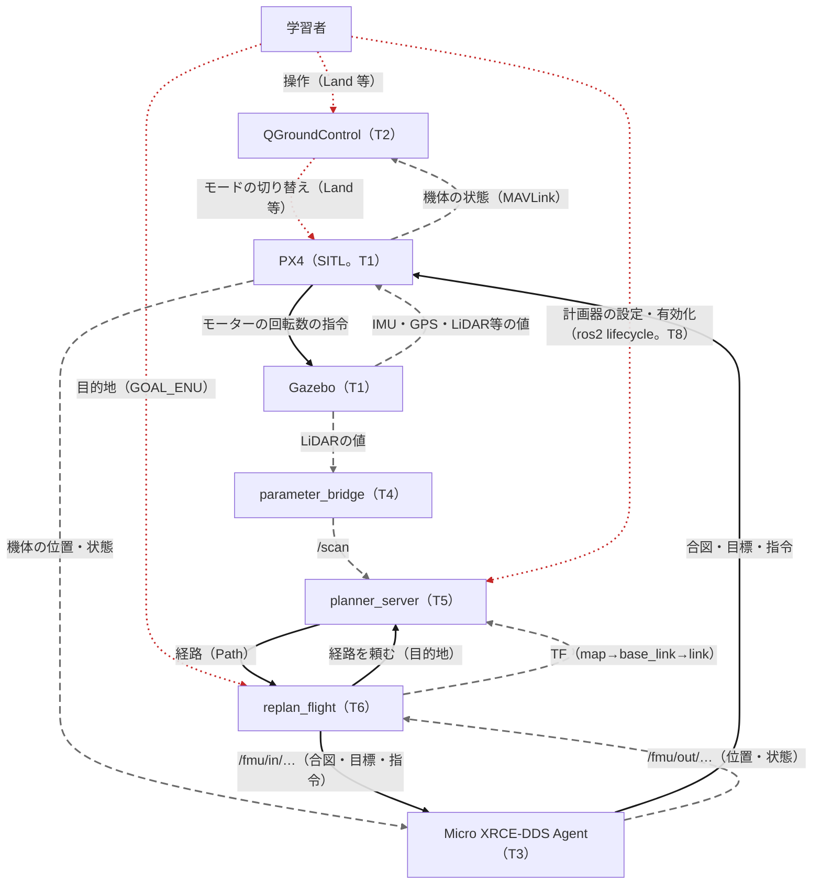
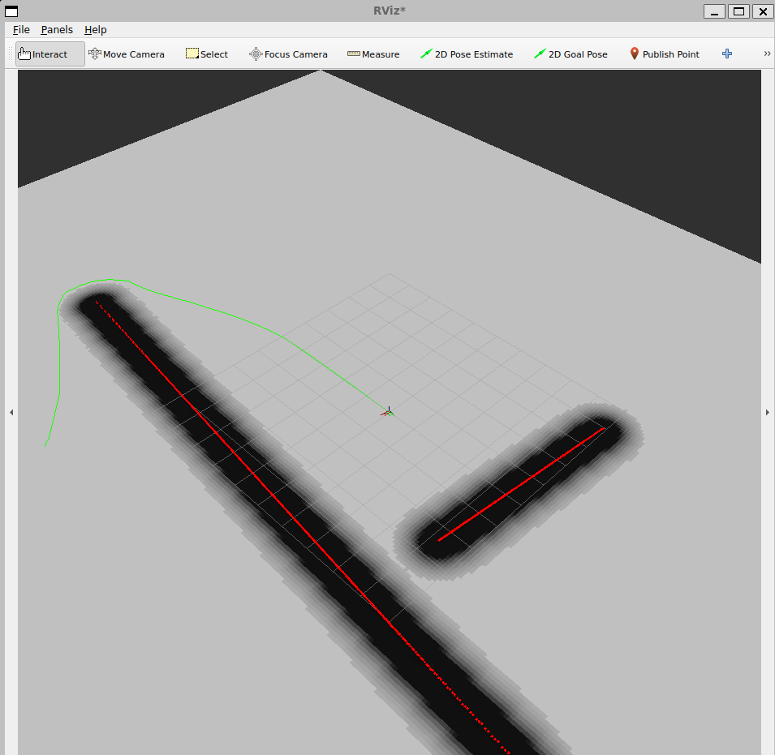
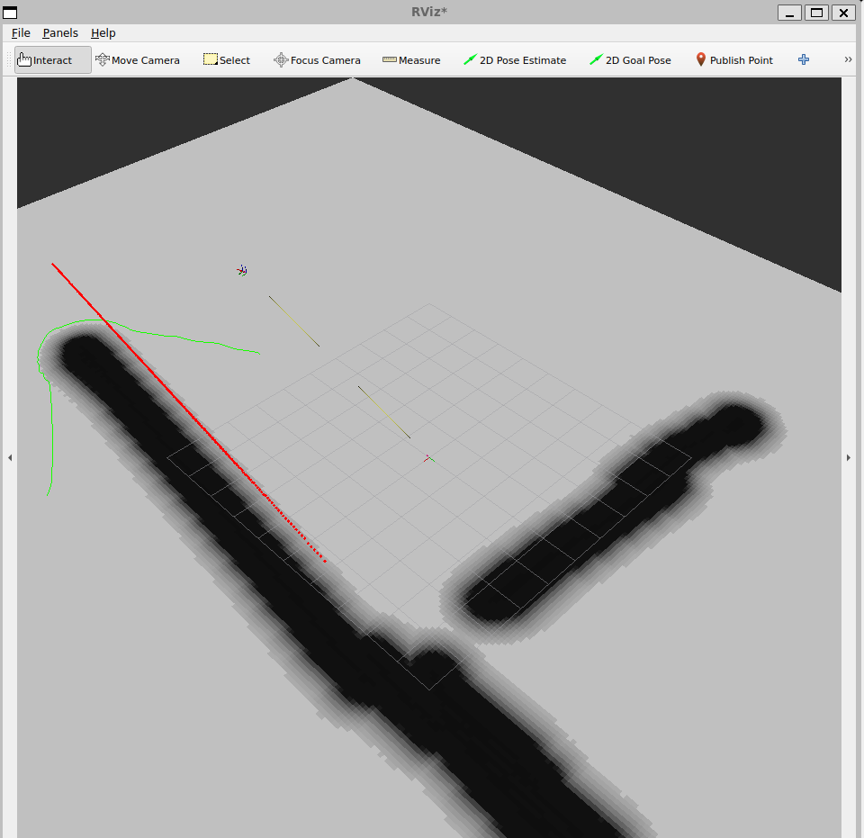
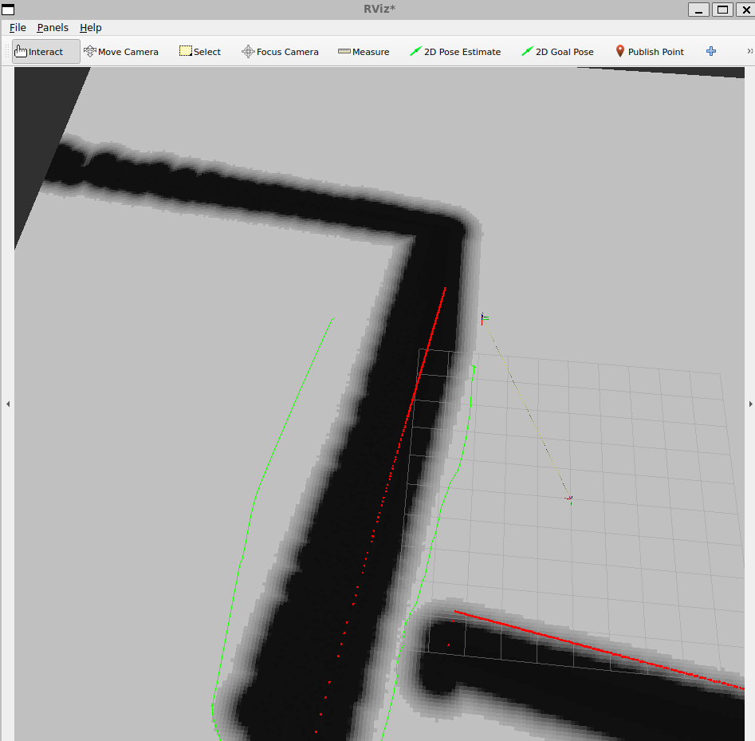
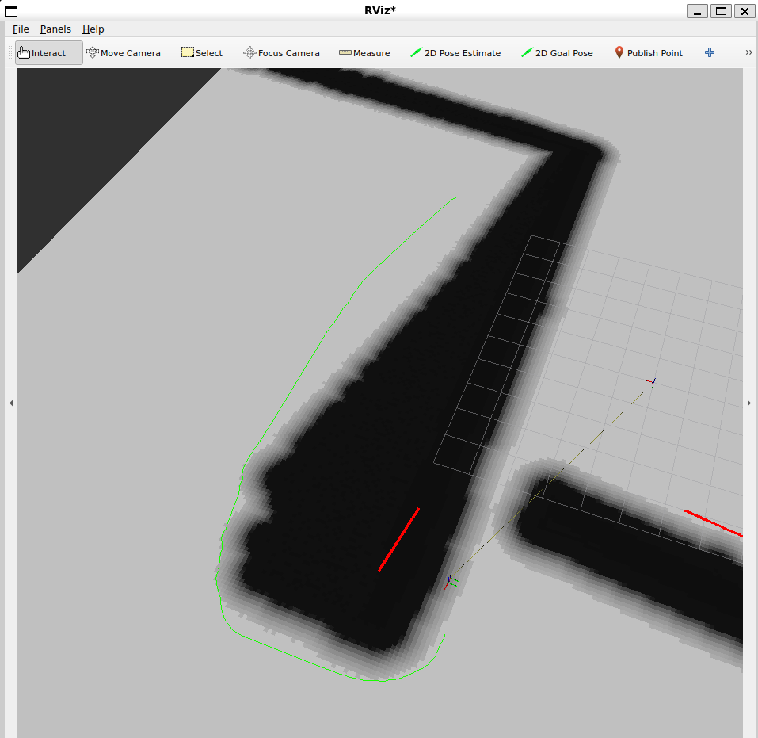
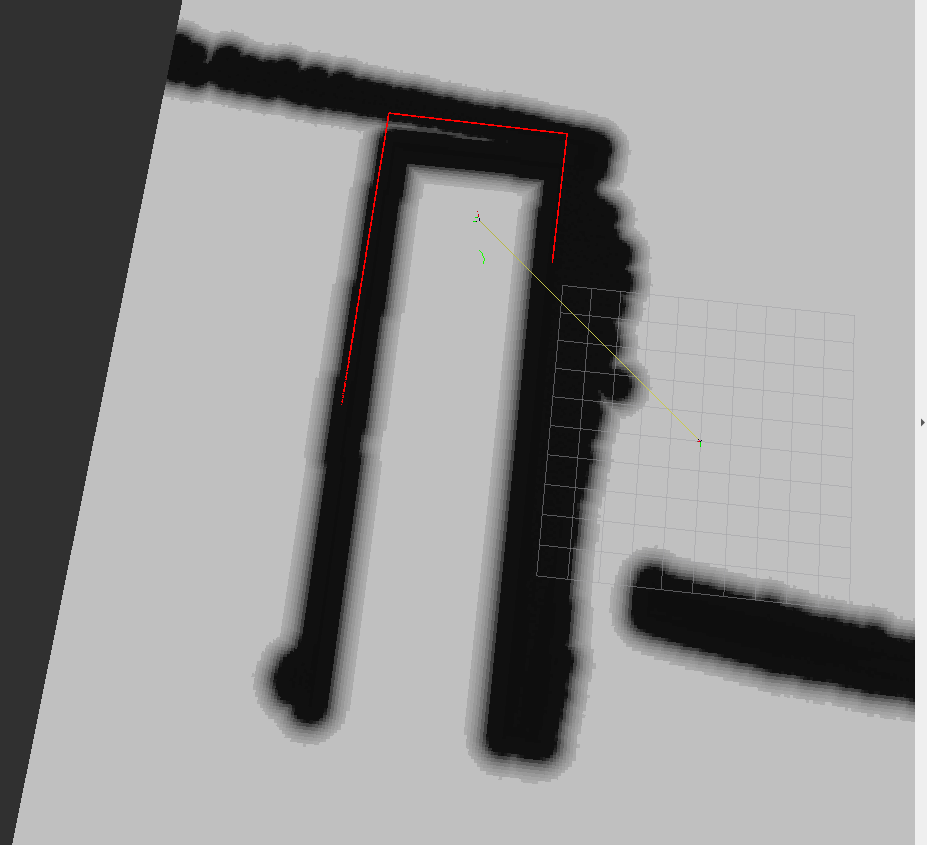

# フェーズ6-2: 起動して飛ばし、経路が変わるのを見る

[学習計画](learning_plan.md) のフェーズ6の後半の手順書で、この教材の最終ゴールに当たる。[フェーズ6-1](phase6_1_planner_node.md) で用意したNav2の計画器と自作のノード `replan_flight` を、シミュレーションと一緒に起動し、機体を飛ばす。障害物をまだ見ていない向きへの経路を計画して飛び始め、飛行中にLiDARが新しい壁を見つけると、経路が引き直されて、機体が壁を回り込むのを観察する。

- 想定環境: [フェーズ6-1](phase6_1_planner_node.md) を終えたWSL2のUbuntu 24.04
- 所要の目安: 1コマ
- 必須の範囲: 1〜5節（6節の課題は任意。5節は読み物で、コマンドは無い）
- 前提（親プロジェクト）: フェーズ6-1と同じ

> **この手順書の位置づけ**: フェーズ6-1の1-1節の図（最終ゴールの構成）の部品を、すべて同時に動かす。仕組み（コストマップ・計画器・アクション・ライフサイクル・TF・時刻）は、フェーズ6-1の2節で説明した。この手順書の中で仕組みを思い出したくなったら、フェーズ6-1の2節と、4-2節のクラス図に戻る。
>
> **期待する結果の出どころ**: （作成中）1-2節のT5・T6の表示、1-3節の表示、2-2節のT6の表示、3節のRViz2の画面は、筆者の環境で、すべてを動かして飛ばしたときのもの（2026-11-01。2-2節のT6の表示は1回目、3節の画面は2回目の飛行）。時刻・経路の長さ・引き直しの回数は、実行ごとに変わる。2-2節と3節の機体の動きの説明は、T6の表示とRViz2の画面から読み取ったもので、Gazeboの画面では確かめていない（壁に触れなかったかも確かめていない）。3節の `ros2 lifecycle get` の表示は、計画器を単体で起動して（PX4とGazeboは使わず、静的なTFを与えて）確かめたもの（2026-11-01）。3節の `ros2 topic hz /plan` の表示と、5-3節の、中継や計画器を止めてもPX4がフェイルセーフに移らないことは、2026-11-07に、画面なしで起動したPX4で確かめた（ほかのシミュレーションと混ざらないように作業フォルダ・Agentのポート等を変え、QGCの代わりに作業フォルダのパラメータ `NAV_DLL_ACT` を0にした）。1-1節のT1〜T4の表示（フェーズ4・フェーズ2と同じ）は、想定したもの。

## 0. 学習目標と完了条件

この手順書を終えると、次のことができるようになる。

1. フェーズ6で使う部品（PX4・Agent・中継・計画器・自作のノード・RViz2）を、決まった順に起動できる（1節）。
2. 計画器を、ライフサイクルのコマンドで「設定」してから「有効化」できる（1-3節）。
3. 計画した経路をたどる目標をオフボード制御で機体に送り、飛行中に経路が引き直されるのを、ログとRViz2で確かめられる（2節・3節）。
4. この構成を実機に移すとき、Gazeboから得ているデータがどこから来るかと、外のプログラムに見張りが要る理由を説明できる（5節）。

**完了条件**: 障害物をまだ見ていない向きへの経路を計画して飛び始め、飛行中にLiDARが新しい壁を見つけると、経路が引き直され（RViz2で経路が変わるのが見える）、機体が壁にぶつからずに回り込んで目的地に着き、着陸する（2節・3節）。あわせて、この構成を実機に移すときに入れ替わるもの（Gazeboから得ているデータの実機での出どころ）と、外のプログラムに見張りが要る理由を説明できる（5節）。

この手順書では、8つのターミナルを使う。

| ターミナル | 動かすもの | 仮想環境 `~/px4-venv` |
|---|---|---|
| T1 | PX4のシミュレーション（`make px4_sitl gz_x500_lidar_2d_walls`） | 使う |
| T2 | QGroundControl | 使わない |
| T3 | Micro XRCE-DDS Agent | 使わない |
| T4 | `parameter_bridge`（LiDARの値の中継） | 使わない |
| T5 | `planner_server`（計画器） | 使わない |
| T6 | 自作のノード（フェーズ6-1でビルドしたもの）と、6節の課題でのビルドし直し | 使わない |
| T7 | RViz2 | 使わない |
| T8 | `ros2 lifecycle` のコマンド | 使わない |

ターミナルの番号は、[READMEの「ターミナルの番号」](../README.md#ターミナルの番号)のとおり、T1〜T4がどの手順書でも同じプログラムで、T5以降がそのページの作業用である。この手順書では、T1〜T8のすべてを使う。

## 1. 起動する

起動するものと、そのつながりは、フェーズ6-1の1-1節の図と1-3節の表のとおりである。起動する前に、すべてが動いているときに、どの値がどこからどこへ流れるかを、次の図で見ておく。線は、値の出どころで3つに分けてある。

- **ユーザーの指令値**（赤の点線）: 学習者が決めて与える値。目的地、計画器の有効化、途中で止めるときのモードの切り替え。
- **センサの値**（灰色の破線）: Gazeboが計算したセンサの値と、それをもとにPX4が推定した機体の位置・状態。自作のノードが送るTF（位置から作る `map` → `base_link` と、LiDARの取り付け位置の動かない `base_link` → `link`）も、ここに含める。
- **ソフトウェアの指令値**（黒の実線）: プログラムが計算して送る値。計画の頼みと答えの経路、自作のノードがPX4へ送る合図・目標・指令、PX4がモーターへ送る指令。

![フェーズ6の最終形の、代表的なデータの流れ。線は3種類で、ユーザーの指令値、センサの値、ソフトウェアの指令値に分けてある。ユーザーの指令値: 学習者が、目的地（GOAL_ENU）を自作のノード replan_flight のコードに書き、ros2 lifecycle で計画器 planner_server を設定・有効化し、途中で止めるときは QGroundControl から PX4 へ Land 等のモードの切り替えを送る。センサの値: Gazebo が計算した IMU・GPS・LiDAR 等の値を PX4 が受け取り、PX4 は機体の状態を QGroundControl へ、機体の位置・状態を Micro XRCE-DDS Agent を通して /fmu/out のトピックで replan_flight へ送る。replan_flight は位置から TF を作って planner_server へ送る。Gazebo の LiDAR の値は parameter_bridge が /scan にして planner_server へ送る。ソフトウェアの指令値: replan_flight が planner_server に経路を頼み、planner_server が経路を返す。replan_flight は合図・目標・指令を /fmu/in のトピックで Agent を通して PX4 へ送り、PX4 はモーターの回転数の指令を Gazebo へ送る](img/phase6_dataflow.svg)

<details>
<summary>同じ図（mermaid版）</summary>



mermaid版には、箱の中の役割の説明を載せていない。

</details>

図の読み方の要点は、次の3つである。

- **計画器には、センサの値が2つの道で届く**。障害物の形（LiDARの値の `/scan`）は、中継を通って計画器へ直接届く。機体の位置は、PX4が推定した値が、Agentと自作のノードを通り、TFになって計画器へ届く。計画器は、この2つを合わせて、壁を地図の上に置く（フェーズ6-1の2-1節）。
- **自作のノードは、LiDARの値を直接は読まない**。自作のノードが受け取るのは、計画器が返す経路と、PX4の位置・状態だけである。壁を見つけたことは、経路が変わることで、自作のノードに伝わる。
- **学習者が飛行中に与える指令は、止めるときだけである**。目的地はコードに書いておき、計画器を有効にすると、後はソフトウェアの指令値だけで、離陸から着陸まで進む。

PX4は、Gazeboから、LiDARの値も直接受け取っている（フェーズ5の組み込みの衝突防止で使った道）。ただし、フェーズ5の8節で `CP_DIST` を−1に戻して衝突防止を無効にしたので、フェーズ6では使っていない。有効にしたとしても、組み込みの衝突防止は、Position mode（操縦桿の入力を加速度の目標にする方式）の中でだけ働き、オフボード制御で飛んでいる間は働かない（フェーズ5の1節と7節）。フェーズ6で壁を避けるのは、計画器と自作のノードだけである。図には、表示のための流れ（RViz2が `/scan`・TF・地図・経路を受け取る流れ）と、Gazeboの時計の流れは載せていない。

### 1-1. シミュレーションと中継

PX4のシミュレーションは、起動し直してから使う（位置の原点を、機体が現れた地点にするため。フェーズ3の5節）。T1からT4を、フェーズ4とフェーズ2と同じように起動する。T4の中継には、フェーズ6-1の2-4節の時刻の設定（`-p override_timestamps_with_wall_time:=true`）を足す。

```bash
# T1
source ~/px4-venv/bin/activate

cd ~/PX4-Autopilot

make px4_sitl gz_x500_lidar_2d_walls

# T2
cd ~/qgc

./QGroundControl-x86_64.AppImage

# T3
source ~/px4_ws/install/setup.bash

MicroXRCEAgent udp4 -p 8888

# T4
export GZ_IP=127.0.0.1

ros2 run ros_gz_bridge parameter_bridge \
  /world/walls/model/x500_lidar_2d_0/link/link/sensor/lidar_2d_v2/scan@sensor_msgs/msg/LaserScan[gz.msgs.LaserScan \
  --ros-args -p override_timestamps_with_wall_time:=true \
  -r /world/walls/model/x500_lidar_2d_0/link/link/sensor/lidar_2d_v2/scan:=/scan
```

**期待する結果**（想定）: T1からT4は、フェーズ4の3-2節・5-1節と、フェーズ2の3節と同じ表示になる。QGCが機体につながり、T1に `Ready for takeoff!` が出るまで待つ。

### 1-2. 計画器と自作のノード

T5で計画器を、T6で自作のノードを、T7でRViz2を起動する。

```bash
# T5
ros2 run nav2_planner planner_server --ros-args \
  --params-file ~/px4_ws/src/drone_offboard/config/planner.yaml

# T6
source ~/px4_ws/install/setup.bash

ros2 run drone_offboard replan_flight

# T7
rviz2
```

**期待する結果**（抜粋。筆者の環境で、すべてを動かして確かめた表示。時刻は実行ごとに変わる）:

```text
# T5（planner_server）
[INFO] [<time>] [planner_server]:
	planner_server lifecycle node launched.
	Waiting on external lifecycle transitions to activate
	See https://design.ros2.org/articles/node_lifecycle.html for more information.
[INFO] [<time>] [planner_server]: Creating
[INFO] [<time>] [global_costmap.global_costmap]:
	global_costmap lifecycle node launched.
	Waiting on external lifecycle transitions to activate
	See https://design.ros2.org/articles/node_lifecycle.html for more information.
[INFO] [<time>] [global_costmap.global_costmap]: Creating Costmap

# T6（replan_flight）
[INFO] [<time>] [replan_flight]: 最初の経路を待つ（計画器の有効化を待つ）
```

T5の計画器は、起動しただけの「未設定」の状態で、外からの切り替えを待っている（フェーズ6-1の2-3節）。計画器の中の地図（`global_costmap`）も、別のライフサイクルノードとして作られ、同じく待っている。T6のノードは、最初の経路が届くまで、TFを送るだけで、機体には何も指示しない。

T7のRViz2で、次の順に設定する（フェーズ4の6-2節と同じ操作）。

1. **Fixed Frame** を `map` にする（今度は、地図の座標系を基準にする）。
2. **Add** の **By topic** で、`/scan` の **LaserScan** を足し、**Size (m)** を `0.05` にする。
3. **Add** の **By topic** で、`/global_costmap/costmap` の **Map** を足す（計画器を有効にした後で一覧に出る。出ていなければ、1-3節の後に足す）。
4. **Add** の **By topic** で、`/plan` の **Path** を足す（同じく、最初の計画の後で一覧に出る）。
5. **Add** の **By display type** で **TF** を足す（`map`・`base_link`・`link` の座標系の軸が表示される）。

### 1-3. 計画器を有効にする

T8で、計画器を「設定」し、状態を確かめてから「有効化」する（フェーズ6-1の2-3節）。「有効化」すると、最初の経路が届いた時点で、機体がアームして離陸する。QGCとRViz2を見られる状態で実行する。

```bash
# T8
ros2 lifecycle set /planner_server configure

ros2 lifecycle get /planner_server

ros2 lifecycle set /planner_server activate
```

**期待する結果**（T8は筆者の環境で、すべてを動かして確かめた表示。T5は抜粋で、時刻は実行ごとに変わる）:

```text
# T8
$ ros2 lifecycle set /planner_server configure
Transitioning successful

$ ros2 lifecycle get /planner_server
inactive [2]

$ ros2 lifecycle set /planner_server activate
Transitioning successful

# T5（planner_server）
[INFO] [<time>] [planner_server]: Configuring
[INFO] [<time>] [global_costmap.global_costmap]: Configuring
[INFO] [<time>] [global_costmap.global_costmap]: Using plugin "obstacle_layer"
[INFO] [<time>] [global_costmap.global_costmap]: Subscribed to Topics: scan
...
[INFO] [<time>] [planner_server]: Planner Server has GridBased  planners available.
[INFO] [<time>] [planner_server]: Action server is inactive. Rejecting the goal.
[INFO] [<time>] [planner_server]: Action server is inactive. Rejecting the goal.
...
[INFO] [<time>] [planner_server]: Activating
[INFO] [<time>] [global_costmap.global_costmap]: Activating
[INFO] [<time>] [global_costmap.global_costmap]: Checking transform
[INFO] [<time>] [global_costmap.global_costmap]: start
...
[WARN] [<time>] [planner_server]: No planners specified in action call. Server will use only plugin GridBased  in server. This warning will appear once.
```

`configure` の `Transitioning successful` は、切り替えができたという表示である。`get` の `inactive [2]` は、「設定」が済み、「有効化」を待っている状態である。`inactive` になっていない（`unconfigured [1]` のまま）ときは、`activate` を実行しても断られる（つまずきやすい点）。

「設定」で、計画器は設定ファイルを読み込み、中の地図とアクションの受け口を作る。T5の `Subscribed to Topics: scan` は、地図がLiDARの値（`/scan`）を受け取る準備ができたという表示である。この時点では、まだ頼みを断るので、T5には `Action server is inactive. Rejecting the goal.` が頼まれるたびに（0.5秒ごとに）出て、T6には「計画器が頼みを断った（有効化を待つ）」が1回だけ出る。「有効化」で、地図がLiDARの値を受け取り始め、頼みを受け付けるようになる。最初の経路が届くと、T6のノードが飛行を始める（2節）。最初の計画のときに、T5に `[WARN] ... No planners specified in action call. Server will use only plugin GridBased  in server. This warning will appear once.` が1回出る。自作のノードが、どの計画器を使うか（`planner_id`）を指定せずに頼むためで、計画器は `GridBased` の1つだけなので、問題ない。

## 2. 飛ばして、経路が変わるのを見る

### 2-1. 何が起きる見込みか

目的地の (東8m, 北−6m) は、正面の壁1の向こう側にある。フェーズ4の3-1節の表のとおり、壁1の南の端には壁3が、壁3の東の端の近くには壁4がつながっていて、目的地は、壁1・壁3・壁4に三方を囲まれた場所にある。フェーズ6-1の3-2節の地図の範囲では、壁3が地図の東の端まで届いているので、地図の中で目的地へ入れるのは、北からだけである。

機体が現れた地点からは、LiDARで壁1の正面と左の壁2は見えるが、壁3の長い面は見えない（壁3の面は南と北を向いていて、北の面は壁1の陰にあり、南の面は壁1の南の端より南へ出ないと見えない）。まだ見ていない場所は「空いている」とみなすので、最初の計画では、目的地に近い南の端を回る経路が引かれる見込みである。

機体が壁1の西の面に沿って南へ進み、壁1の南の端の角を回ると、壁3の南の面が見え、地図の東の端までの壁3が一度に書き込まれる。南からは入れないことが分かるので、経路が引き直され、北の端を回る経路に変わる。北の端を回る経路は、壁2の東の端と壁1の間の、幅約2.5mの隙間を通る。

ただし、壁は少しずつ見えてくるので、北回りに落ち着くまでに、経路が南回りと北回りの間で何度か行き来することがある。壁の一部が見えたばかりのときは、地図の書き込みが変わる間に、2つの回り道が、0.5秒ごとの計画で交互に選ばれることもあると考えられる。

### 2-2. 飛ばす

1-3節で計画器を有効にすると、飛行が始まる。

**期待する結果**（T6の抜粋。筆者の環境で確かめた表示。時刻・経路の長さ・引き直しの回数は、実行ごとに変わる）:

```text
[INFO] [<time>] [replan_flight]: 計画器が頼みを断った（有効化を待つ）
[INFO] [<time>] [replan_flight]: 経路を計画した: 長さ 21.4 m
[INFO] [<time>] [replan_flight]: Offboardへの切り替えとアームを指示した
[INFO] [<time>] [replan_flight]: 経路を引き直した: 長さ 21.3 m → 30.5 m
[INFO] [<time>] [replan_flight]: 経路を引き直した: 長さ 30.4 m → 21.3 m
[INFO] [<time>] [replan_flight]: 経路を引き直した: 長さ 11.6 m → 16.1 m
...
[INFO] [<time>] [replan_flight]: 経路を引き直した: 長さ 37.1 m → 53.0 m
[INFO] [<time>] [replan_flight]: 経路を引き直した: 長さ 53.2 m → 28.4 m
...
[INFO] [<time>] [replan_flight]: 経路を引き直した: 長さ 27.3 m → 35.1 m
[INFO] [<time>] [replan_flight]: 目的地に着いたので、着陸を指示した
[INFO] [<time>] [replan_flight]: 着陸してディスアームした。終わる
```

最初の経路が届くと、機体はアームして3mの高さまで上がり、最初の経路（南の端を回る経路）に沿って、南へ飛び始める。QGCの飛行モードの表示は **Offboard** になる。壁が見えてくるにつれて、T6に「経路を引き直した」が何度か出る。0.5秒の間に長さが行き来する2行（上の表示の 21.3 m → 30.5 m と 30.4 m → 21.3 m）は、2-1節の、2つの回り道が交互に選ばれたものと考えられる。壁1の南の端の角を回り、壁3が見えると、経路は北の端を回る長い経路に落ち着き、機体は向きを変えて北へ戻る。向きを変えている間は、LiDARの真後ろの90°が見えないが、地図には、それまでに見た壁が残っているので、経路はその壁を避ける。機体は、壁1の西の面に沿って北へ飛び、壁2と壁1の隙間を抜け、北の端を回って、壁1と壁4の間を南へ下り、目的地の上で着陸する。ディスアームすると、ノードは自分で終わる。

RTFが低い（シミュレーションが実時間より遅く進む。フェーズ4の5-2節）PCでは、PCの時計で測った飛行の時間は、その分だけ長くなる。

## 3. 観察する

飛行の間、T7のRViz2で、次を見る（1-2節で足した表示）。

| 表示 | 見えるもの |
|---|---|
| LaserScan（`/scan`） | LiDARの点。機体の向きに合わせて回る |
| Map（`/global_costmap/costmap`） | 地図。障害物の格子が濃い色、その周りの膨らませた範囲が段々に薄い色で表示される。飛ぶにつれて、見えた壁が書き加えられていく |
| Path（`/plan`） | 計画した経路の線。0.5秒ごとに計画し直されるので、少しずつ動く。南からは入れないと分かった時点で、大きく形が変わる |
| TF | `map` の原点（機体が現れた地点）と、機体（`base_link`）とLiDAR（`link`）の座標系の軸 |

**期待する結果**（筆者の環境で、飛行中に撮影したRViz2の画面。2-2節のT6の表示とは別の飛行のもの。見る向きは、撮影ごとにマウスで変えてある。経路の形と、切り替わる時刻は、実行ごとに変わる）:

飛び始めは、地図に壁1と壁2だけがあり、経路（緑の線）は、壁1の端を回って、まだ見ていない側へ延びている。



壁1に沿って端へ近づくと、LiDARの点が、地図の壁1の端より先まで並び始め、地図の書き込みが増えていく。経路は、形を変える途中である。



壁1と壁3の角が地図に入ると、南からは入れないことが分かり、経路が北回りに切り替わる。



機体は、壁2との間の狭い隙間を抜け、壁1の北の端を回り込む。経路は、壁1の向こう側（目的地のある側）へ延びている。



最後に、壁1・壁3・壁4に三方を囲まれた場所に入り、目的地に着いて着陸する。



完了条件のとおり、経路が変わり、機体が回り込んで、目的地に着いて着陸する（筆者の環境では、壁に触れなかったかは、Gazeboの画面では確かめていない）。筆者の環境では、南回りと北回りの間で、経路が何度か切り替わってから、北回りに落ち着いた（2-2節のT6の表示も、別の飛行で同じ傾向だった）。

T8で、計画器の状態と、経路のトピックも見られる。

```bash
# T8
ros2 lifecycle get /planner_server

ros2 topic hz /plan
```

**期待する結果**（抜粋。数は実行ごとに変わる）:

```text
$ ros2 lifecycle get /planner_server
active [3]

$ ros2 topic hz /plan
average rate: 2.000
```

`active` は、有効の状態である。`/plan` は、自作のノードが0.5秒ごとに計画を頼むので、毎秒約2回出る。

## 4. 止める

ノードは、着陸してディスアームすると自分で終わる。T8のコマンドを Ctrl+C で止め、T7のRViz2のウィンドウを閉じる。T5の計画器、T4の中継、T3のAgentを Ctrl+C で止める。T2のQGCのウィンドウを閉じ、T1のPX4のシミュレーションを Ctrl+C で止める。

途中で止めたいときは、QGCの **Land** で着陸させる。ノードは「Offboardから別のモードに移った。終わる」と出して終わる（フェーズ3の5節と同じ）。

## 5. 実機に移すとき

この教材の最終形は、1台のPCの中のシミュレーションで動いた。この節では、同じ仕組みを実機の機体（フライトコントローラと、コンパニオンコンピュータ）に載せるとき、何が入れ替わり、何を足す必要があるかをまとめる。各フェーズで扱った内容を、ここで一覧にする。この教材では、実機では確かめていない。

### 5-1. Gazeboから得ているデータの、実機での出どころ

1節の図の灰色の線（センサの値）の多くは、Gazeboから来ている。実機では、それぞれ次のところから来る。

| データ | この教材（シミュレーション）での出どころ | 実機での出どころ | 詳しく |
|---|---|---|---|
| 機体の動き | Gazeboが、プロペラの推力から計算する | 本物の機体 | フェーズ0の4節 |
| PX4が位置の推定に使うセンサの値（加速度・角速度・磁気・気圧・GPS） | Gazeboが計算した値を、PX4の中のモジュール `gz_bridge` が、PX4のドライバの代わりに読む | フライトコントローラの上のセンサと、つないだGPSを、PX4のドライバが読む。GPSの電波が届かない屋内では、VIO等の別の位置の出どころを用意する | フェーズ2の4-2節 |
| 機体の位置・状態（`/fmu/out/`） | PX4の推定の結果を、同じPCの中のUDPでAgentへ送る | PX4の推定の結果（同じ）を、シリアルかEthernetの線で、コンパニオンコンピュータの上のAgentへ送る | フェーズ2の3節 |
| PX4の衝突防止の距離 | GazeboのLiDARの値を、`gz_bridge` が読む | フライトコントローラにつないだ距離センサを、PX4のドライバが読む | フェーズ5の7節 |
| LiDARの値（`/scan`） | GazeboのLiDARの値を、`ros_gz_bridge`（T4）が中継する | コンパニオンコンピュータにつないだLiDARを、ドライバのノードが読む | フェーズ4の8節 |
| LiDARの取り付けの位置（`base_link` → `link` のTF） | 模型のファイルから決めた定数 | 取り付けた位置と向きを測った値。座標系の名前は、ドライバのノードの設定に合わせる | フェーズ6-1の4-3節 |
| LiDARの値の時刻 | Gazeboの時計を、T4がPCの時計に付け替える | ドライバのノードが、ふつう、コンパニオンコンピュータの時計で付ける（そのときは付け替えは要らない。ドライバの時刻の付け方による） | フェーズ6-1の2-4節 |

表の上の4行は、機体とPX4の側の話である。そのうち2行目と4行目は、シミュレーションでは `gz_bridge` が、実機ではPX4のドライバが値を読む。推定から先は同じコードなので、ROS 2のノードから見たトピックは変わらない（3行目のとおり、変わるのはPX4とAgentの間の線である）。下の3行は、ROS 2の側の話で、`ros_gz_bridge` を、ドライバのノードに差し替えることになる。どちらの側でも、シミュレーションの中継は、実機のドライバの代わりをしていたのである。

### 5-2. 動かすものの置き場所

1節で起動したものは、実機では、次のところで動く。

| この手順書 | 実機 |
|---|---|
| T1: PX4のシミュレーションとGazebo | PX4は、フライトコントローラの上で動く。Gazeboは無い。機体に合わせた設定と調整が要る（[間章（フライトコントローラ）](interlude_flight_controller.md) の3節） |
| T2: QGroundControl | 地上のPCで動かし、無線の通信機（テレメトリ）で機体とつなぐ。PX4の文書によると、ふつうは、機体の側の無線の通信機をコンパニオンコンピュータにつなぎ、コンパニオンコンピュータが地上とPX4の間のやり取りを中継する（MAVLink Router等） |
| T3: Micro XRCE-DDS Agent | コンパニオンコンピュータの上で動かす。シリアルでつなぐなら `udp4` の代わりに `serial` を指定し、Ethernetなら `udp4` のまま使う（フェーズ2の3節） |
| T4: `parameter_bridge` | LiDARのドライバのノードに置き換わる（フェーズ4の8節） |
| T5・T8: 計画器と、手での有効化 | コンパニオンコンピュータの上で動かす。有効化は、ライフサイクルの管理の部品で自動にする（6節の課題5） |
| T6: `replan_flight` | コンパニオンコンピュータの上で動かす。Gazeboに合わせた値をパラメータにし（フェーズ6-1の4-3節）、5-3節の見張りを足す |
| T7: RViz2 | 地上のPCで、同じROS 2のネットワークにつないで見るか、記録した値を後で見る |

実機では、ターミナルを開いて1つずつ起動する代わりに、launchのファイルでまとめて起動し、コンパニオンコンピュータの電源を入れると自動で動き出すようにするのがふつうである（6節の課題5が、その入り口になる）。

### 5-3. PX4が気づかない止まり方

フェーズ3の2節で見たとおり、PX4が見張るのは、オフボード制御の合図が届くかどうかである。T6の `replan_flight` が止まれば、合図が途切れるので、PX4はフェイルセーフ（フェーズ0の9-2節）に移る。

しかし、T6より手前の部品が止まった場合は違う。`replan_flight` は、自分のタイマーで合図と目標を送り続けるので、PX4から見ると、何も起きていないように見える。フェーズ6-1の4-3節のコードを読むと、次のようになる見込みである（飛行中に中継と計画器をそれぞれ止めても、止めてから約20秒の間、PX4がフェイルセーフに移らず、Offboardのまま続くことは確かめた。そのとき機体がどう動くかは、確かめていない。6節の課題6で確かめられる）。

- **T5の計画器が止まった場合**: 新しい経路が届かなくなるが、`replan_flight` は、最後に受け取った経路を持ったまま、それをたどり続ける。その経路が、まだ見ていない壁の中を通っていれば、機体は壁に近づく。
- **T4の中継（実機ではLiDARのドライバのノード）が止まった場合**: 地図に新しい壁が書き込まれなくなる。計画器は、古い地図で経路を引き続けるので、新しい壁を避けない。

そのうえ、1節の図の読み方の後の段落で見たとおり、PX4に組み込みの衝突防止は、オフボード制御の間は働かない（フェーズ5の7節）。自動で飛んでいる間、障害物を避け、危ないときに止まる役目は、すべて外のプログラムが負っている。

そのため、実機に移すときは、外のプログラムが、自分の入力が新しいかを見張る必要がある。たとえば、`replan_flight` に、最後に `/scan` や経路やPX4の位置を受け取った時刻を覚えさせ、決めた時間より古くなったら、その場で止まり、PX4に着陸を指示する（フェーズ3の2節の `VEHICLE_CMD_NAV_LAND`）作りが考えられる（この見張りの作りは、筆者の整理である。Nav2の地図にも、センサの値が届く間隔を見張る設定（`expected_update_rate`）があるが、この教材では使っておらず、動きを確かめていない）。

外のプログラムの見張りが働かなかったときのために、人が取り戻す手段も残す。PX4には、送信機のスイッチでモードを切り替える仕組み、すべてのモーターをすぐ止めるキルスイッチ（飛んでいれば機体は落ちる）、決めた範囲から出たらフェイルセーフに移るジオフェンスがある（PX4の文書の Safety Configuration のページ）。送信機のスティックを動かすとPosition modeに移る設定（`COM_RC_OVERRIDE`）は、オフボードのモードでは既定で無効である（フェーズ3の2節）。

### 5-4. シミュレーションを残す

実機に移した後も、この教材のシミュレーションの構成は使い続けられる。ソフトウェアが未完成な段階の試し（PoC）、不具合の切り分け、変更の後の確かめ直しを、機体を壊す心配なしに、何度でも行えるからである。5-1節の表の「実機での出どころ」の列の部品（ドライバのノード等）を差し替えるだけで、同じ `replan_flight` と同じ設定ファイルが、シミュレーションと実機の両方で動くように作っておくのが、移しやすい形である。

## 6. 課題（任意）

1. 設定ファイル（フェーズ6-1の3-2節の `planner.yaml`）の地図の幅を `width: 40`（東へ25mまで）に広げると、壁3の東の端の外を回る道が地図に入る。角を回ったときに引き直される経路が、北回りになるか、東回りになるかを、壁3と壁4の配置（フェーズ4の3-1節）と、`obstacle_max_range` から予想し、確かめる。
2. `GOAL_ENU`（フェーズ6-1の4-3節）を (東−5m, 北8m)（壁2の向こう側）に変えて、壁2の東の端と壁1の間（幅約2.5m）を通る経路が引かれるか、西の端を大きく回る経路が引かれるかを予想し、確かめる。`robot_radius` と `inflation_radius` を変えると、どちらになるかが変わることも確かめる。
3. 設定ファイルの `track_unknown_space` を `true` に、`allow_unknown` を `false` に変えると、まだ見ていない場所を通る経路を引かなくなる。最初の計画がどうなるかを予想し、確かめる（設定ファイルを変えたら、下の段落のとおり、1節から起動し直す）。
4. `use_astar` を `false` にすると、NavFnは、A\*ではなく、出発点から全方向に同じように広げて調べる探し方（ダイクストラ法）を使う。経路の形と、計画にかかる時間（アクションの答えの `planning_time`）を比べる。
5. Nav2のライフサイクルの管理の部品 `lifecycle_manager`（パッケージ `nav2_lifecycle_manager`）を使って、1-3節の切り替えを自動にする。パラメータ `node_names` と `autostart` を調べる。さらに、T4〜T6をlaunchのファイルでまとめて起動する。この課題は、親プロジェクトの [フェーズ4](https://github.com/SanghunIm1991/ros2MinimalPhysicalAi/blob/main/docs/phase4_launch.md) の2節〜4節（launchのファイルの書き方）を前提にする。
6. 5-3節の止まり方を確かめる。2節と同じように飛ばし、機体が離陸して南へ進み始めたら、T4の中継を Ctrl+C で止める。機体が壁1の南の端に近づいたときにどうなるか、PX4がフェイルセーフに移るかを、予想してから見る（壁にぶつかったら、すべてを止め、1節から起動し直す）。同じことを、T4の代わりにT5の計画器を止めて試す。そのうえで、`replan_flight` に、最後に `/scan` を受け取った時刻を覚えさせ、1秒より古くなったら、その場で止まって着陸を指示する見張りを足し、T4の中継を止める方法で、機体が着陸することを確かめる（`/scan` の購読には、フェーズ4の10節の課題2のノードが参考になる）。この見張りは、T5の計画器を止めた場合には働かない（`/scan` は届き続けるため）。T5を止めた場合にも着陸させるには、最後に経路の答えを受け取った時刻（`on_plan_result`）も同じように見張る。

ノード（`replan_flight.py`）を変える課題では、変えた後に、T6でビルドし直す（フェーズ6-1の4-4節と同じ）。

```bash
# T6
cd ~/px4_ws

colcon build --packages-select drone_offboard

source ~/px4_ws/install/setup.bash
```

設定ファイル（`planner.yaml`）は、T5で計画器を起動するときに `src` の下から直接読むので、ビルドし直さなくてよいが、計画器を起動し直す。どちらも、機体を着陸させ、すべてのターミナルを止めてから、1節から起動し直す。

## つまずきやすい点

- **`ros2 lifecycle set /planner_server configure` で `Node not found` が出る**: T8のコマンドが、その時点で計画器のノードを見つけられず、切り替えは送られていない。計画器は「未設定」のままなので、そのまま `activate` を実行すると、`Unknown transition requested, available ones are:` と、`configure [1]`・`shutdown [5]` が表示されて断られる。数秒待ってから `configure` をやり直し、`ros2 lifecycle get /planner_server` が `inactive [2]` になってから `activate` を実行する（計画器を起動した直後に、ノードを見つけるのに時間がかかるためと考えられるが、確かめてはいない）。
- **T5に `Message Filter dropping message: frame 'link' ... for reason 'the timestamp on the message is earlier than all the data in the transform cache'` が出る**: 地図が、LiDARの値を地図に置くためのTF（`map` → `link`）を、その値の時刻の分まで得られず、その値を捨てたという表示である。文言は「キャッシュの全データより前」だが、`tf2_ros` のソースでは、TFを待っても得られなかった場合（待つ時間を過ぎた場合など）も、この文言で表示される。この表示は2.5秒に1回までに間引かれるので、捨てられた数は表示の数より多いことがある。
  - 飛行中に、間を空けて時々出る程度なら、地図への影響は小さい（筆者の環境では、十数秒〜1分余りに1回出たが、壁は書き込まれ、目的地に着いた）。
  - ノードが終わった後に2.5秒ごとに出続けるのは、TF（`map` → `base_link`）が送られなくなったためで、問題ない。
  - 飛行中に2.5秒ごとに出続け、地図に壁が書き込まれないときは、下の「RViz2の地図に壁が書き込まれない」の項目を確かめる。
- **T6が「最初の経路を待つ」のまま進まない**: 1-3節の有効化をしていない。T8で `ros2 lifecycle get /planner_server` を実行し、`active` かを確かめる。
- **有効化で止まる・失敗する（T5にTFのエラーが出る）**: 地図が、`map` → `base_link` のTFを見つけられていない。T6のノードが起動していて、T3のAgentがPX4とつながっているか（PX4の位置が届いているか）を確かめる。
- **RViz2の地図に壁が書き込まれない**: T4の中継に `override_timestamps_with_wall_time:=true` を付けたかを確かめる（フェーズ6-1の2-4節）。T5に、LiDARの値を捨てたという表示（上の `Message Filter dropping message`）が、2.5秒ごとに出続けていないかを見る。設定ファイル（フェーズ6-1の3-2節）の高さの範囲（`min_obstacle_height`・`max_obstacle_height`）も確かめる。
- **「経路が見つからない」が出続ける**: 機体のいる格子か、目的地の格子が、膨らませた範囲に入って通れなくなっている。`robot_radius` と `inflation_radius` を小さくするか、`tolerance` を大きくする。
- **目的地の近くで、着陸せずに浮いたままになる**: 計画器は、目的地の格子が通れないと、`tolerance`（0.5m）以内の近くの格子を代わりの終点にする。経路の終点が目的地から0.5m以上ずれると、ノードの「着いた」の判定（`REACHED_DIST`）に入らない。目的地を壁から離すか、`REACHED_DIST` を少し大きくする。
- **角を回った直後に、壁に近づきすぎる・ぶつかる**: 引き直される前の経路は、まだ見ていない壁3の中を通っている。目標の点がその上にある間に進みすぎると、壁に近づく。`LOOKAHEAD` を小さくする、`PLAN_PERIOD` を短くする、`inflation_radius` を大きくして角から離れて回らせる、のどれかを試す。

## 次へ

ここまでで、この教材の最終ゴール（障害物を見つけたら経路を計画し直して回避する）に着いた。Nav2のほかの部品と、フェーズ6の設定のうち変えて試してよいところは、[間章（Nav2）](interlude_nav2.md) にまとめた。この構成を実機に載せるときの、センサの置き場所・安全の層・試験の進め方の考え方は、任意の [間章（シミュレーションから実機へ）](interlude_sim_to_real.md) にまとめた。学習計画（[`docs/learning_plan.md`](learning_plan.md)）に戻り、全体を振り返る。

## 出典

- 計画器の起動とライフサイクルの切り替え（`ros2 run nav2_planner planner_server`・`ros2 lifecycle`）: [Nav2](https://github.com/ros-navigation/navigation2)（`jazzy`、Apache License 2.0）のソース（`nav2_planner`）を読んで、自分の言葉でまとめたもの。設定ファイルとノードの出典は、フェーズ6-1の出典のとおり。
- 中継の時刻の付け替え（`override_timestamps_with_wall_time`）: [`ros_gz_bridge`](https://github.com/gazebosim/ros_gz/blob/jazzy/ros_gz_bridge/README.md)（`jazzy`、Apache License 2.0、Open Source Robotics Foundation）のREADMEを読んで、自分の言葉でまとめたもの。
- 壁の配置: フェーズ4の出典のとおり、PX4 v1.17に付属する模型のファイルを読んだもの。
- 3節の画像（`img/phase6_rviz2_1.png`〜`img/phase6_rviz2_5.png`）は、筆者の環境で撮影したRViz2（ROS 2、Apache License 2.0）の画面である（撮影の日時が写る下のTimeパネルを切り落とした）。写っている地図・経路・点は、この手順書の計画器と自作のノードが作ったもので、Gazeboの模型の形そのものは写っていない。
- 1節のデータの流れの図（`img/phase6_dataflow.svg`）は、この教材で作ったもの。PX4がGazeboから受け取る値（IMU・磁気・気圧・GPS・LiDAR等）と、モーターへの指令は、PX4 v1.17のソース（`src/modules/simulation/gz_bridge`）を読んで確かめた。
- 5節（実機に移すとき）: PX4 User Guide（v1.17、[CC BY 4.0](https://creativecommons.org/licenses/by/4.0/)、Dronecode/PX4）の [Offboard Mode](https://github.com/PX4/PX4-Autopilot/blob/release/1.17/docs/en/flight_modes/offboard.md)、[Safety Configuration](https://github.com/PX4/PX4-Autopilot/blob/release/1.17/docs/en/config/safety.md)（キルスイッチ・ジオフェンス）、[Collision Prevention](https://github.com/PX4/PX4-Autopilot/blob/release/1.17/docs/en/computer_vision/collision_prevention.md)、[uXRCE-DDS](https://github.com/PX4/PX4-Autopilot/blob/release/1.17/docs/en/middleware/uxrce_dds.md)、[Companion Computers](https://github.com/PX4/PX4-Autopilot/blob/release/1.17/docs/en/companion_computer/index.md) と、PX4 v1.17のソースの [`src/modules/simulation/gz_bridge`](https://github.com/PX4/PX4-Autopilot/tree/release/1.17/src/modules/simulation/gz_bridge) を読んで、自分の言葉でまとめたもの。Nav2の `expected_update_rate` は、Nav2（`jazzy`）の `nav2_costmap_2d` の `observation_buffer.hpp` で名前を確かめた。5-3節の止まり方は、フェーズ6-1のコードを読んで言えることで、止めて確かめてはいない。見張りの作りと、実機での起動の仕方は、筆者の整理である。
